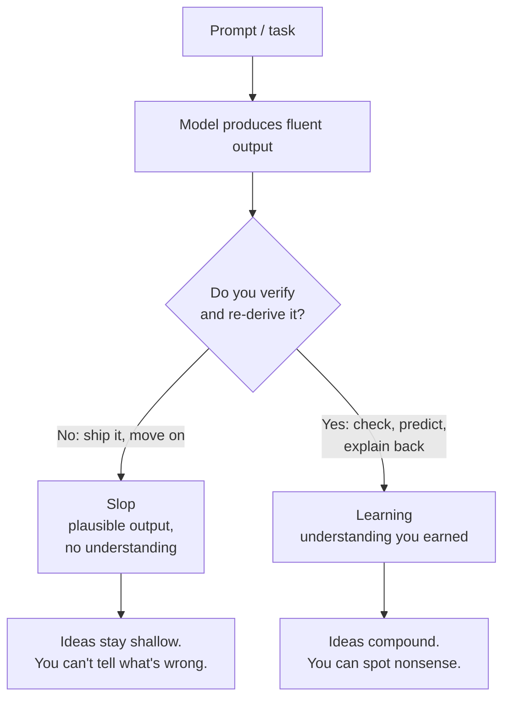

# AI Makes Output Cheap. Understanding Is Still on You.

*Agent tools collapsed the cost of producing answers — and that is exactly the whole risk. Output you didn't earn reads identically to understanding you actually have. The same models can also teach you faster than anything before them, but only when you close the loop. Two things are happening at once, and which one you get is decided by a single habit.*

---

## Every prompt forks into one of two outcomes

If you've used these tools for a while, you've felt both halves at once.

On one hand, they let you produce things you don't understand. A doc, a design, a Slack message, a PR — plausible, fluent, done. And because it looks done, you never go through the work of actually getting it. Your understanding of the thing doesn't develop. And since good ideas are downstream of understanding, later you don't have good ideas about it either. Call it **slop**: output without the comprehension that should have produced it.

On the other hand, they make learning *genuinely* easier. You can ask anything, at any hour, at any level, and get an explanation pitched exactly to where you are — something no book, lecture, or Stack Overflow thread ever managed.

These aren't two different technologies. They're the **same model**, and the difference is whether a human closes the loop. Same tool, two destinations:



Same start. Opposite ends. The rest of this is about why each side behaves the way it does, and how to deliberately land on the right one.

---

## Side one: the slop, and why it's not harmless

The seductive thing about generated output is that fluency reads as truth. A confident, well-formatted answer *feels* like being right. That feeling is the trap, because the cost of generation dropped to near-zero while the cost of verification did not.

The clearest evidence we have of the downside comes from an MIT Media Lab study, **"Your Brain on ChatGPT"** (Kosmyna et al., 2025). Participants wrote essays under three conditions — with an LLM, with a search engine, or with no tool — while wearing EEG headsets. The LLM group showed the **weakest** and most distributed brain connectivity of the three; the "brain-only" group the strongest. More telling than the EEG: LLM users reported the **lowest sense of ownership** of their essays and **couldn't accurately quote work they had written minutes earlier**. When LLM users were switched to writing with no tool, the under-engagement persisted.

That study is a preliminary preprint — small (54 in sessions 1–3, 18 in session 4), not yet peer-reviewed, single model, single task — so treat the specifics with caveats. But the direction matches something less exotic and already established: **cognitive offloading**. We've known since at least the "Google effect" (Sparrow et al., 2011) that when a tool will remember for us, we remember less ourselves. Handing the thinking to the model is the same move, generalized to the parts of thinking we actually care about.

The corporate version shows up in a Microsoft Research / CMU survey at CHI 2025 (Lee et al.) of **319 knowledge workers** and **936 real work examples**. The headline finding is uncomfortable: **the higher your confidence in the AI, the less critical thinking you apply.** And the nature of the work shifted — from generating and reasoning to *verifying and integrating*. In other words, the tool didn't remove the thinking; it relocated it to exactly the part people under time pressure skip.

### Why it compounds

Slop is not a one-time loss. It sets a lower ceiling on everything after it:

- **You can't tell good output from bad.** Without a model of the problem, a plausible lie and a correct answer look the same. You lose your taste, which is the thing that used to catch the model's mistakes.
- **You can't ask a better question.** The next prompt is built from what you understood of the last answer. Miss that, and every subsequent step drifts.
- **The ideas dry up.** New ideas are recombinations of things you deeply understand. If nothing is deeply understood, there's nothing to recombine. This is the "you don't have good ideas about the things" part — not a moral failing, just an arithmetic one. Understanding is the raw material, and slop consumes it without producing any.

This is the intellectual version of what the companion piece in this repo calls the **bottleneck shift**: the tool moved the expensive part of the work to the stage that needed the most human attention — here, understanding — and quietly let people stop showing up for it.

---

## Side two: the lift, and why learning got easier

Now the other half — and it's real, not a consolation prize.

A landmark result: a Harvard randomized controlled trial (Kestin, Miller, et al., *Scientific Reports*, 2025) compared a purpose-built AI tutor against in-class **active learning** — the gold standard, not a passive lecture — in a physics course of **194 students**. The AI-tutored group's median learning gains were **more than double** those of the active-learning group, and students reported being more engaged and motivated. Students learned *more, in less time*.

The caveats matter and the authors say so: it was one course, one subject, and the tutor was **not a raw chatbot** — it was carefully scaffolded with instructor-written pedagogy and step-by-step solutions. A blank GPT with a "be my tutor" prompt is not this. But the mechanism is exactly what makes the tool powerful as a *teacher*:

- **Explanation on demand, at your level.** The single biggest obstacle to learning is not knowing which question to ask next. A model can meet you where you are, then move.
- **Self-pacing and infinite patience.** You can re-ask the same thing ten times, dumbly, at 2 a.m., with no social cost. That removes the fear that suppresses questions in a classroom.
- **Immediate, specific feedback.** Fast feedback loops are one of the most reliable levers in all of learning science. A tutor that answers in seconds is a loop that closes.

So the same Tuesday-afternoon tool that produces slop can, when used differently, be the best tutor most people have ever had access to. The tool is not the variable. The loop is.

---

## The loop is the whole game

Here is the reconciliation, and it's also where hallucinations stop being just a risk and start being the point.

When you learn something from an AI, **you have to check it.** The model will state false things with total confidence. That means every AI-assisted learning session is, structurally, a series of claims you must verify. And that is *exactly the behavior that produces understanding*. The thing that makes AI dangerous is the same thing that makes it educational — if you actually do it:

- **Verification forces retrieval.** To check a claim you have to reconstruct what you already know and test it against the new thing. Retrieval practice (the "testing effect") is one of the best-evidenced ways to make knowledge stick far better than re-reading.
- **Disagreement forces reasoning.** When the model says something you doubt, you have to work out *why*. That generative struggle — Bjork's **"desirable difficulty"** — is the labor that slop skips and that learning requires.
- **Predict-then-check forces the generation effect.** Guess the answer before the model gives it. Even when you're wrong, you learn more than by reading the answer cold. The guess is the exercise.

Put the two sides next to each other and they collapse into one question:

```
  slop:   model produces → you accept       (loop open → nothing sticks)
  learn:  model produces → you verify/re-derive → you accept/reject  (loop closed)
                                    ▲
                                    └── this step IS the learning.
                                        It happens to also be the thing
                                        that catches hallucinations.
```

"Trust but verify" is usually advice about safety. For learning it's stronger than that: **verification isn't a tax on the benefit, it's the mechanism of the benefit.** Skip it and you get the fluency without the knowledge — which is precisely the slop.

---

## Working rules

None of this requires giving up the tools. It requires keeping the loop closed:

1. **Predict before you peek.** Write your own answer — even a wrong one — before reading the model's. You've now turned a read into an attempt, and attempts are what stick.
2. **Make it explain, not just answer.** "Why?" "What would break this?" "What's the counterexample?" A tutor that only emits conclusions is a slop machine; a tutor that reasons with you is a tutor.
3. **Explain it back in your own words.** If you can't, you don't have it yet — you have its output. This is the fastest slop detector there is.
4. **Verify against a primary source, not another model.** A second AI is not a source; it's a second guess. Cite the doc, the paper, the spec, the actual code.
5. **Do the hard part yourself, outsource the boilerplate.** Let the model type the tedious thing; keep the part where the understanding lives. That line is different for everyone and is worth finding deliberately.
6. **Notice when you're rushing.** The Microsoft finding is not that AI dumbs people down — it's that **high confidence in the AI lowers the critical thinking you apply**, and time pressure makes it worse. The riskiest moment is when you feel most sure and least patient.

---

## The takeaway

The tool didn't make understanding optional. It made **output** optional to earn — and output was never the point. The value was always the model of the world you build to produce it. That part is still on you, and always was.

Seen one way, AI is a machine that lets you skip the thinking and still look finished — and the bill arrives later as ideas you can't have, bugs you can't see, and answers you can't defend. Seen the other way, it's a patient, tireless, infinitely available tutor that happens to force you to verify everything, which is the best learning regimen ever devised by accident.

It's the same tool. The fork is whether you close the loop.

---

*The downside evidence draws on Kosmyna et al., "Your Brain on ChatGPT" (MIT Media Lab, 2025 — a preliminary, not-yet-peer-reviewed preprint, with caveats on sample size and design noted above) and on Lee et al., "The Impact of Generative AI on Critical Thinking" (Microsoft Research / CMU, CHI 2025). The positive evidence draws on Kestin, Miller, Klales, Milbourne & Ponti, "AI tutoring outperforms in-class active learning" (Scientific Reports, 2025) — a purpose-built, pedagogically scaffolded tutor in one physics course. The learning-science framing (retrieval practice / the testing effect, the generation effect, desirable difficulties, cognitive offloading) is from established cognitive psychology, notably the work of Robert Bjork and Elizabeth Bjork, Roediger & Karpicke, and Risko & Gilbert. Companion piece: `articles/ai-bottleneck-shift.md`.*
