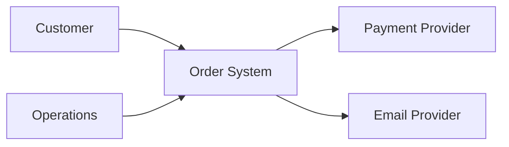
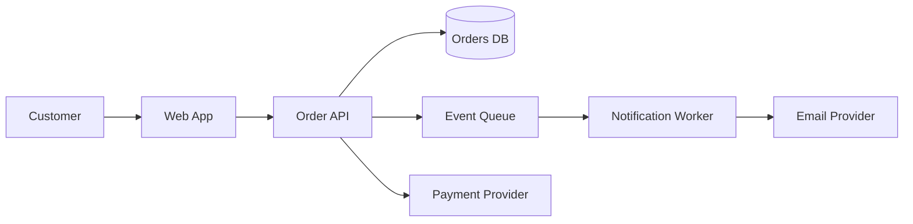

# 01 — Trade-off vocabulary

*Architecture is the set of structures and decisions that are expensive to change. This note gives you the vocabulary to compare them by what they optimize and what they cost.*

The running example is the [order service](../fundamentals/oop/design-patterns/06-composition-root/main.ts) from the composition-root note. It is small enough to hold in your head and concrete enough to expose the trade-offs.

## The definition

Two useful definitions, with different jobs:

> The software architecture of a system is the set of structures needed to reason about the system, which comprise software elements, relations among them, and properties of both.
>
> — Bass, Clements & Kazman, [*Software Architecture in Practice*](https://www.sei.cmu.edu/library/software-architecture-in-practice-fourth-edition/), 4th ed. (2021)

> Architecture is about the important stuff. Whatever that is.
>
> — Ralph Johnson, quoted in Fowler, [*Who Needs an Architect?*](https://martinfowler.com/ieeeSoftware/whoNeedsArchitect.pdf) (2003)

The first definition is precise: architecture is a set of structures that helps you reason about qualities such as performance, availability, security, and modifiability. The second is a warning: "important" is context-dependent. A database choice may be architectural in a CRUD business application and incidental in an image-processing tool.

The useful test is not "is this high-level?" It is:

> What does this decision make hard to change?

## Architecture vs design

Architecture is not "the big boxes"; design is not "the small boxes." The useful boundary is **cost of change and scope of coordination**.

| Decision | Usually architecture | Usually design |
| --- | --- | --- |
| How many deployables are there? | Yes | |
| Who owns a datum? | Yes | |
| Sync or async between modules? | Yes | |
| Strong or eventual consistency? | Yes | |
| Which team can change this independently? | Yes | |
| Strategy pattern vs an `if/else` inside one module? | | Yes |
| Constructor injection vs service locator? | | Yes |
| Table names, class names, local algorithms? | | Yes |

A rule of thumb: if a decision changes deployment, ownership, consistency, failure boundaries, or the number of teams that must coordinate, treat it as architectural. If it changes only how one module is implemented, it is design.

That is a useful boundary, not a law. Some design decisions become architectural when they spread. A shared database schema starts as a design shortcut and becomes architecture once three services read it.

## The five decision axes

Most architecture decisions are choices about five axes. I call them axes rather than units because each is a question, not a thing you can point at. They are a **synthesis**, not a standard taxonomy. The formal taxonomy they borrow from is Bass et al.'s three categories of architectural structures — module, component-and-connector, and allocation — plus ownership and change concerns from Conway, DDD, and Team Topologies, consistency concerns from distributed-data literature, and failure concerns from resilience literature.

| Axis | Question | Monolith | Microservices |
| --- | --- | --- | --- |
| **Deployment** | What ships together? | One artifact or process | Many independently deployed services |
| **Ownership** | Who owns the code and the pager? | One team or shared ownership | Service-aligned teams |
| **Change** | Who must coordinate a change? | Everyone on the deploy | Only the owning service and team |
| **Consistency** | What is atomic? | Local transaction | Saga, outbox, or eventual consistency |
| **Failure** | What fails together? | Whole process | Partial failure, but more failure modes |

This is why "monolith vs microservices" is not the first question. The first question is:

> Which of these five axes actually need to be independent?

### Where the five axes come from

| Axis | Main source or tradition | What it contributes |
| --- | --- | --- |
| **Deployment** | Bass et al., allocation structures; [Newman, *Building Microservices*](https://samnewman.io/books/building_microservices_2nd_edition/); [*Accelerate*](https://itrevolution.com/product/accelerate/) | What must ship independently? |
| **Ownership** | [Conway's law](http://www.melconway.com/Home/Committees_Paper.html); [Evans, DDD](https://www.domainlanguage.com/ddd/); [Skelton & Pais, *Team Topologies*](https://teamtopologies.com/book) | Who owns the code, data, and pager? |
| **Change** | [Parnas, information hiding](https://www.cs.colostate.edu/~france/CS314/Readings/Parnas-decomposition.pdf); [Fowler/Johnson, "the important stuff"](https://martinfowler.com/ieeeSoftware/whoNeedsArchitect.pdf); modifiability | What must change without coordinated releases? |
| **Consistency** | [Kleppmann, *DDIA*](https://dataintensive.net/); [database per service](https://microservices.io/patterns/data/database-per-service.html); [sagas](https://microservices.io/patterns/data/saga.html) | What must be atomic, and what can lag? |
| **Failure** | [Nygard, *Release It!*](https://pragprog.com/titles/mnee2/release-it-second-edition/); [fallacies of distributed computing](https://arnon.me/wp-content/uploads/Files/fallacies.pdf) | What fails together, and how bad is the blast radius? |

If you saw "three units" somewhere, it was probably Bass et al.'s three **structure categories**:

1. **Module structures** — code and data units: packages, classes, layers.
2. **Component-and-connector structures** — runtime elements and their interactions: services, queues, calls.
3. **Allocation structures** — mapping software to environments and teams: deployment, ownership.

Those are a formal taxonomy. The five axes are a decision heuristic built on top of them. They are not exhaustive: security, compliance, latency, and cost cut across all five and show up in the 12 questions below.

## Quality attributes are trade-offs

A quality attribute is a measurable or testable property of the system, not a slogan. [ISO/IEC 25010:2023](https://www.iso.org/standard/78176.html) names nine product-quality characteristics: functional suitability, performance efficiency, compatibility, interaction capability, reliability, security, maintainability, flexibility, and safety. Architecture usually focuses on a smaller, more operational set: availability, reliability, performance, scalability, security, modifiability, deployability, testability, observability, and cost.

Some of the most important qualities are not in the standard: time to market, cognitive load, compliance, and the cost of running the thing.

A quality attribute is only actionable when it has a scenario. Bass et al. use a six-part form: **source, stimulus, artifact, environment, response, measure**. For example:

> When the payment provider is unavailable (source and stimulus), the order API (artifact) under normal load (environment) returns a retryable error within 2 seconds for 99% of requests (response and measure), instead of hanging.

Without the measure, "high availability" is a wish, not a requirement.

You cannot maximize all of them. Concrete tensions in the order system:

| Tension | Choice | What you gain | What you lose |
| --- | --- | --- | --- |
| Consistency vs availability | Strong transaction for order and inventory vs accept the order and reserve later | Correctness now | Checkout can fail during a partition; less resilient |
| Performance vs modifiability | Direct SQL in the handler vs repository plus ports | Fewer hops, less code | Harder to replace the database, harder to test |
| Scalability vs simplicity | Extract a reporting service vs share the database | Independent reporting scale | Network, deploy, schema, and failure complexity |
| Security vs usability | Step-up auth for high-value orders vs one-click checkout | Lower fraud risk | More friction |
| Deployability vs consistency | Independent services vs one deploy | Independent releases | Distributed transactions and eventual consistency |
| Cost vs resilience | Multi-region vs single region | Survives a region failure | Money, operations, and replication complexity |

The architect's job is not to pick the "best" column. It is to pick the column that fits the current forces and to name the cost.

## Coupling and cohesion at module scale

- **Coupling** is the degree of interdependence between modules. The practical test: if A changes, must B change?
- **Cohesion** is the degree to which the elements inside a module belong together. The practical test: can you describe the module's job without saying "and"?

The order system is a good test case.

Bad boundaries:

```text
Orders module
  reads inventory.stock directly
  writes the payments table directly
  sends email inline
```

This has low cohesion (orders + inventory + payments + email), high coupling (shared schema and direct writes), and a wide failure boundary (an SMTP timeout fails checkout).

Better boundaries:

```text
Orders module
  owns the orders schema
  calls Inventory.reserve()
  emits OrderPlaced
  does not read inventory or payments tables

Inventory module
  owns the inventory schema
  exposes reserve/release

Payments module
  owns the payments schema
  exposes authorize/capture/refund

Notifications module
  owns delivery, not business state
  subscribes to OrderPlaced
```

An interface does not fix a shared schema. If both sides read the same table, the table is the contract. That is hidden coupling even when the code imports nothing. See [shared-database schema coupling](../fundamentals/oop/00e-shared-database-schema-coupling.md) and the [coupling concepts](../concepts.md#coupling).

## The 12 trade-off questions

Ask these of any architecture proposal. They work for a monolith, a service, an event flow, or a diagram on a whiteboard.

1. **What is the unit of deployment?** What ships together? If two things must always deploy together, they are one unit in practice.
2. **What is the unit of change?** Which team can change which code without coordinating a release? This is often more important than the code structure.
3. **What is the unit of ownership?** Who owns the data, the schema, the on-call pager, and the roadmap? Ownership is architecture.
4. **Who owns each piece of data?** Which module or service is the source of truth? Who may write it? Who may read it?
5. **What must be strongly consistent?** Which invariants must be atomic? For example: an order cannot be paid without an inventory reservation.
6. **What may be eventually consistent?** Which views, notifications, or reports can lag? For how long? What is the business cost of lag?
7. **What is the failure boundary?** What fails together? What is the blast radius? Can the system degrade instead of collapsing?
8. **What must scale independently?** Which workload has a different scaling curve? Reads vs writes, reporting vs checkout, image processing vs order taking.
9. **What is the latency and throughput budget?** What are the p50, p95, and p99 targets? How many requests per second? Architecture that ignores numbers is aesthetics.
10. **What coupling are we accepting?** Compile-time, deploy-time, runtime, schema, or semantic. Name it explicitly, because "we used an interface" is not a complete answer.
11. **What is the operational and compliance cost?** Who runs it? How is it observed? What about backups, upgrades, audits, PII, and data residency?
12. **What is the cost to reverse this decision?** Can you undo it in a sprint, a quarter, or a year? Prefer reversible decisions; make irreversible ones deliberately.

The tie-breaker: **what is the simplest option that satisfies the top three forces?** Simplicity is not a quality attribute in ISO 25010, but it is usually the best default.

## "It depends" is a real answer

Bad:

> It depends.

Good:

> For this system, given these forces, choose X because it optimizes Y. Accept cost Z. Revisit if W.

Template:

> For **[context]**, given **[top two or three forces]**, choose **[option]** because it optimizes **[quality attributes]**. Accept **[costs]**. Revisit if **[trigger]**.

Order example:

> For a three-team order system with moderate traffic and audit requirements, choose a modular monolith with one schema per module and an outbox, because it preserves local transactional consistency and simple deployment while keeping module boundaries explicit. Accept a shared deploy and a single runtime. Revisit if Payments needs independent compliance isolation, or Notifications needs independent scaling.

That is the Day 1 skill: not memorizing the answer, but making the reasoning explicit.

## ADR: record the decision

An Architecture Decision Record (ADR) is a short, immutable record of one architecturally significant decision. It is not a design document and not a meeting note. It captures the context, the decision, the consequences, and the alternatives.

The one-page template:

```md
# ADR-0001: <decision>

- Status: Proposed | Accepted | Superseded by ADR-XXXX
- Date: YYYY-MM-DD
- Deciders: <names or roles>
- Related: <links>

## Context

What forces are at play? What is the problem? What constraints matter?

## Decision

What are we doing? State it in one or two sentences.

## Consequences

What becomes easier? What becomes harder? What are we accepting?

## Alternatives considered

What else was on the table, and why was it rejected?

## Revisit if

What change in the forces would make this decision wrong?
```

ADRs are **superseded, not edited**. The history is the point. See the [ADR organization](https://adr.github.io/) and Nygard's [original post](https://cognitect.com/blog/2011/11/15/documenting-architecture-decisions.html).

A worked example for this repository: [ADR-0001 — Use a composition root](adr/0001-composition-root.md).

## C4 in one page

The [C4 model](https://c4model.com/) gives you four zoom levels:

1. **Context** — the system as one box, its users, and external systems.
2. **Container** — the deployable or runnable units: web app, API, database, worker, queue.
3. **Component** — the major modules inside a container.
4. **Code** — classes and interfaces; usually generated, rarely maintained by hand.

For architecture conversations, context and container diagrams do most of the work. Do not mix levels in one diagram.

Order system, context:



Order system, containers:



A C4 **container** is a deployable or runnable unit, not necessarily a Docker container. A database is a container in C4. So is a single-page app.

C4 is a communication tool, not a compliance exercise. A diagram that does not answer a question is decoration.

## Starter trade-off matrix

The canonical collection is [tradeoffs.md](tradeoffs.md). This starter table is for Day 1; copy it and fill one row per style as you go. One row is filled as a model.

| Style or decision | Optimizes | Costs | Use when | Avoid when | Failure mode |
| --- | --- | --- | --- | --- | --- |
| **Modular monolith** | Simple deployment; local transactions; fast change; easy debugging | Shared runtime; coarse scaling; boundaries erode without discipline | Small or medium teams; unclear boundaries; strong consistency; early product | Independent scaling or deployment is mandatory; teams block each other | Big ball of mud; one deploy blocks everyone |
|  |  |  |  |  |  |
|  |  |  |  |  |  |
|  |  |  |  |  |  |
|  |  |  |  |  |  |
|  |  |  |  |  |  |

Columns:

- **Optimizes** — which quality attributes this choice is good at.
- **Costs** — what you pay in complexity, latency, operations, or coordination.
- **Use when** — the forces that make it the sensible default.
- **Avoid when** — the forces that make it the wrong tool.
- **Failure mode** — the characteristic way it fails: not the cause, not the blast radius, but the pattern. Examples: big ball of mud, cascading timeouts, duplicate events.

### Failure mode, failure domain, blast radius

Reliability engineering separates the **fault** (the cause), the **error** (the incorrect state), and the **failure** (the deviation from correct service). The **failure mode** is the manner of that deviation: how the system fails, not just that it fails. See [Avizienis et al., *Basic Concepts and Taxonomy of Dependable and Secure Computing*](https://doi.org/10.1109/TDSC.2004.2) (2004) and [IEC 60812:2018](https://webstore.iec.ch/en/publication/26359), the FMEA standard.

- **Failure mode** — how it fails. Example: requests block, the thread pool exhausts, and latency cascades.
- **Failure domain** — what fails together. Example: the order service.
- **Blast radius** — how far the damage spreads. Example: the whole storefront.

A concrete chain:

```text
cause:        the mailer call has no timeout
failure mode: requests block; the thread pool exhausts; retries amplify load
effect:       checkout becomes unavailable
domain:       the order service
blast radius: every customer trying to buy
```

A failure mode is not the root cause and not the business impact. It sits between them. That is why the matrix asks for it: every architecture choice is a bundle of trade-offs, and each trade-off has a characteristic way of biting you.

## Day 1 exercise

- [ ] Confirm the **modular monolith** row, then fill **layered** and **hexagonal**. Leave the rest blank for later days.
- [ ] Write one ADR for a decision in your current project. Use the template above, not a status report.
- [ ] Draw the order system's **context** and **container** diagrams from memory.
- [ ] Say the "it depends" sentence out loud without notes.

**Done when:** you can explain why "it depends" is a real answer, and you can name the forces, the choice, the cost, and the trigger for revisiting.

## Sources

- Bass, Clements & Kazman, [*Software Architecture in Practice*](https://www.sei.cmu.edu/library/software-architecture-in-practice-fourth-edition/), 4th ed. (2021), ch. 1.
- Fowler, [*Who Needs an Architect?*](https://martinfowler.com/ieeeSoftware/whoNeedsArchitect.pdf) (2003).
- Richards & Ford, [*Fundamentals of Software Architecture*](https://www.oreilly.com/library/view/fundamentals-of-software/9781492043447/ch01.html) (2020), Part I.
- Parnas, [*On the Criteria To Be Used in Decomposing Systems into Modules*](https://www.cs.colostate.edu/~france/CS314/Readings/Parnas-decomposition.pdf) (1972).
- Conway, [*How Do Committees Invent?*](http://www.melconway.com/Home/Committees_Paper.html) (1968).
- Evans, [*Domain-Driven Design*](https://www.domainlanguage.com/ddd/) (2003).
- Newman, [*Building Microservices*](https://samnewman.io/books/building_microservices_2nd_edition/), 2nd ed. (2021).
- Skelton & Pais, [*Team Topologies*](https://teamtopologies.com/book) (2019).
- Kleppmann, [*Designing Data-Intensive Applications*](https://dataintensive.net/) (2017).
- Nygard, [*Release It!*](https://pragprog.com/titles/mnee2/release-it-second-edition/), 2nd ed. (2018).
- Avizienis, Laprie, Randell & Landwehr, [*Basic Concepts and Taxonomy of Dependable and Secure Computing*](https://doi.org/10.1109/TDSC.2004.2) (2004), for fault, error, failure, and failure mode.
- IEC 60812:2018, [*Failure modes and effects analysis (FMEA and FMECA)*](https://webstore.iec.ch/en/publication/26359).
- Rotem-Gal-Oz, [*Fallacies of Distributed Computing Explained*](https://arnon.me/wp-content/uploads/Files/fallacies.pdf).
- Forsgren, Humble & Kim, [*Accelerate*](https://itrevolution.com/product/accelerate/) (2018).
- ISO/IEC 25010:2023, [*Product quality model*](https://www.iso.org/standard/78176.html).
- ISO/IEC/IEEE 24765:2017, [*Systems and software engineering — Vocabulary*](https://www.iso.org/standard/71952.html), for coupling and cohesion definitions.
- Nygard, [*Documenting Architecture Decisions*](https://cognitect.com/blog/2011/11/15/documenting-architecture-decisions.html) (2011); [adr.github.io](https://adr.github.io/).
- Brown, [*The C4 model for visualising software architecture*](https://c4model.com/).
