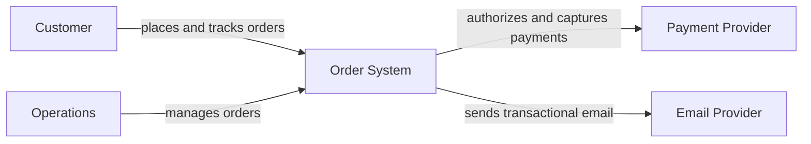
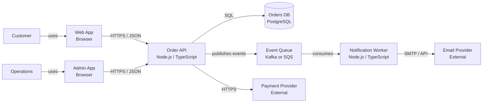
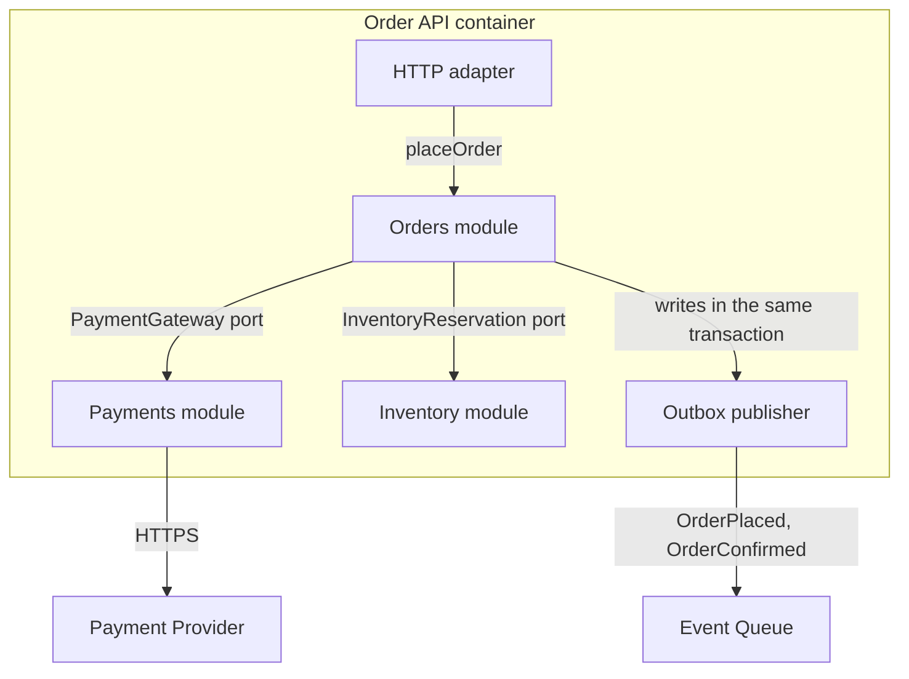
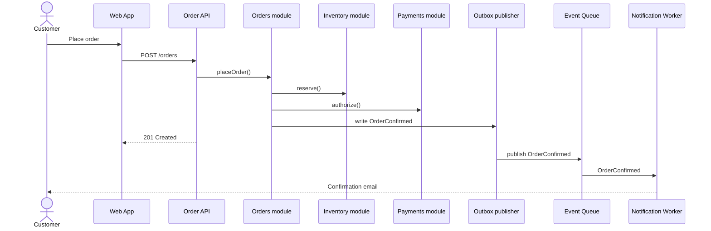

# 01b — C4 model

*The C4 model is a small set of hierarchical abstractions and diagram types for describing the static structure of a software system: context, container, component, and code.*

It is a communication tool, not a compliance exercise. The goal is a map that answers a question for a specific audience, not a diagram that decorates a wiki.

The running example is the [order system](../fundamentals/oop/design-patterns/06-composition-root/main.ts). The diagrams below are deliberately small. A diagram that tries to show everything answers nothing.

## Why C4 exists

Architecture diagrams usually fail in predictable ways:

- they mix abstraction levels: a box for "the system" next to a box for a class;
- they use inconsistent notation: arrows, colors, and shapes mean different things on different diagrams;
- they omit the audience and the question;
- they show structure but not relationships, or relationships labeled only "uses";
- they go stale because nobody knows which diagram is authoritative.

C4 addresses the first two problems with a shared vocabulary and a zoom model. It does not solve the last three. Those are habits.

Simon Brown's framing is useful: C4 gives you a way to create **maps of your code** at different levels of detail, in the same way a paper map has a country view, a city view, and a street view. You do not put every street on the country map.

C4 is **notation independent** and **tooling independent**. You can use Mermaid, PlantUML, Structurizr, a whiteboard, or a drawing tool. The abstractions matter more than the shapes.

## The four abstractions

C4 is hierarchical: a software system contains containers, containers contain components, and components are implemented by code.

| Abstraction | What it is | Examples |
| --- | --- | --- |
| **Software system** | Something that delivers value to users and is owned by a team | The order system; the payment provider; the email provider |
| **Container** | A deployable or runnable unit, or a data store | Web app, API, worker, database, queue, object store |
| **Component** | A group of related code inside a container, behind a well-defined interface | Orders module, Payments module, HTTP adapter, outbox publisher |
| **Code element** | A class, interface, function, or other implementation unit | `Order`, `PaymentGateway`, `placeOrder()` |

The most common mistake is thinking a C4 **container** means a Docker container. It does not. A container is a deployable or runnable unit, or a data store. A PostgreSQL database is a container. A browser single-page app is a container. A Docker image is an implementation detail.

A **component** is not a microservice. It is a grouping of related code inside a container. In a modular monolith, your modules are components. In a microservices system, a service might be a container, a system, or a group of containers, depending on the scope of the diagram.

C4 is not recursive. There is no level 5. If you need more detail than code, use a class diagram, an ERD, or a focused sequence diagram. Do not invent "C5."

## The four diagram types

| Diagram | Scope | Audience | Question it answers | When to use |
| --- | --- | --- | --- | --- |
| **System context** | The system as one box, its users, and external systems | Everyone, including non-technical stakeholders | Who uses this, and what does it depend on? | Start here. Always. |
| **Container** | The applications, data stores, and queues inside one system | Technical stakeholders, product, operations | What deploys, what stores data, and what talks to what? | When you need to see the runtime shape. |
| **Component** | The major components inside one container | Developers and architects | What are the modules, and how do they collaborate? | When a container is too big to reason about as one box. |
| **Code** | Classes, interfaces, and functions inside one component | Developers | How is this component implemented? | Rarely. Prefer generated or focused diagrams. |

The first two do most of the work. Component diagrams are useful when a container has meaningful internal boundaries. Code diagrams go stale fastest and should usually be generated or avoided.

### Supporting diagrams

C4 also defines supporting diagram types:

- **System landscape** — multiple software systems and how they relate. Useful for enterprise or platform contexts.
- **Dynamic** — a runtime scenario, such as "place an order," showing the interactions in order.
- **Deployment** — how containers map to infrastructure: environments, nodes, regions, and network boundaries.

These are not levels 5 and 6. They are different views for different questions. A dynamic diagram is often more useful than a component diagram when you need to explain a flow.

## Order system: context

This diagram answers: who uses the system, and what external systems does it depend on? It deliberately shows the order system as one box. Do not put the database, the modules, or the classes on this diagram. That is the next zoom level.

The external systems are black boxes. You do not need to show the payment provider's internal services. You only need to know that it is outside your boundary and that you depend on it.

## Order system: containers

This diagram answers: what are the deployable or runnable units, what stores data, and what talks to what?

Read it as:

- the web app and admin app are containers because they run in the browser;
- the order API is a container because it is a deployable process;
- the database is a container because it stores data;
- the queue is a container because it is a runnable piece of infrastructure;
- the notification worker is a container because it is a separate deployable process;
- the payment and email providers are external systems.

Notice what is **not** here: modules, classes, or database tables. Those belong to the next level. Notice also that the container diagram does not show deployment nodes, regions, or replicas. That is a deployment diagram's job.

## Order system: components

This diagram answers: what are the major components inside the order API, and how do they collaborate?

In the modular monolith, these components are the modules. The arrows are contracts, not database access:

- the HTTP adapter translates a request into an application command;
- Orders orchestrates the use case;
- Orders calls Payments through a `PaymentGateway` port;
- Orders calls Inventory through an `InventoryReservation` port;
- Orders writes an outbox row in the same local transaction as the order state;
- the outbox publisher sends events to the queue.

This is where the component diagram earns its keep: it shows the module boundaries and the direction of dependencies. It does not show every repository, service, or class. If you need that, zoom into one component with a code-level diagram.

A component diagram can also be used to show a microservice's internals. The abstraction is the same; the deployment boundary is different.

## Order system: a dynamic view

Static diagrams show structure. A dynamic diagram shows a scenario.

This is not a C4 level. It is a dynamic view. It answers: in what order do the parts interact for this scenario? Use it when the static diagram leaves the behavior ambiguous.

A dynamic diagram is especially useful for showing where a transaction ends, where a network call happens, and where consistency becomes eventual. Those boundaries are often more important than the boxes.

## The code level

The code level zooms into one component and shows classes, interfaces, and functions. It is the least useful C4 level for most architecture work:

- it goes stale fastest;
- it duplicates what the IDE already shows;
- it encourages arguments about structure instead of behavior;
- it is too detailed for most stakeholders.

Use it for a focused handover, a tricky pattern, or a generated view of a package. Do not hand-maintain a full class diagram of the system. If you need to show a design pattern, show the few classes that matter and link to the code.

For this repository, the [composition root note](../fundamentals/oop/design-patterns/06-composition-root/composition-root.md) is better than a code diagram: it shows dependency direction in code, not in boxes.

## Notation

C4 does not mandate a notation, but it does require consistency. A practical convention:

- **People** — a distinct shape or color, labeled with the role.
- **Software systems** — boxes; external systems visually distinct.
- **Containers** — boxes inside the system boundary; data stores use a database shape.
- **Components** — boxes inside a container boundary.
- **Relationships** — arrows labeled with purpose and technology: "places orders via HTTPS/JSON," not "uses."
- **Boundaries** — explicit boxes for system scope, container scope, trust boundaries, or deployment zones.
- **Legend** — if shapes or colors carry meaning, explain them.

The most important rule is not aesthetic. It is **one diagram, one question**. If a diagram tries to answer "who uses the system?" and "how is the database indexed?" at the same time, it will fail at both.

Names should be consistent across diagrams. If it is "Order API" on the container diagram, it is not "Order Service" on the component diagram and "orders-api" on the deployment diagram. Consistency is what makes the zoom levels feel like one model.

## How to draw one

1. **Write the question and the audience.** "How does a customer place an order?" is a different diagram from "what deploys to production?"
2. **Choose the level.** Context for scope, container for runtime shape, component for module boundaries, code for implementation.
3. **List the elements.** People, systems, containers, components. Use nouns from the domain.
4. **Add relationships.** Label each arrow with purpose and, where useful, protocol or technology.
5. **Remove anything that does not answer the question.** A diagram is an argument, not an inventory.
6. **Check the level.** If a class appears on a container diagram, it is at the wrong zoom.
7. **Review it with the checklist.** Title, scope, legend, names, types, technologies, relationships.
8. **Version it and link it.** Put it next to the decision it explains. A diagram in a chat thread is already lost.

For a first pass, context and container diagrams are enough. Add a component diagram when a container has boundaries worth explaining. Add a dynamic diagram when the behavior is the point. Skip code unless someone genuinely needs it.

## Common traps

| Trap | Why it hurts | Better |
| --- | --- | --- |
| **Container means Docker** | You omit databases, queues, and browser apps, or add infrastructure that is not a container | A container is a deployable/runnable unit or data store |
| **Mixing levels** | A class next to a system is unreadable for everyone | One diagram, one abstraction level |
| **External systems with internals** | You imply knowledge you do not have and create volatile detail | Show external systems as black boxes |
| **Shared libraries as containers** | A library is not independently deployable | Show it as a component, or omit it |
| **Every arrow says "uses"** | The reader learns nothing about intent or protocol | Label the purpose: "publishes OrderPlaced to" |
| **No technology labels** | The same box could be a queue, a database, or a cron job | Name the technology where it matters |
| **No title, scope, or legend** | The reader cannot tell what the diagram is or what the shapes mean | Add title, scope, and key |
| **Hand-maintained code diagrams** | They are stale before the next sprint | Generate them or skip them |
| **Diagram theater** | Beautiful diagrams nobody updates or uses | Draw to answer a question; link from a decision; delete when obsolete |
| **C4 as a methodology** | It is a diagramming model, not a delivery process | Pair it with ADRs, quality scenarios, and real constraints |

C4 also does not replace:

- **ADRs** — the *why* behind a decision;
- **quality attribute scenarios** — the measurable behavior;
- **ERDs** — the data model;
- **sequence diagrams** — detailed runtime behavior;
- **deployment diagrams** — infrastructure and environments.

Use the right view for the question. C4 is a map, not the territory.

## C4 and ADRs

C4 and ADRs answer different questions:

- **C4** shows the structure: what exists, what contains what, and what talks to what.
- **ADR** records a decision: what we chose, why, what we gave up, and when to revisit.

They work best together. A container diagram shows one database. The ADR explains why the team chose one database with a schema per module rather than a database per service. A component diagram shows the outbox publisher. The ADR explains why the outbox exists and what would make it unnecessary.

Link the diagram from the ADR, and link the ADR from the diagram or its caption. A diagram without a decision is trivia; a decision without a diagram is hard to visualize.

## Review checklist

Use this before you publish a diagram:

- [ ] Does it have a title?
- [ ] Is the diagram type clear: context, container, component, code, dynamic, deployment?
- [ ] Is the scope clear: which system, which container, which scenario?
- [ ] Is there a key or legend if shapes or colors carry meaning?
- [ ] Does every element have a name?
- [ ] Is every element's type clear: person, system, container, component?
- [ ] Does every element have a short description?
- [ ] Is the technology shown where it matters?
- [ ] Are acronyms and abbreviations explained?
- [ ] Is every relationship labeled with purpose?
- [ ] Are all levels of abstraction consistent?
- [ ] Are external systems and data stores visible where relevant?
- [ ] Are trust boundaries or security zones visible where relevant?
- [ ] Does the diagram answer the question it was drawn for?
- [ ] Is it versioned and linked from the place people will look?

The official C4 [review checklist](https://c4model.com/diagrams/checklist) is a longer version of this. Use it for diagrams that will be shared beyond the team.

## Trade-off matrix row

| Style or decision | Optimizes | Costs | Use when | Avoid when | Failure mode |
| --- | --- | --- | --- | --- | --- |
| **C4 model** | Shared understanding; onboarding; scope control; communication across audiences; a vocabulary for module and container boundaries | Maintenance; staleness; oversimplification; false confidence; time spent drawing instead of deciding | Multiple audiences; architecture reviews; onboarding; distributed systems; decisions that need a shared map | A whiteboard sketch is enough; nobody will maintain it; you need detailed behavior or data modeling; the diagram is for compliance theater | Beautiful stale diagrams; mixed abstraction levels; boxes without meaning; "diagram theater" |

This row is also collected in the [consolidated trade-off matrix](tradeoffs.md).

## Sources

- [The C4 model](https://c4model.com/) — official site.
- [C4 abstractions](https://c4model.com/abstractions) — software system, container, component, code.
- [C4 diagrams](https://c4model.com/diagrams) — context, container, component, code, landscape, dynamic, deployment.
- [C4 notation](https://c4model.com/diagrams/notation).
- [C4 review checklist](https://c4model.com/diagrams/checklist).
- [C4 FAQ](https://c4model.com/faq).
- Brown, [*The C4 Model for Visualising Software Architecture*](https://www.oreilly.com/library/view/the-c4-model/9798341660113/) (O'Reilly).
- Brown, [*Diagramming distributed architectures with the C4 model*](https://dev.to/simonbrown/diagramming-distributed-architectures-with-the-c4-model-51cm).
- [Structurizr](https://structurizr.com/) — model-based, diagrams-as-code tooling from the C4 author.
- [Architecture Decision Records](https://adr.github.io/) — the decision record format used in this repository.
- [*Misuses and Mistakes of the C4 model*](https://www.workingsoftware.dev/misuses-and-mistakes-of-the-c4-model) — a useful secondary checklist of traps.

## Next

- [Modular monolith](01a-modular-monolith.md) — the design these diagrams describe.
- [Day 1 trade-off vocabulary](01-tradeoff-vocabulary.md) — the short C4 section, ADR template, and trade-off matrix.
- [ADR-0001 — Use a composition root](adr/0001-composition-root.md) — an example of the decision record that should accompany these diagrams.
- [Roadmap](../roadmap.md) — Day 1 for context and container diagrams, Day 3 for the module map, Day 8 for the capstone.
