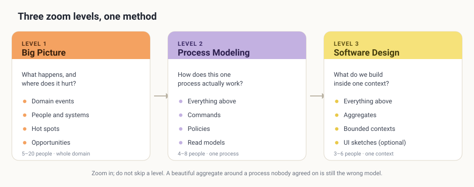
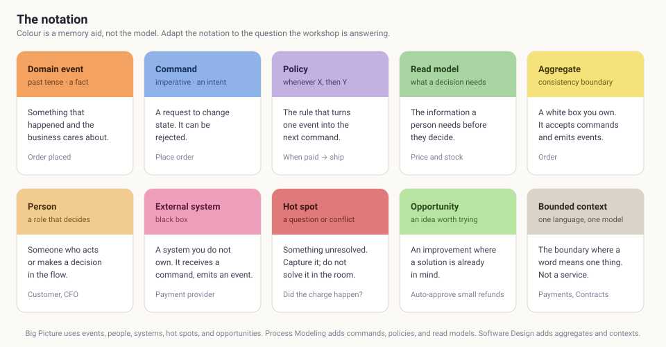
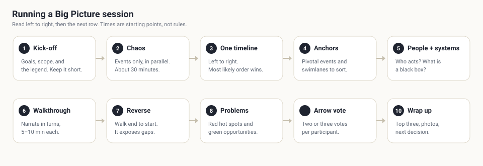
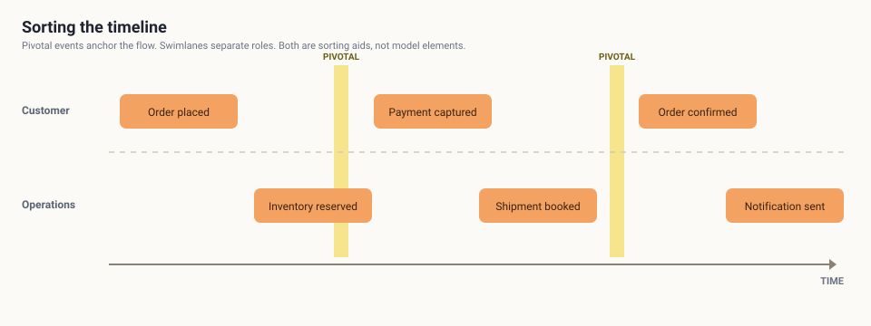
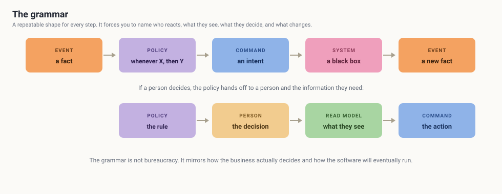
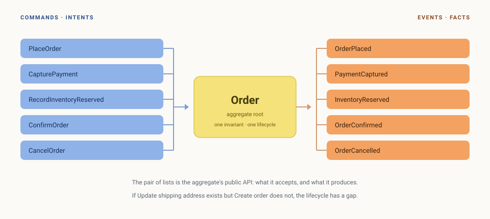
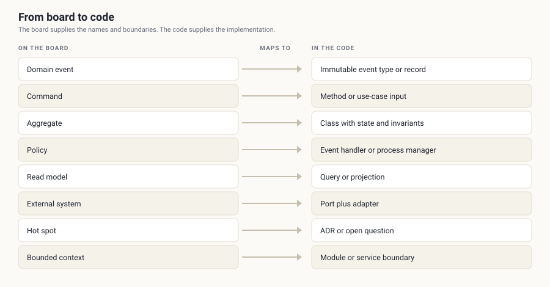

# Event Storming: The Complete Guide

*You cannot design a system you cannot describe. Event Storming is a workshop format for describing a complex business domain out loud, on a wall, before anyone commits to a schema, a service boundary, or a framework.*

*This guide follows the method created by Alberto Brandolini and the practical three-level structure described by Qlerify. It is written to be used: prepare a session, run it, and turn the board into code.*

---

## Why Event Storming exists

Most architecture work starts in the wrong place. A team opens a diagramming tool and draws services, databases, queues, and arrows. The shapes are familiar, so the work feels like progress. But the hard part of a complex domain is not drawing boxes. It is agreeing on:

- what actually happens;
- who decides;
- which rules are real;
- which words mean different things in different parts of the business;
- where one process ends and another begins.

Alberto Brandolini, who created the format, defines a complex domain as **"a network of interdependent agents influencing each other."** A recruitment process is a good example: HR, the hiring manager, the team, and security each evaluate the candidate from a different angle. The decision is collaborative, the outcome is not fully predictable, and every hire needs a slightly different approach. There is no formula that turns the process into a flowchart and no schema that captures it on the first try.

When the domain is complex, the real constraint in a software project is not writing code faster. It is **understanding the domain faster** and identifying the right problem to solve. We have excellent tools for producing code. We have very few for producing shared understanding.

Event Storming is one of those few. It works because it starts from business facts and the language people already use, postpones technical choices until the domain reveals a boundary, and makes disagreement visible instead of averaging it away.

> The board is a thinking tool. The decisions are the output.

---

## The atom: a domain event

Everything in Event Storming is built on the **domain event**: something that happened and matters to the business.

A good domain event has four properties:

| Property | Test | Example |
| --- | --- | --- |
| **Past tense** | Can you say "it happened"? | `Order placed`, not `Place order` |
| **Business language** | Would a domain expert say it? | `Payment captured`, not `Charge API returned 200` |
| **A fact** | Has it already occurred? | Facts cannot be rejected; commands can |
| **Relevant** | Does someone in the business care? | `Invoice sent`, not `Row inserted` |

| Good domain event | Why it works |
| --- | --- |
| `Order placed` | A business fact with a clear meaning. |
| `Payment captured` | Money moved; the business cares. |
| `Proposal accepted` | A decision changed the relationship. |
| `Milestone approved` | Work was accepted and payment can be released. |

| Not a domain event | What it actually is |
| --- | --- |
| `Customer clicked Pay` | A UI interaction. |
| `orders row updated` | A persistence detail. |
| `Payment service called` | A technical step. |
| `Kafka message consumed` | Infrastructure. |
| `Email sent` | Only an event if the business cares about the email itself. |

The timeline is the backbone. If two events cannot be ordered, that is not a failure of the workshop. It is a **hot spot** — a question for the business, and often the most valuable note on the wall.

---

## Three zoom levels

Event Storming is not one workshop. It is a family of workshops at different zoom levels. Each level adds notation and narrows the question.



| Level | Question | Scope | Typical group | Notation added | Output |
| --- | --- | --- | --- | --- | --- |
| **Big Picture** | What happens in this business, and where does it hurt? | The whole domain or value stream | 5–20 people, business and IT | Events, people, systems, hot spots, opportunities | A shared timeline, top problems, candidate contexts |
| **Process Modeling** | How does this one process work, including its exceptions? | One end-to-end process | 4–8 people | Commands, policies, read models | A happy path, important alternatives, explicit rules |
| **Software Design** | What are the aggregates and boundaries we will build? | One bounded context | 3–6 people | Aggregates, bounded contexts, optional UI sketches | Aggregate boundaries and command/event APIs |



The progression is a zoom, not a checklist:

```text
Big Picture      → discovers the process and the language
Process Modeling → discovers the rules and the exceptions
Software Design  → discovers the aggregates and the boundaries
```

You can stop at any level. A Big Picture session that produces a shared map and a top-three problem list has done its job.

Do not skip straight to aggregates. The most common failure is designing a beautiful aggregate around a process nobody actually agreed on.

---

## Level 1: Big Picture

**Use it when** the scope is large or unclear, or when different departments need a shared view. It is the right starting point for a project kickoff, a startup, an organization reboot, onboarding new team members, a retrospective, or any domain you do not yet understand.

**Do not use it when** you already have one narrow process with a clear start and end. That is Process Modeling.

The purpose is to **maximize learning**. The session should create a shared understanding across silos and produce agreement on which problems are most critical. Along the way, inconsistencies become visible without anyone having to be blamed for them.

### Before the session

1. **Frame the problem.**
   - Confirm that Big Picture is the right method. What problem are we solving? What is the scope? What outcome is expected?
   - Are we mapping the current state or envisioning a future state?
   - If the scope is the whole business, Big Picture fits. If it is one specific process, use Process Modeling.
   - A limited Big Picture session can still be a useful warm-up before Process Modeling.
2. **Invite the people who disagree.**
   - Five to ten people is a good default. Up to twenty is possible for a large domain.
   - Mix business and IT where you can, but a business-only session works.
   - The room needs people who can both answer questions and ask them.
   - A room full of engineers will produce an engineering model.
3. **Prepare the materials.**
   - Plenty of sticky notes in every color you plan to use.
   - A black marker for every participant.
   - Tape, a long paper or plastic roll, and something to write the legend on.
4. **Set up the room.**
   - People need to stand and move. Reserve at least 8 meters of wall; large sessions may need 16.
   - A plastic roll works better than a whiteboard, which is rarely wide enough.
   - Arrive at least 30 minutes early to remove chairs, hang the roll, and draw the legend on a separate sheet.
   - Do not forget food, lighting, and fresh air. A four-hour workshop is physical work.

### Running the workshop



#### 1. Kick-off

Start with a short, informal round of introductions. If the group does not know each other, a 20-minute warm-up on a familiar process — ordering a pizza, hiring a candidate — gets people writing before the real topic starts.

Present the goals and align on the objective. Keep the method explanation minimal. Say something like:

> "We are going to explore the business process as a whole by placing relevant events along a timeline. Along the way we will mark the problems, ideas, and opportunities we find."

Show the notation legend, but do not lecture through every color. Introduce each concept when it becomes relevant.

#### 2. Chaotic exploration

Ask everyone to write **domain events only** on orange notes and put them on the wall at the same time. Give each person a stack of notes and a marker.

This phase will feel chaotic. Say so, and say that it is fine. Structure comes later. It is more effective to get people moving than to over-explain.

Prompts that help a stalled group:

- "Do you receive payments?"
- "Are contracts signed at some point?"
- "What does your team do that someone downstream depends on?"
- "What do you wish happened earlier?"

Timebox it to about **30 minutes**, adjusted for scope. Do not try to capture everything. Missing events can be added in any later phase.

#### 3. Enforce one timeline

Now the collaboration starts. Every event goes on a **single left-to-right timeline**. Participants who began their own private timeline must merge it into the shared one.

Expect the question: "Which event comes first?" The answer is:

> "We are not aiming for perfection. Choose the most likely or preferred order."

While sorting, people will naturally add missing events, argue about sequence, and start placing hot spots. Let them. The conversation is the product.

The wall will become uneven: some periods are crowded, others nearly empty. After a few minutes, suggest a sorting strategy.

| Strategy | What it does | Good for |
| --- | --- | --- |
| **Pivotal events** | Pick a few anchors and place everything relative to them | Distributing a long, flat flow |
| **Swimlanes** | Separate roles, departments, or parallel activities | Showing who does what |
| **Temporal milestones** | Anchor on dates such as "end of month" or "contract signature" | Processes driven by deadlines |
| **Chapter sorting** | Group events into themes or phases first | Very large domains |
| **Combinations** | Mix and adapt the above | Most real workshops |

#### 4. Pivotal events and swimlanes

A **pivotal event** is an event that marks a meaningful transition: `Contract signed`, `Order shipped`, `Payment settled`. Mark a few with a strip of tape underneath, then ask the group to position everything else relative to those anchors.

Choose anchors that **distribute the flow across the wall**, not ones that are merely important. You can move them later. Look for events that matter to the business or that separate one phase from the next.

A **swimlane** is a horizontal band for a role, department, or parallel process. Draw it with a marker. Swimlanes make the timeline easier to read, but they consume wall space, so use them when clarity is worth the real estate.

Most workshops combine the two: start with pivotal events, then add local swimlanes where the flow genuinely runs in parallel.



#### 5. Add people and systems

Who acts in this flow? Which systems are involved?

- Use **small yellow notes** for people and roles.
- Use **large pink notes** for external or internal systems treated as black boxes.
- Place them where they play a meaningful role, not next to every event.

This step usually surfaces a wave of hot spots. It also reveals the real shape of the process: a "simple" checkout that crosses five departments and two vendors.

The step is optional. Skip it if the issues are already clear, the system does not exist yet, or everyone already knows the actors. Sometimes it is enough to mark only the external dependencies.

#### 6. Explicit walkthrough

Ask participants to take turns as **narrators**. Each person walks along the timeline and talks through the chain of events in order. The rest of the group challenges unclear parts, fills gaps, and suggests improvements.

Being the narrator is demanding. Keep turns to **5–10 minutes**.

This is where most of the learning happens — and it is usually the longest phase, often a few hours. Build in breaks. Rearrange events, add missing ones, and place hot spots or opportunities as the group talks.

#### 7. Reverse narrative

After the forward walkthrough, do one pass **from the end back to the start**.

For an invoice to be *paid*, it must first be *sent*. So `Invoice sent` must appear to the left of `Invoice paid`. Walking backwards exposes events that the forward narrative skipped because they felt obvious.

When something is missing, stop and let the group add it. At the end, ask:

> "Is anything still missing?"

Expect a few more notes.

#### 8. Problems and opportunities

Set aside dedicated time for problems and ideas. Even if hot spots have appeared all along, this is the moment to dig deeper and surface the frustration, inefficiency, and good ideas that have not been said yet.

Give the group **10–15 minutes**.

- **Red hot spots** for problems you know about but do not yet know how to solve.
- **Green opportunities** for improvements where a solution is already in mind.

Do not solve them in the room. Capture them, and move on. The point of Big Picture is to find the right problems, not to design the fixes.

#### 9. Arrow voting

This is one of the highest-leverage parts of a Big Picture session.

Give each participant **two or three votes**. A vote is a large black arrow drawn on a blue note. Say:

> "Everything on this wall is important. Now pick the two problems or opportunities you believe we should focus on first."

Voting only makes sense once the whole board is visible. Sometimes the group agrees immediately. Sometimes the result is a surprise. Either way, the outcome is visual and hard to argue with.

A good session is a learning experience across silos. Participants often leave with a better understanding of their own organization than they had at the start.

#### 10. Wrap up

Sometimes the session has already delivered its value: everyone understands the domain better, and the top two or three problems are agreed on. For many organizations, acting on those few items produces a noticeable improvement. In some cases, the sticky notes are all the documentation the team needs.

Other times, the next step is to document the board and continue with Process Modeling or Software Design.

Either way: **photograph the board**. A wall of notes disappears when the room is cleaned.

### The solo version

You can run Big Picture alone. Use two hats — the domain expert and the engineer — and switch deliberately.

1. Set a timer for 25 minutes.
2. Write 30–50 events without editing.
3. Sort them into a timeline.
4. Add actors, systems, and hot spots.
5. Pick the three problems that would change the most if solved.

The [local canvas](../server.ts) in this folder is enough for a solo board:

```sh
node architecture/04-microservices/event-storming/server.ts
```

### Outputs

A Big Picture session should leave you with:

- a timeline of domain events;
- the actors and external systems;
- a list of hot spots and opportunities;
- the top two or three problems, chosen by the group;
- a set of candidate bounded contexts, not services;
- a decision about whether to go deeper.

---

## Level 2: Process Modeling

**Use it when** you have one process with a clear start and a clear end, and you need to understand its rules, decisions, and exceptions.

Process Modeling shifts from broad exploration to detailed design. The group is smaller — usually **4–8 people** — and the collaboration is sequential rather than parallel. The team maps one process together, step by step, usually starting from a candidate found during a Big Picture session.

Typical processes:

- from order placed to order confirmed;
- from job posted to the first milestone paid;
- from invoice received to payment scheduled;
- from sign-up request to confirmed subscription.

### The three moves

1. **Frame the process.** Define the start, the end, and the decision the model should support.
2. **Establish the happy path.** Map the most common successful scenario first, from trigger to outcome. You can start at the trigger and move forward, start at the outcome and move backward, or brainstorm the key events first.
3. **Explore the important alternatives.** Mark exceptions, questions, and side flows as hot spots while mapping the happy path. Resolve them afterwards. You are not trying to model every possibility — only the ones that change the design.

### The grammar

Process Modeling has a precise, repeatable shape:

```text
Event → Policy → Command → System → Event
```

If a person makes the decision, insert the person and the information they need:

```text
Event → Policy → Person → Read model → Command → System → Event
```



This is not bureaucracy. The grammar forces you to name:

- **who** reacts;
- **what** they need to see;
- **what** they decide;
- **what** changes as a result.

It also mirrors how most business software actually works, which is why the same model can later become a software design.

Even when a command seems to repeat the event wording, keep it. Each command will map to a feature, an API call, or a use case later.

### The vocabulary

| Element | What it is | What it is not |
| --- | --- | --- |
| **Command** | An intent to change state, in the imperative: `Place order`, `Capture payment`. It can be rejected. | A fact. `Order placed` is an event. |
| **Policy** | A reaction or rule: "Whenever `Order placed`, then `Reserve inventory`." | A command. It explains *why* the command happens. |
| **Read model** | The information a person needs to decide: price, stock, contract status, payment history. | Necessarily a database table. It can be a screen, a query, or a report. |
| **System** | A black box that receives a command and produces an event. | Necessarily something you build. External systems stay black boxes. |
| **Hot spot** | A question, conflict, or unknown. | A failure of the workshop. It is often the most useful output. |

### Commands

A command is a clear instruction: **verb + noun**. `Place order`, `Cancel subscription`, `Approve milestone`.

Beware of vague verbs: *check*, *verify*, *review*. They usually mean one of two things:

- **The user needs information.** Then you are missing a **read model**. Add it instead of inventing a command.
- **The user is changing state.** Then rename the command to say what actually changes: `Check order` becomes `Mark order as checked`, which produces `Order marked as checked`.

The second version is traceable. The first is a verb that hides a decision.

### Policies

A policy is the glue between an event and a command. It is a business rule or an automatic reaction:

> **Whenever** X happens, **then** do Y.

Useful keywords: *whenever*, *if*, *then*, *always*, *immediately*.

Examples:

- *Whenever* an invoice arrives under the unusual-payment policy, *then always* request a review.
- *Whenever* an invoice arrives under the recurring-payment policy, *then always* schedule the payment.
- *Whenever* a payment is unknown, *then* reconcile with the provider before retrying.

A policy can be fully automated, or it can hand off to a person. If a person decides, the policy points to the person and to the read model they need.

### Read models

A read model specifies what someone must see before deciding. Before a customer clicks "Add to basket", they may need:

- the product price and any discount;
- size, colour, and weight;
- availability;
- reviews;
- images.

A read model is not necessarily a table. It can be a screen, a query, a report, or a projection. The test is simple: **does a real decision depend on it?**

### Systems

A system is a black box that receives commands and produces events. It can be an external provider, an internal service, or a component you have not designed yet.

A special case is the **conversational system**: a chatbot, a phone call, a support thread. These are non-linear. Do not try to model every utterance or path. Model the **exit conditions** instead:

- `Customer satisfied`
- `Customer abandoned the conversation`
- `Escalated to a human`
- `Refund requested`

Think of it as a checklist: what must be true before the conversation ends?

### A worked example: invoice → payment

Start with the events:

```text
Invoice received → Payment scheduled → Payment settled
```

Add the rules:

```text
Invoice received
  → Policy: if the invoice matches the recurring-payment policy
  → Schedule payment
  → Payment system
  → Payment scheduled

Invoice received
  → Policy: if the invoice is unusual
  → Ask for review
  → Email
  → Review requested
```

Add the read models the policy needs:

```text
Payment terms
Expected bills
Vendor history
```

Now add the exception the happy path hides:

```text
Schedule payment
  → Payment system
  → ... but the response is lost.

Hot spot: did the payment happen?
Policy: when the outcome is unknown, reconcile with the provider.
Event: Payment unknown.
```

That last hot spot is the bridge to distributed-systems design. The board exposes the ambiguous outcome before anyone chooses a retry policy, an idempotency key, or a reconciliation job.

A second example, from a subscription flow:

```text
Sign-up requested
  → Policy: send a confirmation email
  → Send confirmation email
  → CRM
  → Confirmation email sent

Confirmation email sent
  → Policy: wait for the user to confirm
  → Person: user
  → Read model: confirmation request
  → Confirm email
  → CRM
  → Email confirmed

Email confirmed
  → Policy: accept the subscription
  → Accept subscription
  → CRM
  → Subscription accepted
```

Notice how much of the process is a **policy waiting for a person**. That is normal. Most business processes are not straight-line automation; they are a chain of decisions with information attached.

### Rules of the game

Treat the session as a cooperative game. The group is one team, and the opponent is the complexity of the process.

The goal is to complete:

1. the most important and valuable path — the preferred way for events to unfold;
2. the most important alternative path;
3. a handful of other alternatives, if they change the design.

Covering every edge case is not the goal. Most of the value comes from the happy path plus the few exceptions that force a real decision.

### Outputs

A Process Modeling session should leave you with:

- a happy path with explicit commands and events;
- the policies that connect them;
- the read models each decision depends on;
- the systems involved, marked as owned or external;
- the important alternatives and the hot spots that remain;
- a process model ready to become a software design.

---

## Level 3: Software Design

**Use it when** you have chosen one bounded context and need to decide what the code looks like inside it.

Domain-Driven Design has two goals that are notoriously hard to get right: finding **bounded contexts** and defining **aggregates**. Event Storming gives you a hands-on way to do both.

- **Big Picture** helps you discover bounded contexts — the high-level areas of the business.
- **Software Design** zooms into one context to define its aggregates.

### Bounded contexts

The biggest challenge in a large system is deciding where the boundaries go. DDD recommends using **linguistic and organizational borders** as guides.

In a Big Picture session, those borders often appear on their own. Sales, accounting, and logistics use different words for the same thing, or the same word for different things. Those mismatches are signals: one context ends where the language changes.

Forcing everyone into a single unified model creates friction and a model that fits nobody. Let each team work inside its own bounded context, with a model optimized for its language, goals, and expertise.

A bounded context is not a microservice. It can be a module inside a modular monolith. A service is a deployment choice; a context is a modelling boundary.

### From system to aggregate

In a Process Modeling board, a pink system is a black box. In Software Design, you decide which black boxes you are going to build.

> Replace the systems you own with **aggregates**. Keep the systems you do not own as external systems.

If you are building the payment capability yourself, the pink `Payment provider` note becomes a yellow `Payment` aggregate. If Stripe owns it, it stays pink.

That one visual change turns a process map into an architecture blueprint:

- **Pink system** = external black box you integrate with.
- **Yellow aggregate** = internal white box you design and own.

### What an aggregate is

An aggregate is a cluster of entities and value objects treated as one unit for consistency, accessed only through its **aggregate root**. The root is the gatekeeper: it enforces the invariants that must always hold, and it is the unit you load, save, and reference from outside.

The practical rules:

- **One root per aggregate.** Outsiders hold only the root's ID.
- **The root enforces invariants.** Rules that must always be true live inside the boundary.
- **One aggregate per transaction.** Load it, change it, save it as one unit.
- **Reference other aggregates by ID.** `Order.customerId`, not `Order.customer`.
- **Keep aggregates small.** A large aggregate means more contention, more loading, and more reasons to change.
- **Cross-aggregate consistency is a policy or process manager.** If two aggregates must change atomically, either the boundary is wrong or the workflow needs a saga.

### Finding aggregates: five tests

Use the board, not your imagination. For each candidate, ask:

1. **State test.** What state must be loaded to accept or reject this command? That state belongs to the aggregate.
2. **Invariant test.** What must be true immediately after the command? That rule belongs to the root.
3. **Transaction test.** What must commit together? That is the boundary.
4. **Language test.** Can you name it without the word "and"? `Order` is a boundary; `OrderAndPayment` is two reasons to change.
5. **Lifecycle test.** Does it have a clear lifecycle — created, changed, closed — or is it just a table with a name?

If a command needs data from two aggregates to decide, you have three options:

- the rule belongs in one aggregate, and the other aggregate supplies a fact;
- the rule is a policy that reacts to an event and issues a command;
- the boundary is wrong.

Do not solve it by creating a mega-aggregate. That trades a distributed problem for a concurrency and coupling problem.

### Defining the aggregate API

After the session, take every yellow aggregate note to a clean area.

1. **Isolate and consolidate.** If the same concept appears several times (`Order`, `Order`, `Order`), merge it into one canonical aggregate.
2. **Define the boundary.** Put every command it handles on one side and every event it emits on the other.
3. **Review the lifecycle.** Missing steps become obvious.



That layout is the aggregate's **public API**: what it accepts and what it produces. It is also a completeness check. If you see `Update shipping address` but no `Create order`, the aggregate has no beginning. If you see `Cancel order` but no `Order cancelled` event, something is missing.

### A worked example: the order system

| Candidate | Commands | Events | Invariant | Verdict |
| --- | --- | --- | --- | --- |
| **Order** | `PlaceOrder`, `ConfirmOrder`, `CancelOrder` | `OrderPlaced`, `OrderConfirmed`, `OrderCancelled` | Cannot confirm an empty order; cannot change a confirmed order. | Aggregate |
| **PaymentAttempt** | `CapturePayment`, `MarkPaymentUnknown`, `MarkPaymentFailed` | `PaymentCaptured`, `PaymentUnknown`, `PaymentFailed` | One logical charge per order; unknown is a real state. | Aggregate |
| **InventoryReservation** | `ReserveInventory`, `ReleaseInventory` | `InventoryReserved`, `InventoryReleased` | Cannot reserve more than available; release is idempotent. | Aggregate |
| **OrderSummary** | — | — | — | Read model, not an aggregate |
| **Notification** | `SendNotification` | `NotificationQueued`, `NotificationSent` | At-least-once delivery; duplicates are harmless. | Separate worker or context |

Why are `Order` and `PaymentAttempt` separate? The payment provider has its own failure and reconciliation lifecycle; the order only needs the result. Why is `InventoryReservation` separate? Stock contention is a different consistency boundary. Why is `OrderSummary` not an aggregate? It has no invariants and no commands — it is a query-shaped view.

The cross-aggregate rule "confirm when payment is captured and inventory is reserved" is a **policy** or **process manager**, not a method that reaches into three aggregates. The order can expose `confirm()`, but the policy decides when to call it.

### From board to code

The board is not the code. It is the source of names, rules, and boundaries. The mapping is direct:



| Board note | Code artifact | Example |
| --- | --- | --- |
| **Domain event** | Immutable event type or record | `PaymentCaptured` |
| **Command** | Method, use-case input, or message | `capturePayment(paymentId)` |
| **Aggregate** | Class or module with state and invariants | `Order` |
| **Policy** | Event handler, process manager, or saga | `WhenPaymentCaptured → confirmOrder` |
| **Read model** | Query or projection | `OrderSummary` |
| **External system** | Port plus adapter | `PaymentProvider` |
| **Hot spot** | ADR or open question | "What if the response is lost?" |
| **Bounded context** | Module or service boundary | `payments/` |

The steps:

1. **Export the board.** Markdown or JSON. Keep it next to the notes or the decision record.
2. **Choose one bounded context.** Do not design the whole company in one pass.
3. **List each aggregate's commands and events.** A table is enough.
4. **Draw the state machine.** What states can the aggregate be in? Which commands move it?
5. **Turn invariants into guards.** A guard rejects the command when the rule would break.
6. **Write command methods that return events.** The aggregate decides; it does not publish.
7. **Keep persistence and messaging outside.** Load the aggregate, call the command, save the aggregate and an outbox row in one transaction, then publish.
8. **Write policies as event handlers.** A simple policy calls one command. A multi-step policy becomes a process manager or saga with durable state.
9. **Write read models as projections.** They answer a question; they do not enforce invariants.
10. **Record boundary decisions as ADRs.** A hot spot is not resolved by a comment in the code.

### Event Storming is not event sourcing

A domain event is a fact. That does not mean you must store every event and rebuild state from an event log.

You can:

- store the aggregate's current state in a normal table;
- write an outbox row in the same transaction;
- publish the event;
- let consumers build read models.

Event sourcing is a separate persistence choice. It is useful when history is the source of truth, but Event Storming does not require it. The board gives you the events; the storage decision is yours.

---

## Facilitation: what goes wrong

| Mistake | Symptom | Fix |
| --- | --- | --- |
| **Starting with aggregates** | The board is a class diagram with sticky notes. | Go back to events and the timeline. |
| **Technical events** | `Row inserted`, `API called`, `Message consumed`. | Ask what a domain expert would say happened. |
| **Commands as events** | `Place order` on an orange note. | Commands are intents; events are facts. |
| **Policies as commands** | `Reserve inventory` is labelled a policy. | A policy is "whenever X, then Y"; the command is the action. |
| **One aggregate per service** | The service boundary is drawn before the invariants are known. | Find the consistency boundary first; deployment comes later. |
| **One aggregate per table** | Every table gets its own aggregate. | An aggregate is a consistency boundary, not a schema. |
| **Mega-aggregate** | `OrderAndPaymentAndInventory` accepts every command. | Split it; use a policy or saga for cross-aggregate rules. |
| **Modelling every edge case** | The session never ends. | Model the happy path and the important alternatives. |
| **One person writes** | The board reflects one person's model. | Give everyone a marker; rotate the narrator. |
| **Board as spec** | The diagram is treated as final. | The board is a thinking tool; decisions go in ADRs. |
| **Event Storming equals event sourcing** | The team thinks it must store every event. | The board produces events; persistence is a separate choice. |
| **Skipping domain experts** | The model is technically neat and business-wrong. | Invite the people who do the work. |
| **Resolving hot spots by guessing** | A red note disappears without a decision. | Keep it open, assign an owner, and write the question down. |

---

## Checklists

### Before a Big Picture session

- [ ] The question and the decision the session should unblock are written down.
- [ ] Current state or future state is chosen explicitly.
- [ ] The invite list includes people who do the work and people who decide.
- [ ] There are enough notes and markers for everyone.
- [ ] There is at least 8 meters of wall and a paper or plastic roll.
- [ ] The legend is drawn before people arrive.
- [ ] Someone is responsible for photographing or exporting the board.

### Before leaving a Big Picture board

- [ ] Every event is past tense and business-readable.
- [ ] Every event has a cause: a command, a policy, or an external system.
- [ ] Actors and external systems are visible.
- [ ] Hot spots and opportunities are captured, not solved.
- [ ] The group has voted on the top problems.
- [ ] Candidate bounded contexts are listed.
- [ ] The next step is decided: stop, Process Modeling, or Software Design.

### Before leaving a Process Modeling board

- [ ] The process has an explicit start and end.
- [ ] The happy path is complete.
- [ ] The important alternatives are mapped.
- [ ] Every command has an actor and can be rejected.
- [ ] Every policy is phrased "whenever X, then Y".
- [ ] Every read model answers a real decision.
- [ ] Unknown outcomes and external timeouts are hot spots, not silent assumptions.

### Before leaving a Software Design board

- [ ] Every aggregate has one clear invariant and a lifecycle.
- [ ] Each aggregate's commands and events are listed on opposite sides.
- [ ] Cross-aggregate rules are policies or process managers, not mega-aggregates.
- [ ] Bounded contexts are named by language, not by technical layer.
- [ ] Systems you own are yellow aggregates; systems you do not own stay pink.
- [ ] The next boundary decision is written as an ADR.

---

## Where this fits in this repository

This article is the long-form reference. The practical, repo-specific version is in the parent folder:

- [Event Storming: from Big Picture to aggregates and code](../README.md) — the same method applied to the order system and the Upwork clone, with a notation cheat sheet and a solo session plan.
- [Local canvas](../server.ts) — a dependency-free browser board for solo exploration and first drafts.
- [Runnable aggregate](../order-aggregate.ts) — an `Order` aggregate with guards, events, and tests.
- [04 — Microservices](../../README.md) — what happens after a boundary is chosen, and why a network boundary must earn its cost.
- [Transactional outbox](../../../01c-outbox-pattern.md) — the usual bridge between a state-stored aggregate and reliable event publication.
- [Upwork clone](../../../../projects/upwork-clone/README.md) — the project where the example board is applied.

---

## References

- Brandolini, [*Introducing Event Storming*](https://ziobrando.blogspot.com/2013/11/introducing-event-storming.html) (2013), the original blog post.
- Brandolini, [*Introducing Event Storming*](https://leanpub.com/introducing_eventstorming) (Leanpub book), the long-form treatment.
- Brandolini, [eventstorming.com](https://www.eventstorming.com/), for the workshop format and community resources.
- Qlerify, [*Event Storming – The Complete Guide*](https://www.qlerify.com/post/event-storming-the-complete-guide) (2025), the practical three-level structure, notation, and facilitation steps this article follows. Qlerify is a vendor; use the guide as a guide, not as the primary source.
- Evans, [*Domain-Driven Design: Tackling Complexity in the Heart of Software*](https://www.informit.com/store/domain-driven-design-tackling-complexity-in-the-heart-of-9780321125217) (2003), for bounded contexts, aggregates, and ubiquitous language.
- Fowler, [*BoundedContext*](https://martinfowler.com/bliki/BoundedContext.html), [*DomainEvent*](https://martinfowler.com/eaaDev/DomainEvent.html), and [*DDD_Aggregate*](https://martinfowler.com/bliki/DDD_Aggregate.html).
- Vernon, [*Effective Aggregate Design*](https://www.dddcommunity.org/wp-content/uploads/files/pdf_articles/Vernon_2011_1.pdf) (2011), for choosing small aggregate boundaries.
