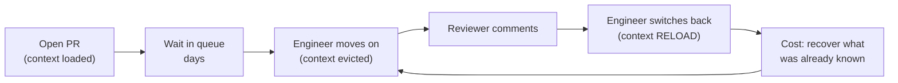

# AI Made You Write Code Faster. That Was Never the Bottleneck.

*The code came out faster and it felt great. Then delivery throughput went down anyway. This isn't a paradox — it's the theory of constraints doing exactly what it always does. When you speed up a non-bottleneck, the queue just moves downstream. And this time it landed on the one stage that needed the most human attention: code review.*

---

## The thing everybody feels but can't explain

If you've used AI coding tools for a few months, you know the feeling. Tasks that used to be an afternoon are done before lunch. Boilerplate writes itself. You're shipping commits faster than you ever have.

And then you look at the team's actual delivery — features reaching production, incidents closed, things that stayed shipped — and the line is flat, or worse. Some teams' throughput went *down*.

This isn't vibes. There's research behind it now. In a 2025 study, METR ran a randomized trial with experienced open-source developers on their own mature repositories. The result: when they were allowed to use AI, they were **~19% slower** — while believing they were **~20% faster**. A perception gap of nearly 40 points. DORA's 2024 report found a related pattern at the org level: AI adoption correlated with **reduced delivery throughput** and **increased instability**.

The intuition "faster at typing = faster at shipping" is wrong, and it's wrong for a reason that predates AI by decades. Speeding up one stage of a pipeline cannot speed up the pipeline. Only the bottleneck controls throughput. This is Eliyahu Goldratt's **theory of constraints**, and the AI coding era is the largest uncontrolled experiment in bottleneck-shifting the industry has ever run.

---

## The old bottleneck, and why it was never typing

Picture a software delivery pipeline as a chain of stages:

```
  idea → design → write code → review → test → merge → deploy → operate
```

Every stage has a capacity — how much work per unit time it can move. The **slowest** stage is the bottleneck, and the whole system's throughput is capped at the bottleneck's capacity. **Everything upstream of the bottleneck just accumulates as inventory.** Work-in-progress grows. Nothing downstream moves faster.

For most healthy teams, "write code" was *not* the slowest stage. It never was. Typing was never scarce. What was scarce, and is still scarce, is:

- **Understanding** — knowing what the right change is.
- **Verification** — proving the change is correct and safe.
- **Integration** — getting it reviewed, tested, merged, deployed, and trusted.

AI is very good at generating code. That's the stage that just got 5–10x cheaper. But "write code" was a *non-bottleneck* stage. And here is the rule that makes all of this feel like a betrayal:

> **Optimizing a non-bottleneck does not increase throughput. It increases the queue in front of the bottleneck.**

You didn't speed up the pipeline. You built a bigger pile of unreviewed code sitting in front of the stage that was already the slowest one.

---

## The bottleneck moved to code review

That's the first shift, and it's structural. The faster code arrives, the more pressure lands on the next human stage. Review doesn't scale with generation speed. If anything, it scales *against* it: more code arriving means more to read, more to trust, and more surface area for bugs — while the reviewer's attention per PR doesn't change at all.

So the pipeline looks like this now:

```
  write code  ████████████████  (fast — AI helped)
  review      ████░░░░░░░░░░░░  (slow — humans, unchanged, now overloaded)
  → a growing queue of open, unreviewed PRs accumulates
```

This is Little's Law, and it's merciless:

```
  cycle time = work-in-progress / throughput
  WIP ↑   while throughput is fixed at the bottleneck
  ⇒ cycle time ↑
```

Raise WIP and you don't ship more — you ship the *same amount*, later. Every PR sits longer. Every feature reaches production further from when it was written, which means it's staler, harder to reconcile with `main`, and more likely to have drifted from what was actually needed.

But the queue itself isn't even the worst part. The worst part is what happens when a human has to *clear* it.

---

## The tax nobody charts: the review round-trip

Here's the loop that actually kills throughput, and it's the one teams never measure. It goes like this:

1. An engineer writes a PR and opens it for review. It goes into the queue.
2. Reviewers are backed up, so it sits for **a day, three days, a week.**
3. The engineer is told not to sit idle — so they **move on to the next task.** Context builds up around something new.
4. Days later, a reviewer finally opens the PR and leaves comments.
5. Now the engineer has to **switch back to the old PR** to address them.

And step 5 is where the real cost hides. The engineer is no longer holding that code in their head. They wrote it in a different mental context, days ago, and have since fully loaded a new one. To respond to review feedback they have to:

- **Re-read their own diff** to reconstruct what they did and why.
- **Rebuild the mental model** of that subsystem, the edge cases, the decisions they made.
- Remember the *reasoning* behind choices that aren't visible in the diff — the things they knew at the time and have since forgotten.

This is a **full context reload, paid in the middle of unrelated work.** It's pure overhead — it produces no new value, only the recovery of context that was thrown away by the delay itself. In the memory analogy: the review delay forced a cache eviction, and the round-trip is a hard miss that stalls the CPU.



**Two interruptions, and only one of them is the one you planned for.** The engineer got interrupted to *address review* — but they also got interrupted *to start a new task* when the PR stalled. The second interruption is the one that erases the context the first one needed.

---

## Why it also stops the current work

The subtle damage is that step 5 doesn't just cost time — it **suspends the work that's currently in flight.**

When the engineer switches back to the stale PR, the task they were actively doing also gets evicted. Now *that* task will need a context reload later too. One delayed review doesn't cost one reload; it seeds a **cascade** of them. Every PR that sits in the queue becomes a future interruption to whatever is being worked on when its review lands.

Chain enough of these and the team reaches a state where **nobody is ever fully working on anything.** Everyone is at 60% context on three things, constantly swapping. The output looks busy. The throughput is terrible. This is the "psychosis" the whole industry is living in: the dashboard says commits are up, everyone *feels* fast, and the thing that actually matters — integrated, shipped, trusted value — is quietly falling.

The queue doesn't just delay work. **It fragments attention across the whole team.**

---

## Why AI makes it uniquely worse

Plenty of pipelines have had review bottlenecks forever. AI makes this particular failure mode sharper in three ways:

- **Volume.** Generation speed multiplies the number of PRs, but reviewer capacity is fixed. The queue grows faster than any team can drain it. More inventory, same bottleneck.
- **Comprehension debt.** When a human writes code, they (usually) understand it. When AI generates it, the *author* may only half-understand it — which means the reviewer is now the first person to actually think hard about it. The review load went *up* per line, not down.
- **False confidence.** Because it *felt* faster, nobody added review capacity, WIP limits, or smaller-batch discipline. The system got more input with no new constraint on the input. That's how you overload the one stage you can't scale by typing.

The tool wasn't the problem. Applying a throughput fix to a non-bottleneck stage, without touching the bottleneck, was.

---

## Quality is the second casualty — and flaky tests are the symptom

There's a version of this story where the queue clears and everything's fine. That's not the version happening. While throughput flatlines, **quality slides** — and the most visible symptom is the one every team now complains about: the test suite that can't be trusted.

**DORA's finding wasn't just lower throughput. It was higher instability** — more change failures, longer recovery. That's the second-order cost of generating change faster than you can verify it. Green CI stops meaning "this works" and starts meaning "this happened to pass this time."

Flaky tests are the fingerprint of quality being produced faster than it's understood:

- **Tests that pass to satisfy the tool, not the behavior.** Generated tests often assert whatever the code currently does rather than what it *should* do. They encode the bug as the expectation. They're green, and they're wrong.
- **Nondeterminism the author never reasoned about.** Real clocks, real network, shared state, ordering assumptions, unseeded randomness, `setTimeout` races. Nondeterminism is exactly what you catch by *thinking hard* about the code — the step that got skipped when the code was generated.
- **Retries as a coping mechanism.** When CI goes red, the fastest path to a green check is re-running it. "Flaky, just rerun" becomes institutional. Now the suite has taught the team to **ignore red**, which is the single most expensive thing a test suite can do.
- **Test volume without test value.** More tests, generated fast, covering shapes rather than invariants. Coverage goes up; confidence goes down.

### How flaky tests feed the bottleneck

This isn't a separate problem from the review queue — it's fuel on the fire. A flaky test **blocks the PR it's running on**, so:

```
  PR is ready → CI goes red (flaky, not real)
    → rerun... rerun... wait
      → review is delayed further
        → author moves on (context evicted)
          → review lands days later
            → ANOTHER context reload
```

Every flake is an extra queue delay, an extra context switch, and one more reason the author stopped trusting the pipeline. Flakiness doesn't just waste CI minutes — **it lengthens the review round-trip**, which is the exact tax we started with. Quality and throughput aren't two problems here. They're the same bottleneck, wearing two hats.

The root cause is identical: **changes are being produced faster than they're being understood.** Unverified generation doesn't just create a review backlog. It creates a trust backlog.

---

## What actually moves the line

If review is the bottleneck, then the only interventions that matter are the ones that attack review — and the ones that stop feeding it faster than it can drain.

1. **Cap work-in-progress.** A hard limit on open, unreviewed PRs. When the queue is full, stop generating new work and go clear it. This is the counterintuitive move AI makes *necessary*: sometimes the highest-leverage thing you can do is **write less code**.
2. **Shrink the batch.** Small PRs review in minutes and reload cheaply when they bounce. A 2,000-line AI-generated PR is a context-reload bomb for both author and reviewer. Smaller batches shorten the queue *and* raise review throughput.
3. **Review before generating more.** Make the review queue a first-class stage with its own capacity, not an afterthought. If throughput is capped there, that's where you invest.
4. **Shorten the round-trip.** The longer a PR sits, the worse the reload tax. A same-day review is two cheap context loads; a two-week-old review is an expensive archaeology project. Latency in the queue is a multiplier on the cost of clearing it.
5. **Treat flaky tests as a throughput bug, not a CI nuisance.** A flake is a queue delay and an interruption. Quarantine it, fix it, or delete it — never teach the team to rerun past it.
6. **Measure the right thing.** Not commits, not PRs opened, not "time to first line of code." Measure **cycle time**, **review queue depth**, and **change failure / flake rate**. The feeling of speed and the fact of throughput are different quantities, and only one of them is on the P&L.

---

## The takeaway

AI coding feels faster because it *is* faster — at the stage that was never the constraint. It makes code cheap and review expensive, quality cheap and trust expensive, and it moves the bottleneck onto the only resource you can't multiply: human attention. The flaky test that nobody trusts isn't a side effect of this — it's the sound of the queue overflowing.

The fix was never "type faster." It's the same thing it's always been: **find the real bottleneck, protect it, and stop drowning it in inventory.** The industry keeps measuring the speed of the non-bottleneck and calling it progress. That's not a paradox. That's a queue.

---

*The perception-vs-reality data draws on METR's 2025 randomized trial on experienced open-source developers and DORA's 2024 Accelerate State of DevOps report. The throughput framing is Eliyahu Goldratt's theory of constraints; the queue mathematics is Little's Law.*
