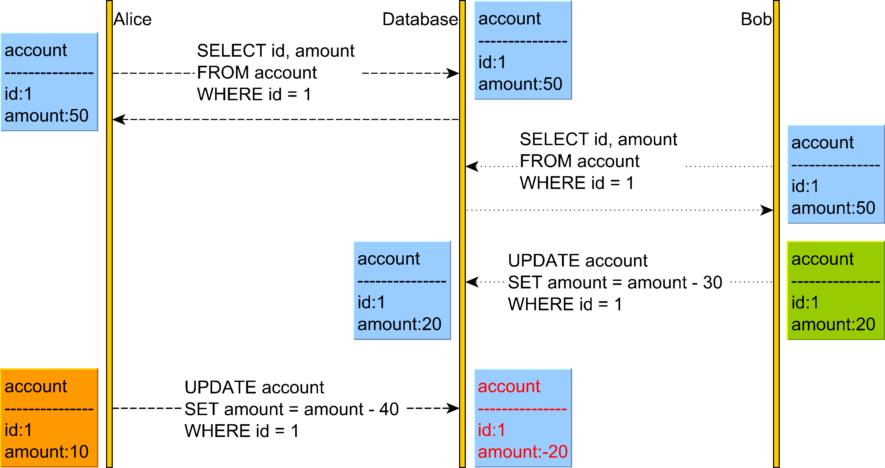
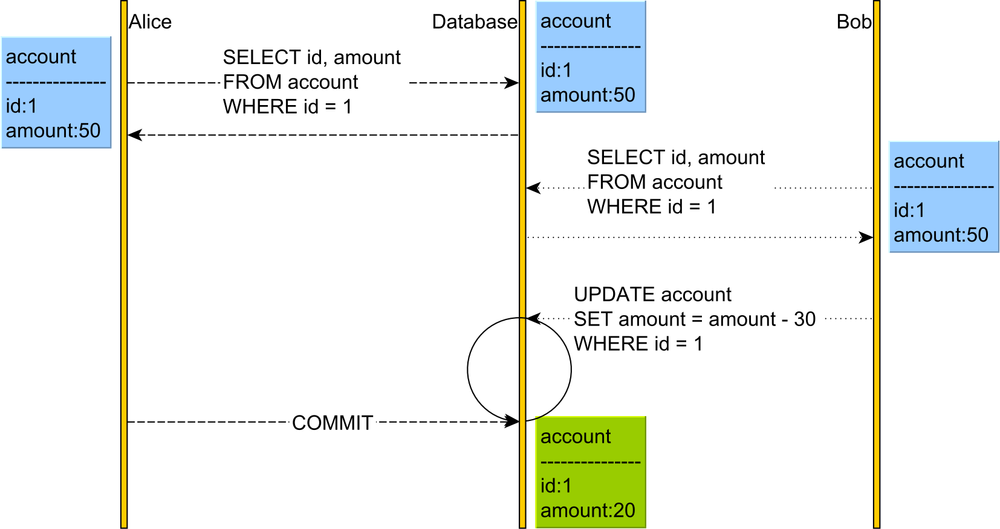
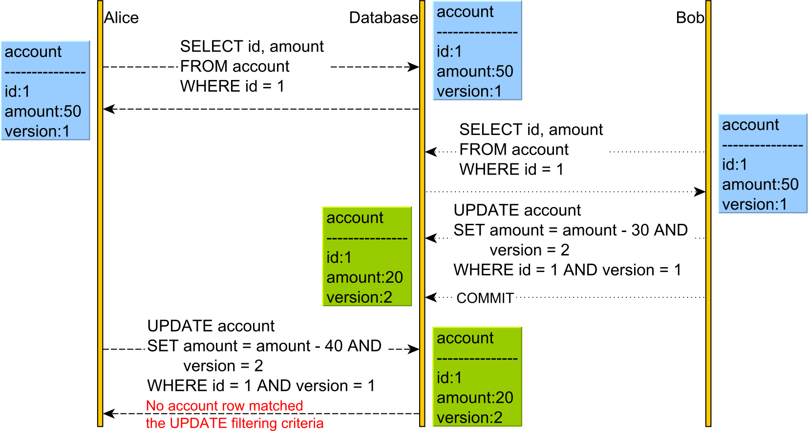
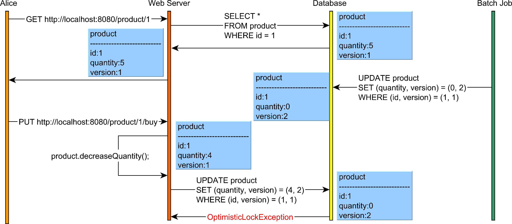

# Optimistic vs. pessimistic locking — Vlad Mihalcea

*Captured notes on [Vlad Mihalcea, "Optimistic vs. Pessimistic Locking"](https://vladmihalcea.com/optimistic-vs-pessimistic-locking/) (March 24, 2021). Kept because the framing is the cleanest short version of the argument: the two strategies are bets about the cost of retrying versus the cost of waiting.*

## TL;DR

> Pessimistic locking is suitable when the cost of retrying a transaction is very high or when contention is so large that many transactions would end up rolling back if optimistic locking were used.
>
> On the other hand, optimistic locking works even across multiple database transactions since it doesn't rely on locking physical records.
>
> — [Vlad Mihalcea](https://vladmihalcea.com/optimistic-vs-pessimistic-locking/)

Two clauses, each answering a different question:

- **Is a losing attempt expensive, or is contention high enough that most attempts would lose?** Pessimistic control: make them queue, because retrying costs more than waiting.
- **Does the work span more than one database transaction?** Optimistic control: a lock dies with the transaction that took it, while a version token lives in the client and can be checked later.

The article explains the two strategies through one anomaly — the lost update — and then adds the case that decides most real systems: reads and writes that do not share a database transaction at all.

## The framing: collisions on a network

The article opens with a comparison from networking, and it is the reason the note is worth keeping:

- **Ethernet** deals with collisions by **detect and retry**. Transmitters send, notice the collision, back off, and try again.
- **Wi-Fi** deals with collisions by **avoiding them**: a station listens and waits for a clear channel before transmitting.

Databases face the same choice:

| Strategy | Network analogue | Database mechanism |
| --- | --- | --- |
| Let the conflict happen, detect it at commit, retry | Ethernet | Optimistic locking (version check) |
| Prevent the conflict by blocking the other writer | Wi-Fi | Pessimistic locking (row locks) |

The decision rule that falls out of it: **if the cost of retrying is high, avoid the conflict; if conflicts are rare, let them happen and detect them.** Everything in the rest of the article is that sentence with examples.

## The lost update anomaly

Under `READ COMMITTED`, two transactions can interleave their reads and writes so that one update disappears.

| Step | Alice | Bob | `account` row |
| --- | --- | --- | --- |
| 1 | `SELECT amount WHERE id = 1` → `50` | | `amount = 50` |
| 2 | | `SELECT amount WHERE id = 1` → `50` | `amount = 50` |
| 3 | | `UPDATE ... SET amount = amount - 30` and commits | `amount = 20` |
| 4 | `UPDATE ... SET amount = amount - 40` | | `amount = -20` |

Alice believed the balance was `50`, so withdrawing `40` should leave `10`. Instead the row is at `20` when her write lands, and the result is `-20`. Bob's `-30` did not literally vanish from the arithmetic — but Alice's decision was based on a value that was no longer true, so the outcome is not any serial order of the two transactions. The schedule is not serializable: it is neither Alice-then-Bob nor Bob-then-Alice.

That last point is the article's real definition of the bug. A lost update is **a read whose result was used after it stopped being true**. The clobbered write is the symptom; the stale decision is the bug.

## Pessimistic locking

The article prevents the conflict by locking the row when it is read.

| Step | Alice | Bob | `account` row |
| --- | --- | --- | --- |
| 1 | `SELECT ... FOR UPDATE` → `50`, holds a lock | | `amount = 50` |
| 2 | | `SELECT ... FOR UPDATE` → `50`, holds a lock | `amount = 50` |
| 3 | | `UPDATE ... SET amount = amount - 30` **blocks** | `amount = 50` |
| 4 | `COMMIT` → `20` | | `amount = 20` |
| 5 | | update proceeds | `amount = -10` |

Because a write needs an exclusive lock and the other transaction holds a lock on the same record, Bob waits. The interleaving that produced the anomaly cannot happen: the two updates are forced into *some* serial order.

The engine notes in the article:

- **SQL Server** acquires the shared locks automatically at `REPEATABLE READ` or `SERIALIZABLE`, because it uses two-phase locking (2PL) by default.
- **MySQL** uses pessimistic locking at `SERIALIZABLE`, and optimistic control (MVCC) at the less strict levels.
- **PostgreSQL** is not mentioned, but the practical equivalent is `SELECT ... FOR UPDATE` at `READ COMMITTED`; plain reads under MVCC do not lock.

## Optimistic locking

Optimistic locking lets the conflict happen and detects it at write time. The article uses a **logical clock** — a `version` column — rather than a physical one (a timestamp), because logical versions are monotonic and do not depend on clock agreement between nodes.

| Step | Alice | Bob | `account` row |
| --- | --- | --- | --- |
| 1 | `SELECT ...` → `amount 50, version 1` | | `amount 50, version 1` |
| 2 | | `SELECT ...` → `amount 50, version 1` | `amount 50, version 1` |
| 3 | | `UPDATE ... WHERE id = 1 AND version = 1` sets `version = 2`, commits | `amount 20, version 2` |
| 4 | `UPDATE ... WHERE id = 1 AND version = 1` | | matches **0 rows** |
| 5 | `OptimisticLockException` → rollback | | `amount 20, version 2` |

The mechanism is three rules in one statement:

1. The `WHERE` clause carries the **expected** version (the snapshot that was read).
2. The `SET` clause increments the version, so every write is a new snapshot.
3. A zero-row result means the snapshot is stale, so the transaction rolls back.

The version is also used for `DELETE`, not only `UPDATE` — a stale delete is the same anomaly with a different verb.

In JPA/Hibernate this surfaces as `OptimisticLockException`; the raw signal is `PreparedStatement.executeUpdate()` returning `0`. The framework is doing something simple: running one conditional `UPDATE` and treating zero rows as a conflict.

### MVCC is optimistic locking inside the engine

The observation that makes the two strategies feel less like opposites:

> Oracle, PostgreSQL, and the InnoDB MySQL engine use MVCC, which is based on optimistic locking. In MVCC, readers don't block writers and writers don't block readers, allowing conflicts to occur. However, at commit time, conflicts are detected by the transaction engine and the conflicting transactions are rolled back.

So the common case in PostgreSQL is already optimistic: reads are snapshots, and a conflicting write fails at commit (`40001`) rather than blocking at read time. `FOR UPDATE` is the escape hatch you reach for when you want to opt *out* of that and wait instead.

## Application-level transactions and long conversations

This is the section that decides most web systems, and it is why the article reaches past JDBC into application design.

The classic setup assumes reads and writes happen inside one database transaction. On the web they usually do not: a `GET` renders a form, the user thinks for two minutes, a `PUT` saves it. Those are two requests, two transactions, and no lock can span them without holding a database lock across human think time.

| Step | Actor | Action | `product` row |
| --- | --- | --- | --- |
| 1 | Alice | `GET /product/1` → `quantity 5, version 1` | `quantity 5, version 1` |
| 2 | Batch job | `UPDATE ... SET (quantity, version) = (0, 2) WHERE (id, version) = (1, 1)` | `quantity 0, version 2` |
| 3 | Alice | `PUT /product/1/buy` → `decreaseQuantity()` on the stale snapshot | |
| 4 | Web server | `UPDATE ... SET (quantity, version) = (4, 2) WHERE (id, version) = (1, 1)` | matches **0 rows** |
| 5 | Web server | `OptimisticLockException` → `409`/`412` to Alice | `quantity 0, version 2` |

The diagram shows the version travelling all the way to the client and back. That is the whole trick: **the version is part of the state the user is editing**, so a save can prove which snapshot it is based on. Pessimistic locking cannot express this, because there is no transaction to hold the lock in.

## Review: what holds up, and what to add

Worth keeping as-is:

- **The collision analogy is the right mental model.** It explains *why* there are only two strategies; most treatments present them as two libraries.
- **The long-conversation section is the strongest part.** It is the case people get wrong most often: they reach for `SELECT ... FOR UPDATE` and then discover that the "transaction" spans two HTTP requests and a coffee break.
- **The MVCC observation is underrated.** Most "should we use optimistic or pessimistic?" debates in PostgreSQL are really "do you want the default MVCC behaviour, or do you want to override it for this one statement?"
- **Logical clock over physical clock.** A version column avoids clock skew and ABA; a timestamp does not.

Worth adding when applying it:

1. **The diagrams assume no lock conversion deadlock.** In strict 2PL, if both readers hold shared locks and both then try to upgrade to write a lock, they block each other — a conversion deadlock, not a clean wait. The pessimistic diagram is idealized. In practice, use `SELECT ... FOR UPDATE` (exclusive) when you know you are about to write, so readers queue on one lock, and use consistent lock ordering when several rows are involved.
2. **Locking orders the writes; the business rule still needs its own check.** The pessimistic schedule still ends at `-10`. Serialization prevents the *lost update*; it does not enforce "no overdraft". That needs a `WHERE amount >= 40` condition (or a domain check inside the transaction). A lock makes the check reliable; it does not replace it.
3. **`SELECT ... FOR UPDATE` on a missing row locks nothing in PostgreSQL.** No gap lock means a concurrent insert can slip past. Unique constraints, advisory locks, or `SERIALIZABLE` cover the phantom case that the article does not discuss.
4. **Retry needs jitter, a cap, and idempotency.** The article says "detect and retry" but does not cover the retry loop. Without jitter, losers re-collide; without a cap, a hot row becomes a retry storm (the `N²` work problem); without idempotency, a retry with external side effects duplicates work. See [01g — Idempotency](../../architecture/01g-idempotency.md).
5. **The optimistic path wastes the work already done.** The loser computed something and throws it away. That is fine for a small update; it is expensive for a long calculation, which is another reason "cost of retrying" is the right axis.
6. **An atomic statement often beats both mechanisms.** When the invariant is a single statement (`SET amount = amount - 40 WHERE amount >= 40`), there is no read-modify-write window to protect. The article stays at the JPA level; this option is worth adding.
7. **Distributed locks introduce a failure mode neither diagram shows.** A lease can expire while its holder is still alive, so a "pessimistic" lock across services needs fencing tokens to be safe. See [Kleppmann](https://martin.kleppmann.com/2016/02/08/how-to-do-distributed-locking.html).
8. **The optimistic check must live in the write statement.** Hibernate does this for you. Hand-written SQL often does not: a `SELECT` for the version followed by an unconditional `UPDATE` is still a lost update, with extra steps.

## Where this fits

- The **mechanism** — a `version` column and `SELECT ... FOR UPDATE` — is the minimal version in [Layered architecture, §24](../../architecture/02-layered-nuances.md#24-optimistic-vs-pessimistic-locking).
- The **long conversation** is the same problem as [cross-aggregate transactions](../domain-driven-design-ddd/cross-aggregate-transactions-and-rollback.md): once there is no shared transaction, "rollback" becomes a business state transition, and "locking" becomes a version or a reservation. The cross-request case has its own note: [Concurrency control across requests](03-cross-request-concurrency-control.md).
- The **schedule itself**, explained as a transaction boundary rather than a lock, is in [What a transaction guarantees](02-what-a-transaction-guarantees.md).

## Reference

- Vlad Mihalcea, [*Optimistic vs. Pessimistic Locking*](https://vladmihalcea.com/optimistic-vs-pessimistic-locking/), March 24, 2021 — diagrams reproduced here from the article, with attribution.
- Vlad Mihalcea, [*Preventing Lost Updates in Long Conversations*](https://vladmihalcea.com/preventing-lost-updates-in-long-conversations/) — the expanded version of the last section.
- Vlad Mihalcea, [*How does MVCC work*](https://vladmihalcea.com/how-does-mvcc-multi-version-concurrency-control-work/) — why readers do not block writers.
- Vlad Mihalcea, [*Logical vs. physical clock for optimistic locking*](https://vladmihalcea.com/logical-vs-physical-clock-optimistic-locking/) — why a version beats a timestamp.
