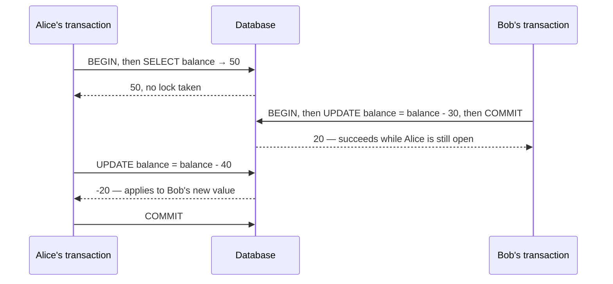
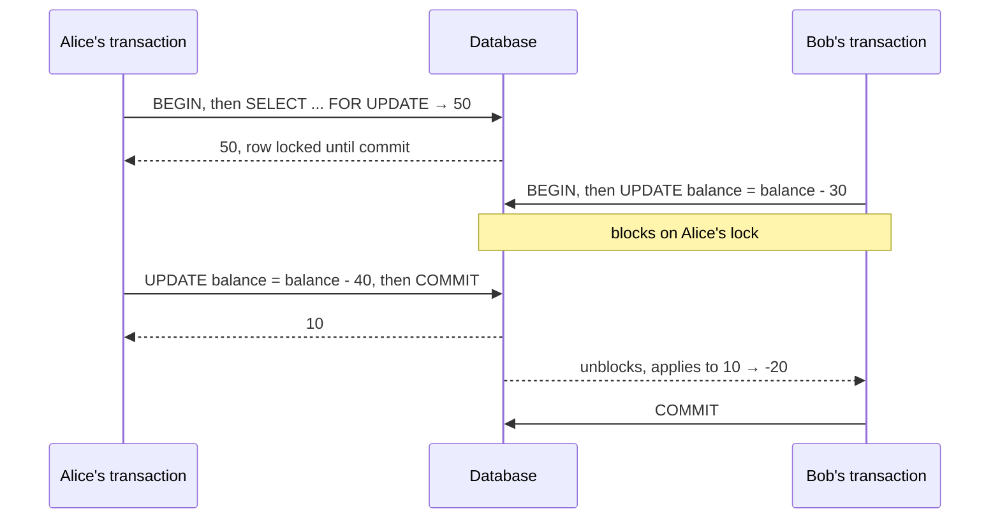

# What a transaction guarantees

*A transaction gives you an atomic commit: all of its statements land or none do. It does not give you the rows. Another transaction can read, change, and commit the same record while yours is open — and the first place that shows up is a decision you made from a value that had already moved.*

The confusion is natural, because `BEGIN … COMMIT` reads like "reserve this work for me". It reserves the *commit*, not the *data*. Those are two different guarantees, and only one of them is automatic.

## Atomicity is about the commit; isolation is about other transactions

ACID is four promises, and they are not a package deal:

| Letter | Promise | Is it negotiable? |
| --- | --- | --- |
| **A**tomicity | All statements commit, or none do | Always on |
| **C**onsistency | Constraints hold at commit | Enforced by the schema, not by the transaction |
| **I**solation | How much other transactions can see and change | **Configurable**, and weaker than most people assume |
| **D**urability | A committed write survives a crash | Always on |

`BEGIN` buys you `A` and `D`. `I` is the setting you choose, and at the default level — `READ COMMITTED` in PostgreSQL, Oracle, and SQL Server — it permits a lot.

So the accurate version of the intuition is:

> A transaction is a boundary for **what commits together**. It is not a boundary for **who else may touch the same rows**.

## A schedule: the same row, two transactions

Alice and Bob touch `account` 1. Both wrap their work in a transaction, and nothing blocks.



| Step | Alice | Bob | Row |
| --- | --- | --- | --- |
| 1 | `BEGIN; SELECT balance` → `50` | | `50` |
| 2 | | `BEGIN; UPDATE ... - 30; COMMIT` | `20` |
| 3 | `UPDATE ... - 40` | | `-20` |
| 4 | `COMMIT` | | `-20` |

Alice's transaction was atomic: both of her statements committed, or neither would have. Bob's was atomic too. Neither transaction was *exclusive*, and the interleaving produced a result that no serial order of the two would produce.

Notice what did **not** happen: Alice's `UPDATE` did not fail, and nothing warned her that the base value had changed. The engine had no reason to object — it had never been asked to protect that read.

## The engine does lock — from the write onward

The lock exists, but it arrives later than people expect.

- A plain `SELECT` takes **no row lock** in PostgreSQL, MySQL/InnoDB, and Oracle at their default MVCC levels. Their readers do not block writers and are not blocked by them.
- The **first write** to a row takes an exclusive lock, and that lock is held **until commit**.
- A second transaction that writes the same row **blocks** until the first commits.

So write-write collisions on an existing row are already serialized. What is *not* serialized is the read that came before the write. That is the whole gap.

What the second writer sees when it unblocks depends on the isolation level:

| Level | Behaviour of the blocked `UPDATE` |
| --- | --- |
| `READ COMMITTED` (PostgreSQL default) | Waits, then re-reads the new row version and re-applies the statement. The write succeeds. |
| `REPEATABLE READ` (PostgreSQL) | Fails with `40001 could not serialize access due to concurrent update`; the transaction must retry. |
| `SERIALIZABLE` | Conflicting transactions abort with `40001`; retry. |
| SQL Server `READ COMMITTED` | Reads take shared locks for the statement; writers block readers. |

That table explains two very different outcomes from the same code:

```sql
-- Relative: safe from a lost update. Applies to whatever the row says now.
UPDATE account SET balance = balance - 40 WHERE id = 1;

-- Absolute: Alice computed this from the stale 50. Bob's -30 is destroyed.
UPDATE account SET balance = 10 WHERE id = 1;
```

The second form is the classic lost update, and no amount of "it's in a transaction" fixes it. The first form is arithmetically correct but can still produce a non-serializable outcome — `-20` — because Alice's decision to withdraw 40 was made when the balance was 50.

## Three collisions, one of which the transaction already handles

| Collision | Does the implicit write lock help? | What you need |
| --- | --- | --- |
| Two writes to the **same row**, both after their reads | Yes, the second blocks or aborts | Nothing extra |
| A write based on a **stale read of that row** | No — the decision predates the lock | `SELECT ... FOR UPDATE`, a version check, or a conditional write |
| Writes to **different rows** that share an invariant | No — the two locks do not overlap | `SERIALIZABLE`, a lock on a common row, or an advisory lock |

The third row is write skew: two doctors each read "2 on call" from *different* rows, each update their own row, and the invariant `count >= 2` is violated. Two transactions, two rows, two perfectly valid locks.

## What the transaction does protect

To be fair to the mechanism, inside one transaction you do get:

- **Atomic commit.** Every statement lands or none does. A failure halfway leaves no partial state.
- **Your own writes are visible to you.** `INSERT` then `SELECT` in the same transaction sees the row.
- **No dirty reads.** At every level above `READ UNCOMMITTED`, you never see another transaction's uncommitted work.
- **Write-write ordering on the same row.** Once you write, nobody else writes that row until you finish.
- **A stable snapshot, if you ask for it.** `REPEATABLE READ` keeps your reads consistent; it just does not stop others from writing, and it will abort you if they do.

The guarantee you were imagining — "this row is mine while I work with it" — is exactly `SELECT ... FOR UPDATE`. That is a different tool, and it is opt-in.

## With a lock, the schedule changes



| Step | Alice | Bob | Row |
| --- | --- | --- | --- |
| 1 | `BEGIN; SELECT ... FOR UPDATE` → `50` | | `50`, locked by Alice |
| 2 | | `UPDATE ... - 30` **blocks** | `50` |
| 3 | `UPDATE ... - 40; COMMIT` | | `10` |
| 4 | | unblocks, applies `- 30` | `-20` |

The anomaly is gone: the two updates now happen in a definite order, and Alice's read was true when she used it. The balance is still negative, because serialization orders the writes but does not enforce "no overdraft" — that needs a `WHERE balance >= 40` condition or a check inside the transaction.

## Where the intuition comes from

The belief that a transaction reserves its rows is not stupid; it is inherited.

- **Two-phase locking.** SQL Server, DB2, and MySQL at `SERIALIZABLE` take shared locks on reads and hold lock-based isolation for the transaction. On those engines the intuition is close to true, so tutorials written there teach it.
- **MVCC engines inverted the default.** PostgreSQL, Oracle, and InnoDB at `READ COMMITTED`/`REPEATABLE READ` let readers run free. The lock moved to write time.
- **ORM units of work.** A `SaveChanges()` / `flush` presents the transaction as "the object graph I am editing", which sounds like ownership.
- **The advice itself.** "Wrap it in a transaction" is repeated as if it were the whole answer, and it addresses atomicity only.

The same shapes appear in the JDBC article captured in this folder: on SQL Server, the read acquires a lock; in PostgreSQL, the equivalent needs `FOR UPDATE` written explicitly.

## What actually provides exclusivity

| Mechanism | Scope | Held until | Protects against |
| --- | --- | --- | --- |
| `SELECT ... FOR UPDATE` | Rows the query matched | `COMMIT`/`ROLLBACK` | Others writing or locking those rows |
| `SELECT ... FOR SHARE` | Rows the query matched | `COMMIT`/`ROLLBACK` | Others writing those rows |
| Implicit write lock | The row being written | `COMMIT`/`ROLLBACK` | Concurrent writes to the same row |
| `pg_advisory_xact_lock(key)` | A logical key, existing row or not | `COMMIT`/`ROLLBACK` | Anything using the same key |
| Unique / exclusion constraint | Enforced by the index | Forever | Duplicate or overlapping facts |
| `SERIALIZABLE` | The transaction | `COMMIT`/`ROLLBACK` | Non-serializable schedules, including write skew |

Two properties of locks cause most of the remaining surprises:

1. **Locks cover the rows the statement matched, not the rule you care about.** `SELECT ... FOR UPDATE` on a row that does not exist locks nothing, which is why phantom inserts need a unique index or an advisory lock.
2. **Locks are held to commit, not to the end of the statement.** That is why a transaction containing a network call holds a row for as long as the call takes.

## The same mistake at larger scales

Once you see it, the pattern repeats:

- **Two repository calls, two transactions.** The application service looks atomic; the two commits are independent. See [cross-aggregate transactions](../domain-driven-design-ddd/cross-aggregate-transactions-and-rollback.md).
- **Two HTTP requests.** A `GET` and a `PUT` are separate transactions, so there is no unit to be atomic about. See [concurrency control across requests](03-cross-request-concurrency-control.md) and the long-conversation case in [the Vlad Mihalcea capture](01-vlad-mihalcea-optimistic-vs-pessimistic-locking.md).
- **Two services.** No shared transaction at all; consistency is a workflow with compensation, not a lock.

In each case the mistake is identical: assuming that the unit of work is also the unit of exclusion.

## Checklist

When you write `BEGIN`, ask:

- [ ] Which rows does this transaction **read**, and could another transaction change them before I use the value?
- [ ] Does any write depend on a value read earlier in the transaction?
- [ ] Do two transactions write **different rows** while sharing an invariant?
- [ ] Could a row I checked for be **inserted** by someone else?
- [ ] Have I taken the lock **before the read** that matters, not after?
- [ ] Which isolation level am I actually running at — the default, or the one I think I set?
- [ ] Is this really one transaction, or do my repositories open their own?

## Rules of thumb

- **A transaction is a commit boundary. A lock is an access boundary.**
- **`BEGIN` protects the outcome, not the input.** If a decision depends on a value, lock the value or check it in the write.
- **Locks arrive at write time, and that is one statement too late.** Take the lock at read time when the read drives the write.
- **Two locks on two rows do not protect one rule.** Cross-row invariants need `SERIALIZABLE` or a shared key to lock.
- **The stronger the isolation, the more the engine asks you to retry.** Budget for `40001` whenever you ask for more than the default.

## See also

- [Captured: Optimistic vs. pessimistic locking — Vlad Mihalcea](01-vlad-mihalcea-optimistic-vs-pessimistic-locking.md) — the same schedule in the article's diagrams.
- [Layered architecture, §23 — Isolation levels](../../architecture/02-layered-nuances.md#23-isolation-levels) — what each level permits, anomaly by anomaly.
- [Cross-aggregate transactions and rollback](../domain-driven-design-ddd/cross-aggregate-transactions-and-rollback.md) — the version of this mistake that spans aggregates.

## References

- PostgreSQL documentation, [*Transaction Isolation*](https://www.postgresql.org/docs/current/transaction-iso.html) — the anomaly table, `READ COMMITTED` re-evaluation, and `40001`.
- PostgreSQL documentation, [*Explicit Locking*](https://www.postgresql.org/docs/current/explicit-locking.html) — row locks and why plain reads take none.
- Martin Kleppmann, [*Designing Data-Intensive Applications*](https://dataintensive.net/), ch. 7 — atomicity versus isolation, and the anomalies isolation levels permit.
- Martin Fowler, [*Unit of Work*](https://martinfowler.com/eaaCatalog/unitOfWork.html) — the pattern that makes a transaction feel like ownership of the object graph.
