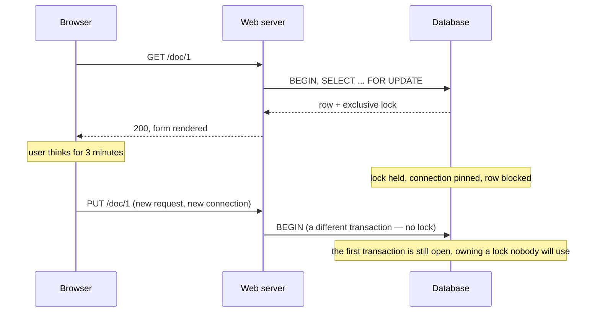
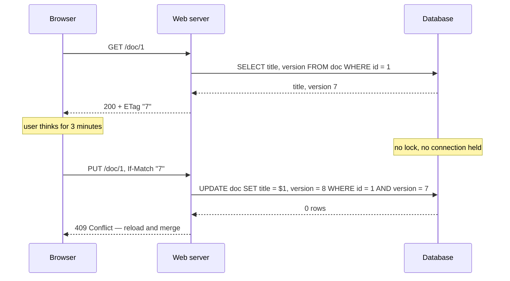

# Concurrency control across requests

*A row lock lives as long as the transaction that took it. When one unit of user intent spans two requests, the lock and the intent stop lining up: the first request ends, the lock goes with it, and the second request starts a fresh transaction that knows nothing about what the user saw. The version token is what carries the guarantee across that gap.*

## The gap between two calls

The problematic shape is familiar:

```text
GET  /products/1        → reads quantity: 5
        ...  user thinks, decides, opens another tab, goes to lunch ...
POST /products/1/buy    → acts on the quantity it saw
```

Two requests, two transactions, and a delay in between. The first transaction has committed and released everything before the second one starts. Nothing in the second request knows that the first one happened, and nothing it does can retroactively reserve the row the first one read.

The delay is the point. In-request work is measured in milliseconds; human deliberation is measured in tens of seconds to minutes.

| Phase | Typical duration |
| --- | --- |
| One request's database work | 5–50 ms |
| Payment or third-party call inside a request | 200 ms – 2 s |
| User reading a screen and deciding | 10 s – 5 min |
| User leaving a tab open overnight | hours |

At 20 ms of work and two minutes of think time, the gap is about **6,000×** longer than the lock would ever be held inside a single request.

## Why the lock cannot travel

The instinct is to hold the lock between the calls. That means keeping a database transaction open while the user thinks, which is possible — pin a connection and leave the transaction uncommitted — and it is how a row lock becomes an outage.



It fails in five independent ways:

1. **Throughput collapses on the contested row.** One editor at a time, at human speed. With a two-minute think time, the row supports roughly `1/120` operations per second instead of `1/0.02 = 50`. Ten editors on the same record wait twenty minutes each.
2. **The connection pool becomes the user's hostage.** Each open transaction holds a connection. With a 20-connection pool, ten people mid-edit remove half the pool while doing no work — and unrelated requests start queueing behind them.
3. **The lock is not tied to the user.** If the tab closes, the lock stays. It belongs to a transaction on a server, not to Alice. You need a timeout, a sweeper, or a restart, and each of those has its own failure mode.
4. **Every operational event breaks it.** Deploys, restarts, failovers, load-balancer idle timeouts, and `idle_in_transaction_session_timeout` all kill the transaction — and with it the guarantee the user thought they had.
5. **Long transactions are expensive even when idle.** In PostgreSQL an open transaction holds back the `xmin` horizon, so vacuum cannot reclaim dead tuples and the table bloats. A parking lot of open edit sessions is a slow storage leak.

Distributed locks do not rescue this. A Redis lock with a two-minute TTL is the same bet with a different failure mode: the TTL expires, the process resumes, and two writers proceed.

## The optimistic answer: carry the snapshot

Instead of holding the row, send its identity to the client and check it on return.



The token is the whole mechanism. It holds no resources, expires by itself, and proves exactly one thing: *this write is based on version 7*. If the row is still at 7, the write lands. If it moved, the write is rejected and the user's work can be preserved and merged.

The comparison is stark:

| | Pessimistic across requests | Optimistic across requests |
| --- | --- | --- |
| Resources held during think time | A row lock, a connection, a transaction | Nothing |
| Cost per editor | Blocks everyone on that row | One extra column and a header |
| Failure on tab close | Lock stuck until timeout | Nothing to clean up |
| Failure on restart | Guarantee silently lost | Guarantee intact (token is in the client) |
| What the user experiences | Waiting for a turn | Occasionally a merge prompt |
| Works across servers/regions | Only with a distributed lock | By construction |

The trade is explicit: you give up *prevention* and get *detection*. What you buy is a critical section that can be as long as the user wants, at a cost of one rejected write.

## Two different problems behind the same 409

Cross-request state shows up in two shapes, and they take different fixes.

### The user is editing the data

Alice is changing a document's title; Bob is changing its body. The user's input *is* the payload, so the server must not silently discard it. Version check, `409`, and a merge or reload — the conflict is real and the user should see it.

Reduce the conflict surface where you can:

- `PATCH` only the fields the user touched, instead of `PUT`-ing the whole resource.
- Field-level versions for large documents, so two people editing different sections do not collide.
- `If-Match` on the `ETag` the client actually rendered.

### The server needs to make a decision

The second request is not saving the user's edit; it is *acting* on data the user saw.

```text
GET  /products/1              → price: 100
POST /orders {product: 1}     → "charge me 100"
```

Here the client's snapshot is an untrusted hint. The server should re-read the price, stock, and permissions **inside the write transaction** and recompute. A stale client copy becomes a validation error (`409` / `422`), not a value the server trusts.

This is the more valuable lesson of the two: **do not accept a decision input from a snapshot.** Re-read it at decision time. A version token is for protecting a user's *work*, not for outsourcing a *check*.

## When the two calls really need exclusion

Sometimes detection is the wrong shape and you need the second caller to be kept out. The answer is a **lease in the data model** — pessimistic control with an explicit owner and an explicit expiry — rather than a database lock.

### Reservations with an expiry

```sql
-- Claim one unit of stock atomically; no lock is held after the statement.
UPDATE inventory
SET reserved = reserved + 1
WHERE sku = $1 AND quantity - reserved >= 1;
-- rowCount = 0 → sold out, or every unit is already reserved
```

The claim itself is a reservation row: `owner`, `expires_at`, and a status. A sweeper returns expired reservations to the pool, and a confirm step converts one into a sale. A cart, a seat hold, and a payment authorization are the same pattern: it survives restarts, spans services, and leaves an audit trail.

### Edit leases with a heartbeat

A CMS that must stop two people from editing the same page at once can use a short lease: `owner`, `acquired_at`, `expires_at`, renewed by the open editor. It is a lock with the failure modes made visible — show "Alice is editing" in the UI, offer force-unlock to an admin, and never let the lease outlive the session by much. This is the honest version of "hold the lock across calls".

### Draft and publish

Split the long window from the shared row: each editor writes a private draft, and publishing merges drafts into the canonical row under a version check. Conflicts drop to publish time and the owner of the published state decides. Wikis, CMSs, and configuration management all use this shape.

### Per-user rows or CRDTs

If the data is genuinely collaborative, model the merge instead of the conflict: per-user rows merged on read, or a CRDT where operations commute. No token, no 409, and no lock — at the cost of a data model that only suits certain content.

## Match the mechanism to the window

| Critical section | Mechanism |
| --- | --- |
| One statement | Atomic conditional `UPDATE ... WHERE` |
| One request, a few milliseconds | Transaction plus `FOR UPDATE` |
| One request with an external call inside | Short lock, or outbox instead of a lock |
| Seconds to minutes of user think time | Version token / `ETag` / `If-Match` |
| Minutes of exclusive intent (seat, stock) | Reservation row with `expires_at` |
| Days of workflow | Saga or state machine with compensation |
| Continuous collaborative editing | CRDT / OT |

The rule underneath: **the mechanism's lifetime has to match the window's lifetime, and the cost has to match the window's frequency.** A lock is affordable for milliseconds; a token is affordable for hours; neither is affordable for both.

## Failure semantics worth getting right

- **`409 Conflict`** for a semantic conflict (the version moved), **`412 Precondition Failed`** for `If-Match` mismatch. Pick one convention and keep it.
- **Return enough to recover.** Send the current version and the changed fields, so the client can show a diff instead of "something went wrong".
- **A retried `PUT` after success must not fail.** The version has already moved, so a naive retry looks like a conflict. Use an idempotency key, or have the client treat an identical-payload retry as success. See [01g — Idempotency](../../architecture/01g-idempotency.md).
- **Never retry a write automatically on 409.** A 409 means the user's intent is stale; only a human or a merge strategy can resolve it. Automatic retry with a fresh version is last-write-wins in disguise.
- **Bound the token's lifetime in policy, not in storage.** Tokens do not expire; if a version is too old to merge sensibly, reject it with a clear "reload" answer.

## Checklist

- [ ] Does the user's intent span more than one request?
- [ ] If so, what carries the snapshot — `version`, `ETag`, or a timestamp? Is it in the response and echoed back?
- [ ] Is the check inside the write statement, or in a separate read?
- [ ] Is this an edit (preserve the input) or a decision (re-read the truth server-side)?
- [ ] Does a retried write after success produce a false conflict?
- [ ] Is there a reservation, lease, or draft that would fit better than a version token?
- [ ] Does anything hold a database transaction open across a user-visible wait?

## Rules of thumb

- **Locks die with the request. Tokens live in the client.**
- **The critical section cannot outlive the process that owns it — so keep the critical section inside one request, or move the ownership into the data.**
- **Pessimism across a human pause becomes a reservation, not a lock.**
- **A version token protects a user's work; a server-side re-read protects a decision.**
- **Cost is per call, not per row.** Optimistic control charges one rejected write when conflicts happen, and nothing when they do not.

## See also

- [SELECT ... FOR UPDATE in PostgreSQL](04-select-for-update.md) — the row lock that cannot make the trip, and what it costs when you hold it anyway.
- [What a transaction guarantees](02-what-a-transaction-guarantees.md) — why the transaction boundary is a commit boundary, and why the lock stops at it.
- [Captured: Optimistic vs. pessimistic locking — Vlad Mihalcea](01-vlad-mihalcea-optimistic-vs-pessimistic-locking.md) — the long-conversation section, with diagrams.
- [01g — Idempotency](../../architecture/01g-idempotency.md) — why a retried `PUT` needs a key.
- [Cross-aggregate transactions and rollback](../domain-driven-design-ddd/cross-aggregate-transactions-and-rollback.md) — the same gap across services, where the answer is a workflow.

## References

- Vlad Mihalcea, [*Preventing Lost Updates in Long Conversations*](https://vladmihalcea.com/preventing-lost-updates-in-long-conversations/) — the stateful, versioned conversation in detail.
- Martin Fowler, [*Optimistic Offline Lock*](https://martinfowler.com/eaaCatalog/optimisticOfflineLock.html) — the pattern name for exactly this: validate that the data a business transaction read has not changed since it was read.
- Martin Fowler, [*Pessimistic Offline Lock*](https://martinfowler.com/eaaCatalog/pessimisticOfflineLock.html) — the lease variant, and why it is "offline" rather than a database lock.
- Microsoft Learn, [*Handling concurrency conflicts*](https://learn.microsoft.com/en-us/ef/core/saving/concurrency) — `ETag`/rowversion round-tripping in an application framework.
