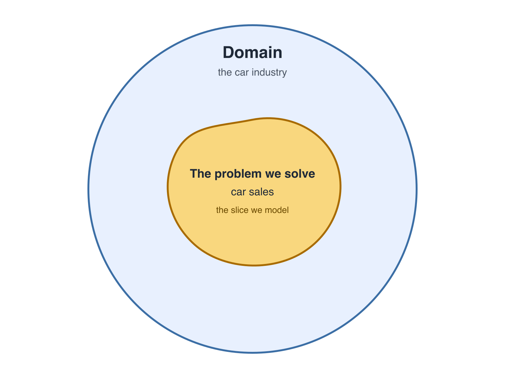
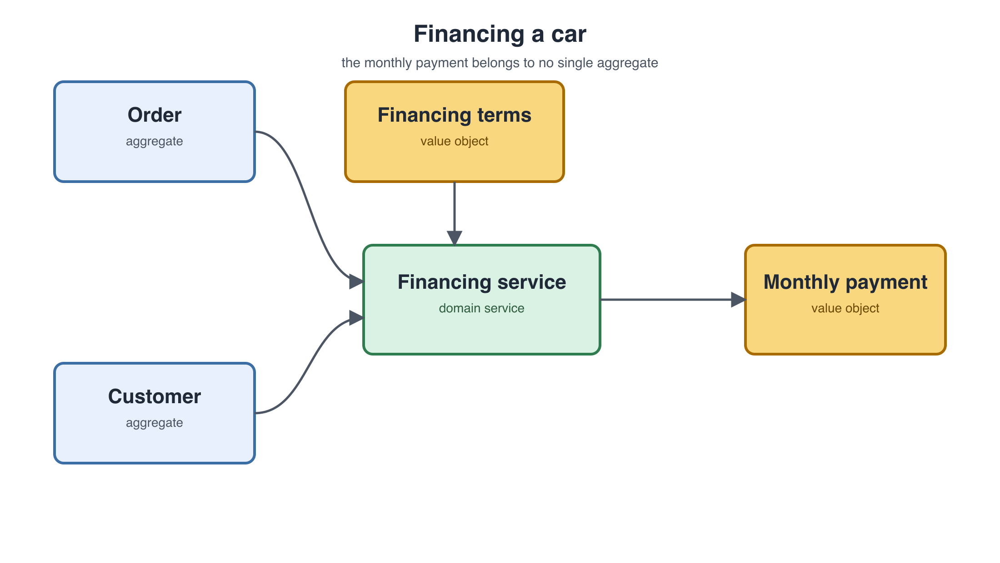

# Domain-Driven Design (DDD)

Domain-driven design is a software design discipline that centers development on a model of the business domain — its concepts, rules, and language — and keeps that model and the code aligned.

> Domain-driven design is not a technology or a methodology. It is a way of thinking and a set of priorities, aimed at accelerating software projects that have to deal with complicated domains.
>
> — Eric Evans, [*Domain-Driven Design Reference*](https://www.domainlanguage.com/ddd/reference/) (2015)

## The domain



> A sphere of knowledge, influence, or activity. The subject area to which the user applies a program is the domain of the software.
>
> — Eric Evans, *Domain-Driven Design* (2003)

A domain can be broad — finance, the car industry — but the domain of the software is not the whole sphere. If the software is about car sales, the effective domain is car sales, not the entire car industry. There is no reason to model every intricacy of the industry when the problem being solved is narrower. This distinction matters because the domain we model is cultivated, not copied: we develop a model of the slice the software actually serves rather than attempting to model the whole industry.

## The model

A model is an abstraction of the concepts the software cares about. We do not model the whole domain; we represent only what is relevant to the problem being solved. In the car sales example, that might include color customization, but not the rest of the car industry.

## How domain models are cultivated

Domain models are cultivated, not invented out of thin air. They emerge from a conversation between the technical people and the domain experts — people who are not technical but know the domain deeply. Through that conversation, the two sides develop a shared understanding of the domain, and that shared understanding is the model. Technical people are often inclined to speak in technical terms, but that is a mistake: DDD addresses it by giving both sides a common language for talking about the domain.

## Strategic design

Strategic design focuses on the core domain and explores its models in creative collaboration. That means the models cannot be developed by technical people alone; the domain experts, who are usually non-technical, have to be part of the work. The model is a product of collaboration between the two. At this stage we should not be thinking about the code: the work is about terminology and developing the model with the domain experts.

## The ubiquitous language

That collaboration depends on a ubiquitous language: a shared language both sides use to talk about the domain. But the language does not mean the same thing across an entire organization. It might hold together if the context is really small, but within a large organization that is highly unlikely. To the salespeople, "car" means one thing; to another department, it means something else. The same physical object has two different meanings. So the ubiquitous language is not universal — it is shared within a context.

## Bounded context

The model and the ubiquitous language are bounded by the context. This is why a system can contain different models and different ubiquitous languages: it contains multiple contexts. Within a context, the model and the language are valid and unambiguous, so people understand what a term means. In the car example, the contexts might include the warehouse, assembly, and sales; a real system has many more, such as marketing, financing, and payment processing.

## Context mapping

Contexts do not exist in a void. They need to talk to each other, communicate, and exchange information. Context mapping is the discovery of the relationships between contexts. Discovery is the right word because you do not invent those relationships: when you map something, you do not invent the territory — you observe it and write down what you see. The relationships already exist; you document them and work out how to deal with them.

A relationship can mean hiding or sharing information, and it can mean influencing each other. It can constrain the nature of a model and give it a different pace of change. Common relationships include:

- **Partnership** — contexts depend on each other mutually.
- **Open host service** — a context supports multiple dependent contexts.
- **Conformist** — one context depends unilaterally on another.
- **Unaware** — contexts do not know the other exists, so neither has any influence on the other's success.

Sometimes you do not control the relationship. If you hire a third-party payment system, you may have no way to talk to its developers, so you conform to its rules — and those rules influence your domain model.

## DDD is not about the code

DDD is not about the code. It is about how we talk to each other about the problem we are trying to solve.

## Model-driven design

Once we have the model, domain-driven design becomes model-driven design: the design decisions are based on the model we have created. This is the shift Evans describes in the 2003 book — often called the "blue book" — from the domain to the model, and then from the model to design. It is easy to overlook, but the order matters: we first model the subset of the domain we care about, and only then do we make design decisions from that model.

## Entity

Consider an order as an example. An order has an identity, a delivery date, and a status. Over its life those attributes change — the order is shipped, gets a delivery date, and is later delivered — but its identity stays the same. A model with a stable identity plus a lifecycle meets the definition of an entity.

### The order entity in TypeScript

```ts
type OrderStatus = "pending" | "shipped" | "delivered" | "cancelled";

class Order {
  constructor(
    private readonly id: string,
    private status: OrderStatus,
    private shippingAddress: string,
    private estimatedDelivery: Date,
  ) {}

  getStatus(): OrderStatus {
    return this.status;
  }

  updateStatus(status: OrderStatus): void {
    this.status = status;
  }

  updateShippingAddress(address: string): void {
    this.shippingAddress = address;
  }

  getEstimatedDelivery(): Date {
    return this.estimatedDelivery;
  }

  rescheduleDelivery(date: Date): void {
    this.estimatedDelivery = date;
  }

  equals(other: Order): boolean {
    return this.id === other.id;
  }
}
```

The method names come from the ubiquitous language, so everyone on the team — technical and non-technical — can understand what the behavior means.

## Value object

A color has red, green, and blue attributes, and three behaviors that update each channel individually. But if we change the red value, we get another color — not the same color — because a color has no identity. When there is no identity, and changing an attribute gets us another thing, that thing is a value object.

That is also why each update returns a new `Color` instead of mutating the current instance. If changing an attribute produces a new value, it is conceptually wrong to change the value in the old instance. The class is immutable: the fields are `readonly`, and `equals` compares the attributes rather than an identity.

```ts
class Color {
  constructor(
    readonly red: number,
    readonly green: number,
    readonly blue: number,
  ) {}

  updateRed(red: number): Color {
    return new Color(red, this.green, this.blue);
  }

  updateGreen(green: number): Color {
    return new Color(this.red, green, this.blue);
  }

  updateBlue(blue: number): Color {
    return new Color(this.red, this.green, blue);
  }

  equals(other: Color): boolean {
    return (
      this.red === other.red &&
      this.green === other.green &&
      this.blue === other.blue
    );
  }
}
```

## Aggregate root

An order does not exist in a void. It has a payment, a customization, and extras — other types in the model. If the payment method changes, or the customization changes, the order is affected. When a set of objects must stay consistent with each other and update together, they form a consistency boundary. One object takes the role of the main object — the aggregate root — and all changes go through it. The root has direct access to everything inside the boundary and changes it on the caller's behalf.

```ts
class Payment {
  constructor(readonly method: string) {}
}

class Extra {
  constructor(readonly name: string, readonly price: number) {}
}

class Customization {
  constructor(readonly color: Color) {}
}

class Order {
  private status: OrderStatus;
  private shippingAddress: string;
  private estimatedDelivery: Date;
  private payment: Payment;
  private customization: Customization;
  private extras: Extra[];

  constructor(
    private readonly id: string,
    status: OrderStatus,
    shippingAddress: string,
    estimatedDelivery: Date,
    payment: Payment,
    customization: Customization,
    extras: Extra[] = [],
  ) {
    this.status = status;
    this.shippingAddress = shippingAddress;
    this.estimatedDelivery = estimatedDelivery;
    this.payment = payment;
    this.customization = customization;
    this.extras = extras;
  }

  getStatus(): OrderStatus {
    return this.status;
  }

  updateStatus(status: OrderStatus): void {
    this.status = status;
  }

  changeShippingAddress(address: string): void {
    this.shippingAddress = address;
  }

  rescheduleDelivery(date: Date): void {
    this.estimatedDelivery = date;
  }

  changePaymentMethod(payment: Payment): void {
    this.payment = payment;
  }

  changeColor(color: Color): void {
    this.customization = new Customization(color);
  }

  private calculateTotalPrice(): number {
    return this.extras.reduce((total, extra) => total + extra.price, 0);
  }

  equals(other: Order): boolean {
    return this.id === other.id;
  }
}
```

Callers do not reach into the order's payment or customization directly. They call the root's methods, and the root keeps the objects inside the boundary consistent.

## Repository

An aggregate does not stay in memory. It has to be persisted, and the application needs to find orders by ID or by status. That is the job of a repository. The domain depends on an abstraction — an interface written in terms of the domain type, `Order` — and the infrastructure provides the database implementation. The interface acts as a port, and any infrastructure adapter can implement it. The domain does not know about the database.

```ts
interface OrderRepository {
  findById(id: string): Promise<Order | null>;
  findByStatus(status: OrderStatus): Promise<Order[]>;
  save(order: Order): Promise<void>;
}
```

## Domain service



Financing a car needs an order aggregate, a customer aggregate, and financing terms, which are a value object. It also needs a monthly payment. The monthly payment does not belong in the order, the customer, or the financing terms. If something is not an aggregate, an entity, or a value object, and it does not belong inside one of the aggregates, where does it go? That is what a domain service is for: the calculation of the monthly payment lives in a domain service, and the monthly payment itself is a value object.

A domain service is for a domain behavior that is meaningful in the model, does not naturally belong to a single entity or value object, and has no state of its own. Entities and value objects are nouns with state, and their behavior lives with the state it protects. A domain service is a verb: it receives the objects it needs, applies a rule, and returns a result, without holding state or identity. "Stands alone in the model without encapsulating state" means the operation is a real domain concept, but it is not a thing that owns data.

Putting the monthly payment in the order does not work, because the payment depends on the financing terms and the customer as well — not only on the order. Putting it in the customer does not work either, because the payment is not decided by the customer alone; it also depends on the financing terms and the order. A useful test is to try to place the behavior in each candidate and see where it resists. If it needs data from more than one aggregate, it does not belong in any single one.

It is tempting to put everything in a domain service, but it should only hold logic that does not belong in an aggregate. This is the same rule as in layered architecture: move a rule out of the model only when it does not belong there.

## The problem it solves

> The heart of software is its ability to solve domain-related problems for its user.
>
> — Eric Evans, *Domain-Driven Design* (2003)

DDD exists because code and the business often speak different languages for the same concepts. Developers model the domain in tables, DTOs, and service methods while domain experts use their own vocabulary, so someone has to maintain a mental — or literal — mapping between the two, and that mapping rots as the system and the organization change. DDD removes that translation layer by refining the business language with domain experts and making it the language of the code: the model. The model is more than naming — it fixes which concepts exist, which invariants hold, and which operations are legal — and because a large organization cannot share one vocabulary, each bounded context gets its own model, with translations between contexts made explicit rather than scattered. The point is not language alignment for its own sake, but keeping domain complexity from turning into accidental complexity.

## Misconceptions and where they come from

There is a lot of misunderstanding around domain-driven design. Common claims include:

- DDD only adds unnecessary complexity.
- DDD is a type of software architecture.
- DDD is a way to organize files and folders, and because of that, a DDD application has too many files.
- You have to use a lot of design patterns to use DDD.
- DDD makes the code harder to understand.
- "I never needed DDD for my software to work." That is not inherently wrong, but it is not the point.

I usually attribute this confusion to two things: people learned DDD from "all you need to know about DDD" content, or from DDD live tutorials.

## See also

- [Lessons from Eberhard Wolff's DDD example](lessons-from-eberhard-wolff.md)
- [When to use DDD](when-to-use-ddd.md)
- [What actually fails in a layered CRUD app](what-fails-in-a-layered-crud-app.md)
