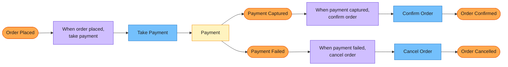
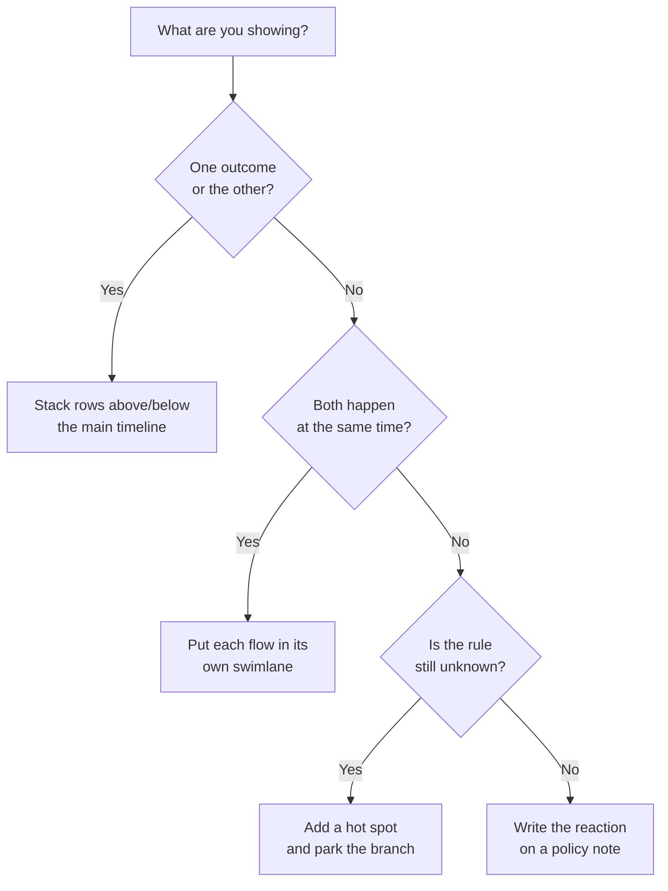
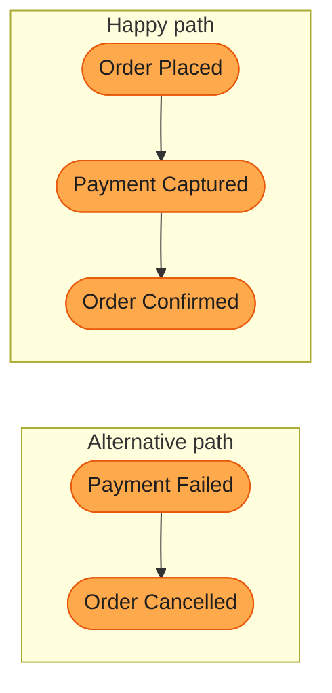
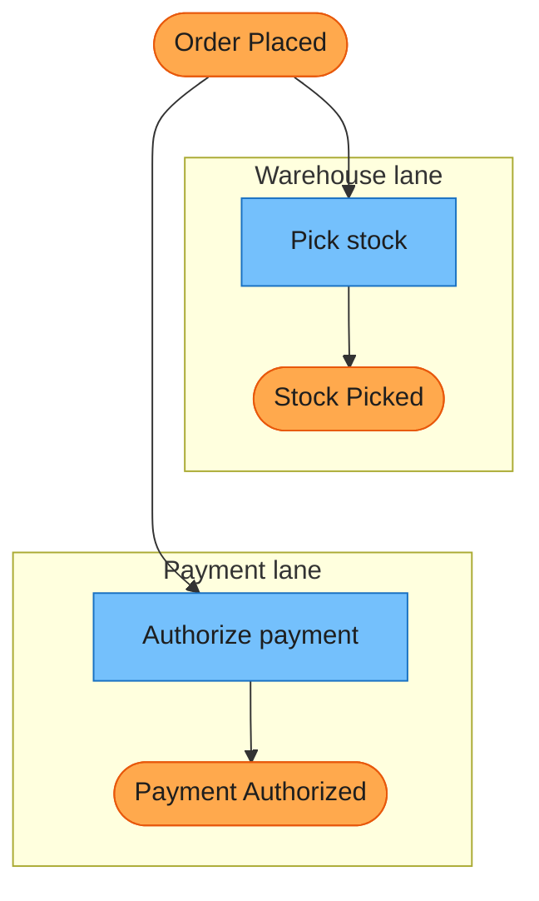
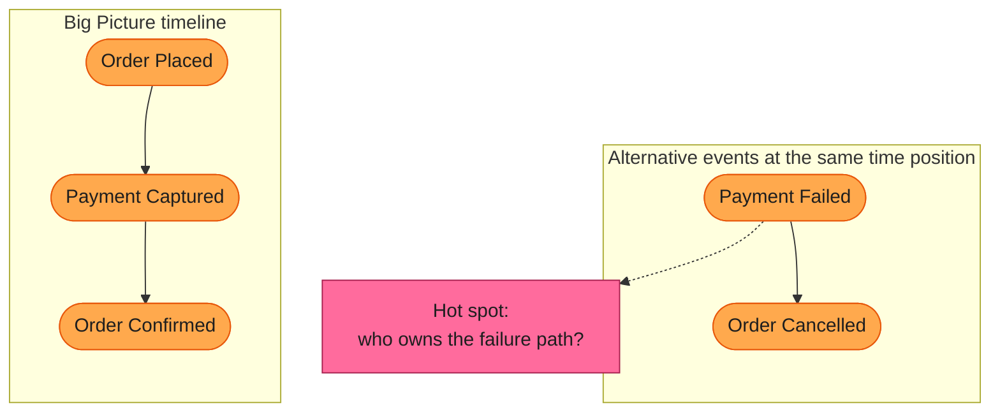
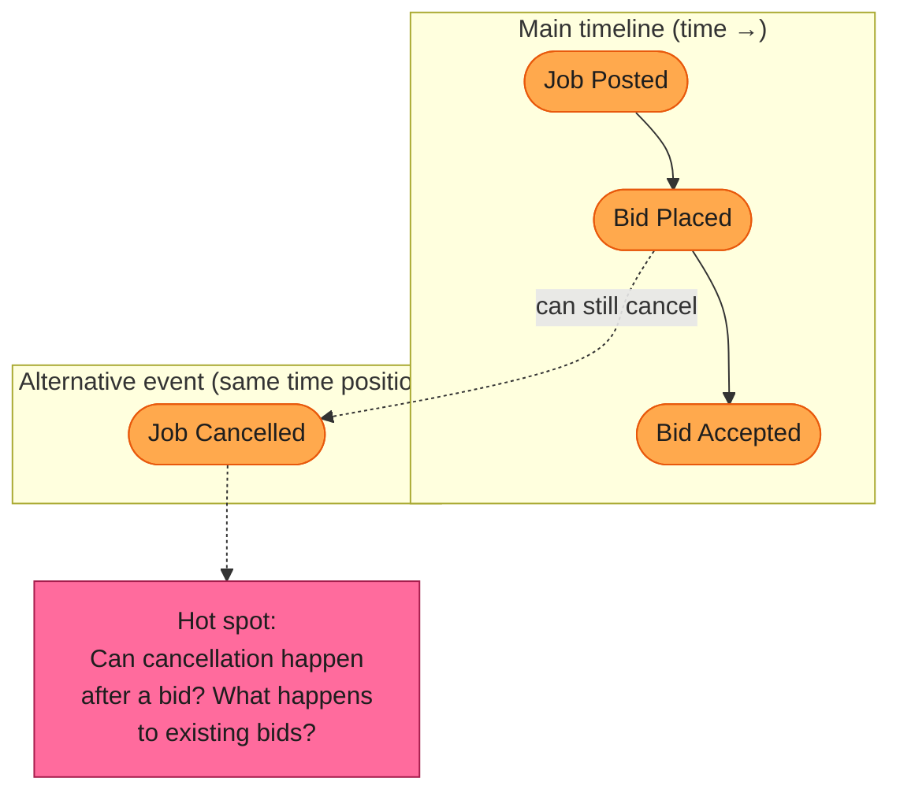

# Branching in Event Storming

*Time runs left to right. Branches run vertically. Do not turn the timeline into a flowchart.*

The diagrams below use Mermaid, so they render in GitHub, GitLab, and most Markdown viewers.

## The short version

Put the **happy path** on the main horizontal line. When something can go another way, keep the same position on the time axis and move the alternative **above or below** the main line.

The ddd-crew glossary describes the timeline as time running left to right, with "parallel streams from top to bottom on the paper roll" ([*EventStorming Glossary & Cheat Sheet*](https://ddd-crew.github.io/eventstorming-glossary-cheat-sheet/)). Serverless Land's EventStorming guide makes the branch case concrete: "put the parallel events above or below the 'happy path' flow" ([*Step 3 — Sequence events*](https://serverlessland.com/content/guides/eventstorming/timeline)).

That is the core idea. A branch is not a decision diamond. It is another horizontal storyline that shares the same time position as the fork.

## A worked example

Mermaid lays this out as a graph. On the physical wall, `Payment Captured` and `Payment Failed` sit at the same x-position, one above the other, because they are alternative outcomes of the same payment attempt. The arrows only show causality. Each branch then continues to the right with its own policy, command, aggregate, and event.

The reactions go on **policy** notes (lilac). In the diagram above, the two policy nodes are the branch rules:

- `Payment Captured` → *when payment is captured, confirm the order* → `Confirm Order` → `Order Confirmed`
- `Payment Failed` → *when payment fails, cancel the order* → `Cancel Order` → `Order Cancelled`

A policy is "a reaction that says 'whenever X happens, we do Y'" ([ddd-crew glossary](https://ddd-crew.github.io/eventstorming-glossary-cheat-sheet/)). If the condition or the desired reaction is still unknown, use a **hot spot** (neon pink) instead of inventing a rule.

## Which tool for which problem

| You need to show... | Use... | Notes |
| --- | --- | --- |
| An alternative outcome | A second row above or below the main timeline | Align the fork at the same x-position |
| Two things happening in parallel | A horizontal swimlane | Usually one actor, department, or process per lane |
| A reaction to an event | A policy (lilac) | "Whenever X happens, then Y" |
| An unknown branch or condition | A hot spot (neon pink) | Park it; do not silently decide |
| A phase change | A pivotal event | A vertical divider, not a branch |
| Branches that rejoin | Bring the rows back together at the merge event | Show the merge explicitly |

**Quick decision guide:**

### Alternative is not the same as parallel

- **Alternative:** one outcome or the other. `Payment Captured` or `Payment Failed`. Use stacked rows.
- **Parallel:** both happen at the same time, often in different parts of the business. `Warehouse picks stock` while `Payment Gateway authorizes payment`. Use swimlanes.

**Alternative** — one row above the other:

**Parallel** — one lane per flow:

Mixing these up is why timelines become unreadable. A branch is a fork in one story. A swimlane is a second story happening at the same time.

## Pivotal events are not branches

Pivotal events are the few big milestones that split the story into phases. They are often marked with a vertical strip of tape through the whole board. They are not decision points.

As Avanscoperta puts it, "Pivotal Events act as splitters between distinct phases of the business flow" ([*Pivotal Events in EventStorming*](https://www.avanscoperta.it/en/eventstorming/pivotal-events/)). A branch may happen inside a phase; a pivotal event marks the boundary between phases.

## Big Picture versus Process/Design

The vertical-space rule applies at every level. The notation around the branch changes.

|  | Big Picture | Process / Design |
| --- | --- | --- |
| What goes on the timeline | Orange domain events, plus people, systems, and hot spots | Commands, policies, aggregates, read models, and events |
| How to show a branch | Put the alternative event(s) above or below the main line; only the branches that change the story | Show the full alternative path with its command, policy, aggregate, and event |
| What to do with an unknown rule | Use a hot spot and keep moving | Use a hot spot, or resolve it with a policy |
| Pivotal events | Yes; vertical dividers between phases | Yes; phase boundaries |
| Swimlanes | Optional; for parallel flows or actors | Optional; often more detailed |

In Big Picture, the branch is usually just a second row of orange events. You are not trying to fill in every command and policy; the point is to expose the alternative and the disagreement. Brandolini separates Big Picture storytelling from the stricter Process Modelling grammar ([*Collaborative Process Modelling with EventStorming*](https://medium.com/@ziobrando/collaborative-process-modelling-with-eventstorming-17ed363650c0)), and [Serverless Land](https://serverlessland.com/content/guides/eventstorming/timeline) notes that Big Picture sessions often capture the big events without every permutation, leaving the details for later sessions. The full grammar in the diagrams above is Process/Design-level.

### Big Picture example: a job is posted

A job board starts with `Job Posted`. At the Big Picture level, the branch is simply two possible next events:

On the wall:

- `Job Posted` is an orange event on the main line.
- `Bid Placed` continues the main line.
- `Job Cancelled` goes below, aligned with the point where cancellation becomes possible.
- Add `Client` near the posting and cancellation events, and `Freelancer` near the bid event. These are small yellow actor notes.
- Add hot spots: Can a job be cancelled after a bid? Who can cancel it? What happens to bids that already exist? Is there an expiry?
- `Job Posted` is usually the start of the story, not a pivotal event. If you need a phase boundary, `Bid Accepted` or `Job Awarded` is a better pivotal event.

The important nuance: **"either bid or cancel" may be false.** If a job can be cancelled after a bid, `Job Cancelled` is not just a sibling of `Bid Placed`; it is an interrupting event that can occur later. Do not force that into a decision diamond. Put `Job Cancelled` below the timeline at the point or points it can occur and park the uncertainty in a hot spot. That is exactly what Big Picture Event Storming is for.

At the **Process** and **Design** levels, model the alternatives that matter:

- the failure path that changes the business outcome;
- the path that requires a compensating action;
- the path that changes who owns the next step;
- the path that is expensive, risky, or legally significant.

You are not trying to draw every possible execution path. You are trying to expose the ones that change the model, the conversation, or the risk.

## Laying it out in the Excalidraw template

The template uses lanes by element type — actors, commands, policies, aggregates, events, read models, hot spots — with columns as time. That layout is good for one flow. A branch needs **vertical space**, not another column.

The simplest approach:

1. Keep the main happy path on the primary row.
2. At the fork, copy the relevant command, aggregate, event, and policy notes into a **second band below** the main flow.
3. Align the first note of the branch with the fork on the time axis. Do not move it to the right.
4. Put the branch policy directly under its event; use a hot spot if the rule is unresolved.
5. If the branch rejoins, bring the second band back up to the main line at the merge event.
6. Use arrows only at the fork and merge. Avoid long diagonals across unrelated notes.

If the branch belongs to a different actor or process, give it its own **swimlane** instead of stacking it inside the same band. If you need two rows inside the type lanes, increase the lane height in the template first; otherwise the notes will collide.

The important thing is that the **x-axis still means time**. A branch to the right reads as "this happened next." A branch below reads as "this was the alternative."

## Common mistakes

- **Putting the branch to the right.** That turns an alternative into the next step in the sequence.
- **Using decision diamonds.** Event Storming's core grammar does not have them. Use policies, hot spots, and multiple possible events.
- **Modelling every edge case in Big Picture.** You will run out of space before you run out of branches.
- **Using a swimlane for every `if`.** Swimlanes are for parallel work, not for every alternative.
- **Forgetting the condition.** A branch without a policy or hot spot is a story with a missing reason.
- **Hiding the merge.** If two paths rejoin, show where and why.

## See also

- [Subdomains and bounded contexts](subdomains-and-bounded-contexts.md)
- [Bounded contexts, microservices, and teams](bounded-contexts-microservices-and-teams.md)
- [Event Storming, read models, and data availability](event-storming-read-models-and-data-availability.md)
- [Event Storming template](event-storming-template.excalidraw)
- [When to use DDD](when-to-use-ddd.md)
