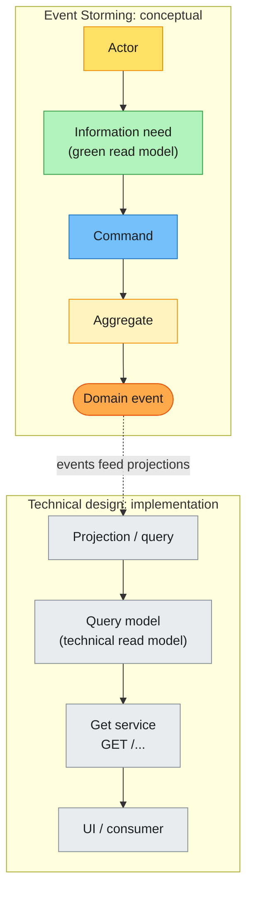
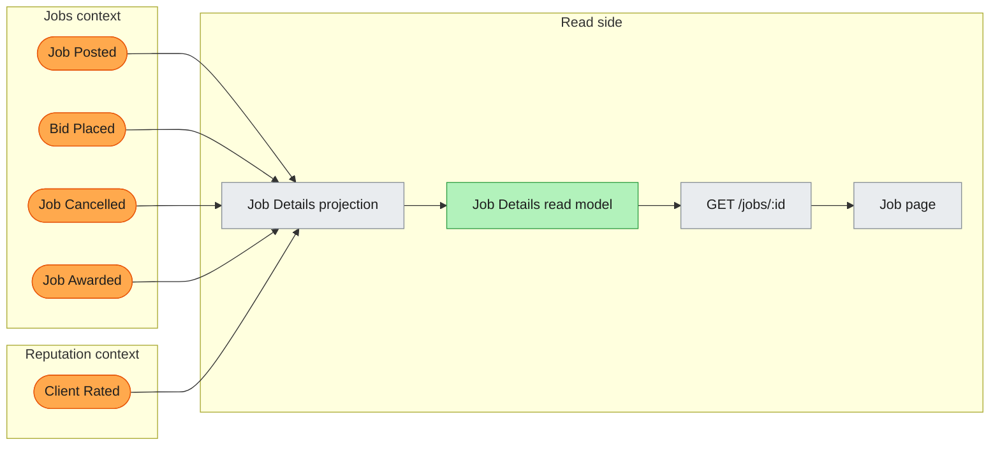

# Event Storming, Read Models, and Data Availability

*Event Storming maps what happens and what information an actor needs. It does not prove that a get service will have the data it needs. That proof comes from a read-model contract and a source for every field.*

## The short answer

At **Big Picture** level, Event Storming is deliberately event-first: the timeline is made of domain events, with actors, systems, hot spots, pivotal events, and candidate boundaries around them. Read models are not part of the core Big Picture grammar; they appear at **Process** and **Design** level, where the board adds commands, policies, read models, and UI mockups ([ddd-crew glossary](https://ddd-crew.github.io/eventstorming-glossary-cheat-sheet/); [Event Storming Journal](https://www.eventstormingjournal.com/software%20design/how-to-explain-design-level-event-storming-to-your-mother/); [Rubicon guide](https://www.rubicon-world.com/resources/event-storming-guide)).

But even the green read-model sticky is not a get service. It is a **conceptual information need**: "what must this actor see before making this decision?" ([Event Storming Journal](https://www.eventstormingjournal.com/software%20design/how-to-explain-design-level-event-storming-to-your-mother/); [Qlerify](https://www.qlerify.com/event-storming-concepts/read-model)). The get service is a technical implementation of that need. Event Storming does not try to specify it, and it is not a data-modeling technique: "Event storming is not data modeling. Instead, it results in a fully behavioral model that can be quickly implemented and validated" ([Lucid](https://lucid.co/blog/ddd-event-storming)).

So the confidence does not come from the event timeline alone. It comes from turning each green sticky into a **read-model contract** and tracing every field to a source that someone owns and can test.

## The memory hook: a projection tests the event model

> **No event, no metric.**

Big Picture names **what happened**, not **what each event carries**. That is not a gap; it is the point. An event is the moment a fact starts to exist:

| Event | Facts it brings into existence |
| --- | --- |
| `Job Posted` | the job, its category, budget, and `postedAt` |
| `Bid Accepted` | the hire, and `hiredAt` |
| `Review Posted` | the rating, its score, and `reviewedAt` |

Deferring payloads is deliberate: fields are cheap to add later, a wrong event model is not, and people can agree that a job was posted long before they agree on its schema.

So when a report needs data, do not start from the tables. Start from the question: **which events does this projection consume?**

| Projection | Kind | Needs |
| --- | --- | --- |
| Total spent, jobs posted | current state | the write model |
| Completion rate | history | completed vs cancelled / abandoned |
| Average time to hire | history + payload | `postedAt` → `hiredAt` |
| Rating over time | history + payload | score + timestamp |

Two rules of thumb:

- **Current-state projections** can read the write model. **History projections** need events kept on purpose — a row that is overwritten tomorrow cannot answer "how did this change over time?"
- If a projection cannot be traced to events plus current state, you have not found a missing column. You have found a **missing event** (or an event that must carry one more fact). That is a Big Picture finding, and it is far cheaper to fix on the board than in production.

Write the **source events** on the requirement, not just the fields. `Average time to hire = posted → hired` is a stronger requirement than `average_time_to_hire: number`, because it names what must be recorded for the number to exist.

## Why events come first

Domain events are the most stable thing in the conversation. They are facts the business can agree on, and they let the group talk about behavior before jumping to screens, tables, or endpoints. Event Storming uses them as the spine and layers other elements around them ([ddd-crew](https://ddd-crew.github.io/eventstorming-glossary-cheat-sheet/); [EventSourcingDB](https://docs.eventsourcingdb.io/best-practices/event-storming/)).

That is also why starting with get services would be a mistake. The workshop would turn into a UI/API design session, and the business rules, policies, and alternative paths would hide behind CRUD screens. Event Storming starts "with the domain itself, not with technical concerns" ([EventSourcingDB](https://docs.eventsourcingdb.io/best-practices/event-storming/)).

The three levels have different jobs:

| Level | Question it answers | Read models? |
| --- | --- | --- |
| Big Picture | How does the whole business or value stream work? | Usually not. Events, actors, systems, hot spots, pivotal events, candidate boundaries. |
| Process | How does this one process work, step by step? | Yes. Commands, policies, read models, UI mockups, external systems. |
| Design | How should the software model this bounded context? | Yes. Read models, aggregates, rules, UI mockups. |

This is why "Event Storming only talks about events" is true only if you stop at Big Picture. The green read model is a Process/Design element ([ddd-crew](https://ddd-crew.github.io/eventstorming-glossary-cheat-sheet/); [Rubicon](https://www.rubicon-world.com/resources/event-storming-guide)). If a team runs Big Picture and then jumps straight to code, the get-service requirements really are missing. That is not a flaw in Event Storming; it is a missing follow-up.

## The green sticky is not a get service

In the Event Storming grammar, an actor sees information, makes a decision, and issues a command. The green sticky sits before the command. It is the information the actor needs to decide, not the data the system emits after the decision ([Event Storming Journal](https://www.eventstormingjournal.com/software%20design/how-to-explain-design-level-event-storming-to-your-mother/); [Setms](https://www.setms.org/design/analysis.html)).

The technical read model is a different thing with the same name. In a CQRS or event-sourced design, it is a query-optimized projection built from events. In a normal CRUD design, it may simply be a view over the transactional database. The conceptual read model is independent of that implementation choice ([Qlerify](https://www.qlerify.com/event-storming-concepts/read-model); [Fowler on CQRS](https://martinfowler.com/articles/201701-event-driven.html)). You do not need CQRS or event sourcing to make the read model explicit; the questions in the contract are the same, only the implementation of the answer changes.

The diagram is the key distinction. On the left, "read model" means **what the actor needs to know**. On the right, "read model" means **how the system answers the query**. Event Storming gives you the first; you still have to design the second.

This is also why a green sticky with only a name is not enough. `Job Details` tells you there is an information need. It does not tell you which fields, for which actor, from which source, at what freshness, with what permissions. Those are the requirements that make a get service buildable.

## The requirements live at different layers

The feeling that "the requirements are not mentioned anywhere" usually comes from expecting one artifact to carry all of them. They live at different layers:

| Layer | Artifact | Does Event Storming produce it? |
| --- | --- | --- |
| Business behavior | Events, commands, policies, hot spots | Yes, at the appropriate level |
| Information need | Green read model and UI mockup | Yes, at Process/Design level |
| Data model | ERD, event schema, field types | No. This is a follow-up design activity. |
| Query contract | Get service, API schema, filters, pagination | No. This is API design. |
| Quality attributes | Freshness, latency, authorization, retention | No. These are non-functional requirements. |

Event Storming is "not a substitute for a UML diagram, design document, deployment plan, or other implementation models" ([Lucid](https://lucid.co/blog/ddd-event-storming)). It is a prelude and catalyst for those artifacts, not a replacement ([Philippe Bourgau](https://philippe.bourgau.net/how-to-max-out-ddd-big-picture-event-storming-with-other-workshops/)).

That is why the follow-up matters. After Big Picture, teams commonly run Design-Level Event Storming, Example Mapping, and User Story Mapping. Example Mapping pins acceptance criteria; Story Mapping slices the user journey; Design-Level Event Storming adds the read models and UI mockups ([Philippe Bourgau](https://philippe.bourgau.net/how-to-max-out-ddd-big-picture-event-storming-with-other-workshops/); [Qlerify](https://www.qlerify.com/post/from-event-storming-to-user-stories)).

## How to gain confidence: a read-model contract

For each green sticky that matters, write down the answers to these questions. This is the bridge from "the actor needs Job Details" to "the get service can be built and tested."

| Question | Artifact |
| --- | --- |
| Who consumes it? | Actor, UI screen, API client, report, or automated decision |
| What exactly must be shown? | Field list with types and examples |
| Where does each field come from? | Event, aggregate, query, external system, or another bounded context |
| How fresh must it be? | Synchronous, eventual, maximum lag, stale-while-revalidate |
| Who may see it? | Authorization, tenant isolation, PII rules |
| What happens when the source is unavailable? | Fallback, cached value, error, degraded view |
| How is it tested? | Given events, then expected view; contract test for the API |
| How is it rebuilt? | Projection replay, backfill, idempotency, checkpoint |

The first question is not "what does the event contain?" It is "what does the consumer need?" EventSourcingDB's read-model guidance puts it directly: a read model should answer a specific set of questions, and its structure "should be guided by these needs — not by the structure of the event data itself" ([Designing Read Models](https://docs.eventsourcingdb.io/best-practices/designing-read-models/)).

That last point is the trap. If you design the get service by looking at the event payload, you get whatever the event happened to carry. If you design it by looking at the consumer's questions, you discover what the event must carry, what must be projected, and what must be fetched from another context.

## Worked example: `Job Details`

Take the job board from [Branching in Event Storming](branching-in-event-storming.md). A freelancer needs to see a job before deciding to bid. The green sticky might say `Job Details`. That is the information need. The get service might be `GET /jobs/:id`. That is the implementation.

A useful read-model contract for `Job Details` looks like this:

| Field | Source | What if it is missing? |
| --- | --- | --- |
| `title`, `description`, `budget`, `deadline` | `Job Posted` | Enrich the event, or query the Jobs write model |
| `status` | `Job Cancelled`, `Job Awarded` | Project the latest status; add an event if the transition is not recorded |
| `bidCount` | Count of `Bid Placed` events, or a bid projection | Project it; do not load every bid just to count them |
| `clientRating` | `Client Rated` from the Reputation context | Define an integration contract, local projection, or API call; this is not Jobs' data |

The diagram is deliberately not an Event Storming board. It is the **data-lineage view** that comes after the board. It answers the question the board raises: "if we need `clientRating`, where will it come from, and who owns it?" If a field has no source, you have found a real gap before building the get service. You can fix it by enriching the event, adding a projection, querying the owning context, or removing the field from the UI.

This is also where cross-context ownership matters. `clientRating` is not Jobs' data. Jobs needs an explicit contract with Reputation, not an assumption that the field will appear. See [Bounded contexts, microservices, and teams](bounded-contexts-microservices-and-teams.md) and [Analytics as a bounded context](analytics-as-a-bounded-context.md).

## Event design decides whether the data is there

Even a complete read-model contract depends on the events carrying enough information. There are three common shapes, and they have different consequences for data availability ([Fowler, "What do you mean by Event-Driven?"](https://martinfowler.com/articles/201701-event-driven.html)):

| Event style | What the event carries | Consequence for a get service |
| --- | --- | --- |
| Event notification | Minimal data, often an ID and a link back to the source | The consumer must call the source. Data availability depends on that service being up. |
| Event-carried state transfer | The changed state needed by consumers | The consumer can build a local read model without a callback. More coupling to the event schema, and more data copied. |
| Event sourcing | The full history of state changes | Projections can be rebuilt from the log. Schema evolution, retention, and PII become explicit concerns. |

Fowler notes that a notification event "need not carry much data on it, often just some id information and a link back to the sender that can be queried for more information." Event-carried state transfer, by contrast, lets recipients "update [their] own copy of customer data" without contacting the source ([Fowler](https://martinfowler.com/articles/201701-event-driven.html)).

So "the event has everything" is not a law. It is a design choice. For each event that feeds a read model, decide whether it is a notification or a state transfer. The Setms design method makes this explicit: for all events, decide whether to use notification or event-carried state transfer, and if the latter, determine what data the event carries; for all read models, design the data model with an ERD or similar notation ([Setms](https://www.setms.org/design/analysis.html)).

If you do use event sourcing, read models are eventually consistent and disposable; they can be rebuilt if the events are retained and the projection is deterministic ([EventSourcingDB](https://docs.eventsourcingdb.io/best-practices/designing-read-models/)). A new read model "won't magically contain data from existing events"; it needs a backfill or replay ([Event-Driven.io](https://event-driven.io/en/rebuilding_event_driven_read_models/)). Event schemas also need versioning, or a field that exists today can break the projection tomorrow ([EventSourcingDB on versioning](https://docs.eventsourcingdb.io/best-practices/versioning-events/)).

## If you need read models to be first-class: Event Modeling

Event Storming is a discovery technique. If you want a blueprint where the read side is as explicit as the write side, **Event Modeling** is the closer tool. It puts wireframes, commands, events, read models, and processors on one timeline, and it ties each screen to a read model and each read model to its events ([Event Modeling](https://eventmodeling.org/posts/what-is-event-modeling/)).

Its completeness check is exactly the confidence mechanism this question is asking for: "the event model should have every field accounted for. All information has to have an origin and a destination. Events must facilitate this transition and hold the necessary fields to do so" ([Event Modeling](https://eventmodeling.org/posts/what-is-event-modeling/)). It also specifies read models with Given/Then examples, much like commands are specified with Given/When/Then ([Event Modeling](https://eventmodeling.org/posts/what-is-event-modeling/)).

Event Modeling is not a replacement for Event Storming; it is a complementary, more implementation-oriented model. Confluent's introduction describes it as a visual design language for "capturing the blueprint for a business information system," with an explicit command API and query API ([Confluent](https://developer.confluent.io/courses/event-modeling/intro/)). If your team keeps discovering missing read-model data after Event Storming, Event Modeling is a reasonable next step.

## Practical checklist

Before calling a get service "covered," check:

- The green sticky names a **consumer** and the **decision** it supports.
- The read model has an explicit **field list**, not just a name.
- Every field has a **source**: an event, an aggregate, a query, an external system, or another bounded context.
- The source has an **owner** and a **contract** (event schema, API, or shared read model).
- **Freshness** is stated: synchronous, eventual, or maximum lag.
- **Authorization and PII** rules are stated.
- **Failure behavior** is stated: stale data, fallback, or error.
- The projection is **idempotent** and can be **rebuilt or backfilled** if event-sourced.
- There is a **Given events / Then view** test for the read model.
- There is a **contract test** for the get service and its consumer.
- There is **observability** for projection lag and missing fields.

If any of these is missing, you do not yet have confidence that the data will be there. You have a hope.

## Bottom line

Event Storming does not guarantee data availability. It exposes **information dependencies**. Big Picture is event-first because it is trying to understand the business, not design the API. Process/Design adds the green read models, but even those are conceptual. The confidence comes from the follow-up: a read-model contract, a field-to-source map, an explicit event design, and tests that prove the query returns the right view.

If you stop at Big Picture, the get-service requirements are genuinely missing. That is not a reason to abandon Event Storming; it is a reason to run the next level and then do the data and API design.

## See also

- [Branching in Event Storming](branching-in-event-storming.md)
- [Analytics as a bounded context](analytics-as-a-bounded-context.md)
- [Bounded contexts, microservices, and teams](bounded-contexts-microservices-and-teams.md)
- [Transactions in repositories and the single responsibility principle](transactions-in-repositories-and-srp.md)
- [Subdomains and bounded contexts](subdomains-and-bounded-contexts.md)
