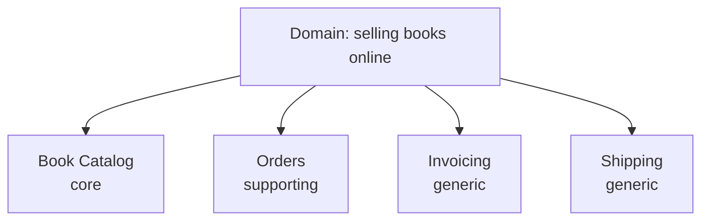

# Lessons from Rico Fritzsche: what "domain" means in DDD

Source: [What Means Domain in the Context of Domain-Driven Design?](https://ricofritzsche.me/what-means-domain-in-the-context-of-domain-driven-design/) — Rico Fritzsche, 31 Aug 2023. A short, practical explanation of the domain, subdomains, and why DDD refuses to build one model for the whole business.

## The domain is the business, not the model

The domain is the sphere in which the organization operates: what the business does and the environment it does it in. For an online bookstore, the domain is selling books online.

The common mistake is to read "domain model" as "one grand model of everything". DDD advises against exactly that. The domain is too large and too varied to model as a monolith.

## A domain is an ecosystem of subdomains

Subdomains are smaller, specialized areas inside the domain. The bookstore's might be Book Catalog, Orders, Invoicing, and Shipping.

DDD's move is to focus on individual subdomains and draw a **bounded context** around each — a boundary inside which one model and one set of rules apply. Shipping and product management are different problems; they should not share one model.

Organization size does not change this. Whether the software serves five people or five million, decomposing the domain is how complexity stays manageable.

## Not every subdomain deserves the same investment

The article's central practical lesson is the three-way classification. It is about **where to spend effort**, not about importance.

| Type | What it is | What to do |
| --- | --- | --- |
| **Core** | The part you must get right to win; the differentiator. In the example, the catalog. | Best model, best people, most time. Keep infrastructure concerns out. |
| **Supporting** | Specific and valuable, but not the reason the business exists. In the example, orders. | Build it, but with a simpler model. Full DDD is not required. |
| **Generic** | Needed to operate, but not unique. Invoicing and shipping in the example. | Buy, reuse, or integrate. Do not compete on it. |

All three still have to work. The classification only tells you where innovation and modelling effort pay off.

> The article sometimes says "Core Domain" where it means the **core subdomain**. The domain contains all three types; only one part is core.

## What to carry into our work

- **Do not build one model for the whole marketplace.** Buyer, professional, jobs, bidding, payments, disputes, and messaging are subdomains, not one schema.
- **Classify before you invest.** Bidding and matching may be core for this product; OTP, address verification, and payment providers are generic and should be bought or integrated.
- **A subdomain is problem space; a bounded context is solution space.** The lane you draw is a hypothesis until language, ownership, and consistency boundaries agree with it.
- **The classification is a business decision and can change.** What is core today may be generic tomorrow.

## See also

- [Subdomains and bounded contexts](subdomains-and-bounded-contexts.md)
- [Lessons from Eberhard Wolff's DDD example](lessons-from-eberhard-wolff.md)
- [When to use DDD](when-to-use-ddd.md)
