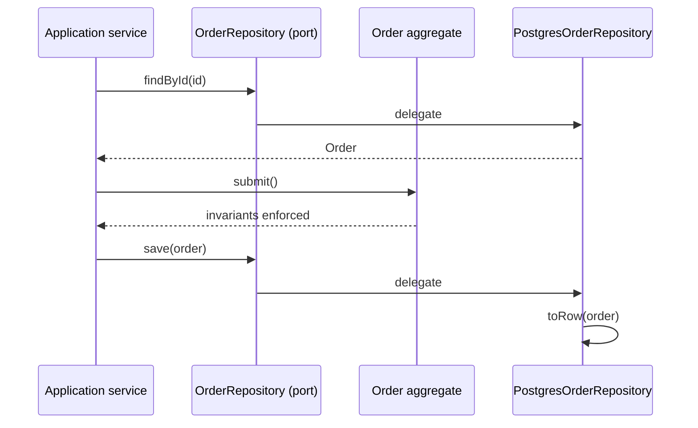

# Repositories do not live in aggregates

*A repository is a collection-like abstraction for loading and saving aggregates. It is not a collaborator inside an aggregate. The application service loads the aggregate, calls its behavior, and saves it; the repository implementation maps the aggregate to persistence and back in infrastructure.*

## The misconception

It is tempting to write an aggregate that saves itself:

```ts
class Order {
  constructor(private readonly orders: OrderRepository) {}

  async submit(): Promise<void> {
    if (this.lines.length === 0) throw new Error("empty order");
    this.status = "submitted";
    await this.orders.save(this);
  }
}
```

The repository interface is injected, so it feels decoupled: `Order` depends on an abstraction, not on Postgres. But the aggregate now knows that it is persisted, performs I/O inside a domain operation, and hides a transaction boundary inside a business method.

That is the misconception: **the repository does not belong inside the aggregate.**

## The corrected flow

The application service is the orchestrator:

1. Receive the command.
2. Load the aggregate through the repository port.
3. Call the aggregate's behavior.
4. Save the aggregate through the repository port.
5. Let the repository implementation map the aggregate to the database and back.



The aggregate enforces its invariants. The application service decides the use case and the transaction boundary. The repository hides storage.

## Who owns what

| Component | Responsibility | Knows about |
| --- | --- | --- |
| **Aggregate** | Behavior and invariants | Domain concepts only |
| **Repository interface** | Persistence contract for one aggregate root | Domain types |
| **Application service** | Use-case orchestration and transaction boundary | Repository interface, domain |
| **Repository implementation** | Mapping and storage | Domain types and the database/ORM |

The repository interface is usually in the domain layer because it speaks the domain language. Some teams place it at the application boundary. Either way, the aggregate does not know it exists.

The application service **depends on** the repository; the repository does not live inside the aggregate. The implementation is injected from the composition root.

## Why the aggregate must not hold the repository

- **The domain stays persistence-ignorant.** `Order.submit()` should be testable without a database, a transaction, or a mock repository.
- **I/O does not hide inside business methods.** A method named `submit()` should enforce a rule, not open a connection.
- **The application service owns the transaction.** The aggregate should not decide when a unit of work commits.
- **A repository is a collection of aggregates.** `orders.save(order)` makes sense; `order.orders.save(order)` does not.
- **The dependency direction stays clean.** The repository depends on the aggregate type. The aggregate should not depend on the repository.
- **Loading and creating stay separate.** Rebuilding an aggregate from the database is not the same as running its creation rules.

## What if the aggregate needs to check something?

Sometimes a rule seems to need a repository. For example: "a user's email must be unique."

That is usually not an invariant of the `User` aggregate itself. It is a rule about the set of users. Handle it in the application service or a domain service:

```ts
class RegisterUser {
  constructor(private readonly users: UserRepository) {}

  async execute(command: RegisterUserCommand): Promise<void> {
    if (await this.users.existsByEmail(command.email)) {
      throw new Error("email already taken");
    }

    const user = User.register(command.email);
    await this.users.save(user);
  }
}
```

If an aggregate method needs data from another aggregate, pass that data in as a parameter. Do not inject a repository into the aggregate to fetch it.

A domain service can depend on a repository port when a domain rule genuinely needs to look up other aggregates. The repository still is not inside the aggregate.

## The mapping boundary

The aggregate and the persistence model are different shapes. The repository implementation is where they meet:

```ts
type OrderRow = {
  id: string;
  status: string;
  // ...
};

function toRow(order: Order): OrderRow {
  return {
    id: order.id.value,
    status: order.status,
    // ...
  };
}

function toOrder(row: OrderRow): Order {
  return Order.restore({
    id: new OrderId(row.id),
    status: row.status as OrderStatus,
    // ...
  });
}
```

The mapper reads the aggregate through its public API. It should not require the aggregate to expose public setters or mutable fields just for the ORM. If the database library insists on a mutable entity, use a separate persistence entity and map between the two.

Reconstitution is not creation. Use a factory or `restore` method to rebuild an aggregate from persisted state without re-running rules that only apply to new objects.

## Coupling points inward

The infrastructure adapter necessarily knows the aggregate type. That is not a violation; it is the adapter's job.

What matters is the direction:

| Dependency | Allowed? |
| --- | --- |
| Domain → infrastructure | No |
| Infrastructure → domain | Yes |
| Application service → repository interface | Yes |
| Aggregate → repository | No |

The repository interface is the seam. The domain depends on the interface; the infrastructure implements it. The infrastructure is coupled to the domain by design, but the domain is not coupled to the infrastructure.

You can avoid mapping by using the same class as both the domain aggregate and the ORM entity, but then the domain depends on the ORM. Separate models cost mapping and keep the domain independent. That is the trade-off.

## Repository is not a DAO

A repository speaks in aggregates, not tables:

- one repository per **aggregate root**, not per table or child entity;
- `findById`, `save`, and a few named queries, not a generic query builder;
- no business logic inside the repository;
- no persistence types leaking back to the domain.

A DAO or data mapper may live inside the repository implementation. The repository is the domain-shaped boundary; the DAO is an implementation detail.

## Testing follows the same boundary

- **Aggregate tests** need no repository and no database.
- **Application service tests** use an in-memory repository or a fake.
- **Repository adapter tests** use the real database.

If testing an aggregate requires a database, the repository has leaked into the domain.

## Summary

- The aggregate holds behavior and invariants; it does not hold a repository.
- The application service loads the aggregate, calls it, and saves it.
- The repository interface is a domain-shaped port; the implementation lives in infrastructure.
- The repository implementation maps aggregate ↔ persistence model.
- Infrastructure depends on the domain, not the other way around.
- One repository per aggregate root.

## See also

- [Repositories](../../fundamentals/08-repositories/README.md)
- [Aggregates](../../fundamentals/07-aggregates/README.md)
- [Domain services](../../fundamentals/09-domain-services/README.md)
- [Aggregate root IDs and foreign keys](aggregate-root-ids-and-foreign-keys.md)
- [What actually fails in a layered CRUD app](what-fails-in-a-layered-crud-app.md)
- [Lessons from Eberhard Wolff's DDD example](lessons-from-eberhard-wolff.md)
