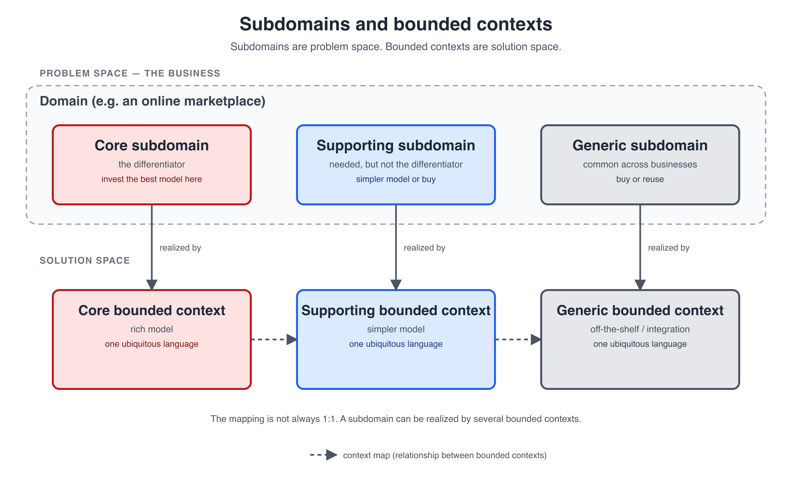

# Subdomains and bounded contexts

A domain is the whole business area the software addresses. A subdomain is a coherent part of it. A bounded context is the boundary within which a model and a ubiquitous language are consistent.

The important distinction is that they live in different spaces:

- **Subdomains are problem space.** They describe what the business does.
- **Bounded contexts are solution space.** They describe how we model it.

## Domain and subdomain

The domain is the sphere of knowledge and activity the software serves. A subdomain is a distinct area of business expertise inside it: invoicing, delivery, payments, identity, search, contracts.

Subdomains are discovered by understanding the business, not by splitting the codebase into folders. They are not technical modules. They are the parts of the problem that have their own vocabulary, rules, and experts.

## Core, supporting, generic

Not every subdomain deserves the same investment.

| Type | What it means | What to do |
| --- | --- | --- |
| **Core** | The differentiator. The part the organization values most, the reason the product exists, and the part it wants to sustain over time. | Invest the best model, the best people, and the most time. Keep it independent of infrastructure. |
| **Supporting** | Necessary for the business, often specific to it, but not the differentiator. | Build it, but with a simpler model. It does not need the full DDD treatment. |
| **Generic** | Common across many businesses: identity, notifications, file storage, maybe payments. | Buy it, reuse it, or integrate with a provider. Do not compete on it. |

People often say "core domain" when they mean the core subdomain; the domain as a whole contains all three types.

The classification is a business decision, not a technical one. It can change over time: what is core today may become generic tomorrow.

## Bounded context

A bounded context is a boundary within which one model and one ubiquitous language are valid. Inside the boundary, a term has one meaning. Outside, another context may use the same word differently.

A bounded context is where the model lives: the code, the database terms, the conversations, and ideally one team. Context mapping describes the relationships between bounded contexts.

## How subdomains and bounded contexts relate

A subdomain is territory. A bounded context is a map. The map is not inside the territory; it represents it.

- A bounded context **realizes** a subdomain, or a part of one.
- A subdomain can be realized by **more than one** bounded context.
- A bounded context should not be shared between unrelated subdomains or between teams.
- The mapping is not always one-to-one.

The core subdomain should be realized by a bounded context with a rich model. Supporting subdomains can use simpler bounded contexts. Generic subdomains are often realized by bought systems that you integrate with.

## How event storming finds subdomains

Event storming does not start with subdomains. It starts with events: things that happened in the business, written in the past tense on orange stickies.

The first pass is chaotic exploration: produce as many events as possible. Then enforce a timeline, remove duplicates, and discuss what must happen before what. Then separate parallel work into swim lanes and mark pivotal events.

Subdomain candidates emerge from that material:

- **Clusters of events** that share a vocabulary and a business capability.
- **Swim lanes** that represent parallel work, such as invoicing and delivery.
- **Pivotal events** where the world changes and the language changes with it.
- **The same word meaning different things** in different parts of the timeline. The customer who pays an invoice is not the customer who receives a delivery.
- **Handoffs** between people, departments, or systems. Be careful here: organizational boundaries are a clue, not a rule.

The result is a set of candidate subdomains and bounded contexts. It is not a mechanical partition. You validate the candidates with domain experts, look at the business strategy, and iterate.

## When do we know what is core?

You do not know at the start, and you do not need to. Event storming gives you the raw material; the classification comes after you understand the domain and the business.

Ask the domain experts and the people responsible for the product:

- What differentiates us from competitors?
- Where do we create unique value?
- What are we willing to invest in and maintain for years?
- What would hurt most if we lost it?
- What can we buy, reuse, or treat as good enough?

The core domain is not necessarily the biggest feature, the most complex code, or the busiest screen. It is the part the organization values strategically and wants to survive technology changes. It is also not a technical call: technical people can translate the decision into a model, but they should not make it alone.

"I don't know" is a valid answer. The next step is to ask someone who does.

## Build, buy, or simplify

Once the subdomains are classified, the investment follows:

- **Core** — build in-house, model deeply, and keep the model independent of infrastructure.
- **Supporting** — build, but with a simpler model. CRUD or a transaction script may be enough.
- **Generic** — buy or reuse. Integrate through an API and do not build a custom model for it.

This is a portfolio decision. Applying DDD uniformly to every subdomain is how teams create accidental complexity.

## Core domain and infrastructure independence

The core domain is long-lived and strategically important, so it should not be tied to a database, framework, UI, or vendor that may change. That is why the domain model is kept at the center and infrastructure at the edges.

The domain defines the interfaces it needs — repositories, gateways, policies — and infrastructure implements them. This lets you swap a database, a payment provider, or a messaging system without rewriting the core model. It also lets you test the model without infrastructure.

Infrastructure independence is not what makes a subdomain core. It is how you protect the core once you have decided it is core.

## Example: an Upwork-like marketplace

The classification depends on the business, but a plausible example is:

| Subdomain | Type | Why |
| --- | --- | --- |
| Contracts, milestones, escrow | Core | Money, trust, and disputes are where the marketplace differentiates itself. |
| Matching and search | Core, if discovery is the differentiator | Finding the right freelancer can be the product's main value. |
| Profiles, job postings, proposals | Supporting | Necessary marketplace functions, but not the differentiator. |
| Reviews and reputation | Supporting | Important, but usually a simpler model. |
| Identity, notifications, file storage | Generic | Common across businesses; buy or reuse. |

Only one or two things should be core. If everything is core, nothing is.

## Summary

- Subdomains are problem space; bounded contexts are solution space.
- Event storming discovers candidates; domain experts and business strategy classify them.
- Core gets the rich model and infrastructure independence.
- Supporting gets a simpler model; generic gets bought or reused.
- The mapping between subdomains and bounded contexts is not always one-to-one.

## See also

- [When to use DDD](when-to-use-ddd.md)
- [What actually fails in a layered CRUD app](what-fails-in-a-layered-crud-app.md)
- [Lessons from Eberhard Wolff's DDD example](lessons-from-eberhard-wolff.md)
- [Bounded contexts, microservices, and teams](bounded-contexts-microservices-and-teams.md)
