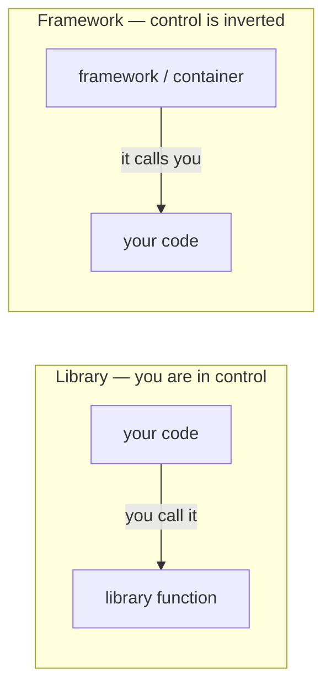

# Inversion of Control

*Inversion of Control (IoC) is the principle of **reversing the flow of control**: instead of your
code calling into a library, an outer framework calls into your code. IoC is the broad principle;
**dependency injection is just one technique that implements it**. It's the distinguishing trait
of a framework — the "Hollywood principle": **don't call us, we'll call you**.*

Part of the language-agnostic [`fundamentals/`](../) track. For the React-specific angle, see
`reactjs/00b-library-vs-framework`.

## The one-line idea

Normal code is *you* driving: your `main()` decides when to call `parse()`, `save()`, `render()`.
IoC flips that — you hand the outer control flow to a framework, and it calls your code at the
time *it* chooses. You keep responsibility for the **specifics** (what your function does); the
framework keeps responsibility for the **orchestration** (when, whether, and how often it runs).



## The Hollywood Principle

> "Don't call us, we'll call you."

You supply the pieces; the framework decides when to invoke them. This is what lets a framework be
an **extensible skeleton**: it defines the generic algorithm, and your code tailors specific steps
of it. The same idea covers everything from a DOM `onClick` handler to a test runner invoking your
`@Test` method.

## You call a library; a framework calls you

This is the classic test, and it's a **spectrum**, not a binary:

| | Library | Framework |
| --- | --- | --- |
| Who drives the flow | your code | the framework |
| Direction of calls | you → library | framework → you |
| You provide | calls into it | plug-in code it calls |
| Example | `lodash`, `axios` | Spring, Angular, Flask, React's render loop |
| Control | yours | inverted |

A library is a set of functions you invoke. A framework is an *inverted* skeleton that invokes
yours. (Some systems are both — a library with a plugin system is partly inverted.)

## What actually gets inverted

"Control" can mean several things, and IoC is used for all of them:

- **Flow of control** — who calls whom, and when.
- **Object creation** — who `new`s your dependencies.
- **Configuration & lifecycle** — who decides how a component is wired, when it's created, shared,
  and destroyed.

In a large framework, an **IoC container** takes over creation/configuration/lifecycle: you
declare components and their dependencies, and the container provisions them for you. That's the
"object creation, configuration, and lifecycle management delegated from your code to an external
framework" framing you'll see in Spring/Angular/Flask material.

## Parameterization: the general mechanism

IoC isn't magic — mechanically it's **parameterization**: making the varying part a parameter
instead of hardcoding it, so the *callee* owns the flow while the *caller* supplies the behavior.

```js
arr.sort(compareFn);          // you decide the ordering; sort owns the algorithm
arr.map(transform);           // you decide the transformation; map owns the iteration
setTimeout(callback, 1000);   // the runtime decides WHEN to call you
button.addEventListener("click", handler); // the browser decides when the handler fires
```

`sort` knows *how* to sort; you parameterize it with *what* "less than" means. Because the
receiving code can now call *your* code, control has inverted. Every IoC technique is a point on
this spectrum:

```
pass a value → pass a function (callback / higher-order function)
             → pass an object (strategy) → pass your whole lifecycle (DI container)
```

A framework is, in the end, a big generic algorithm **parameterized by your application**.

## Untangling the vocabulary

These four get conflated constantly. The video's whole point is that **IoC is the principle and
DI is a technique**, not synonyms.

| Term | What it is | One line |
| --- | --- | --- |
| **IoC** | a **principle** | reverse the flow of control |
| **DI** (dependency injection) | a **technique** | dependencies are passed *in*, not created inside |
| **DIP** (dependency inversion principle) | a **principle** (SOLID "D") | depend on abstractions, not concretions |
| **DI container** | a **tool** | auto-wires and manages component lifecycle |
| **Service locator** | another **IoC technique** | you *ask a registry* for dependencies |

- **IoC vs DI:** DI is one way to invert control. Saying "a container uses IoC" is like saying "a
  car has wheels" — IoC is characteristic of frameworks, not a special feature (Fowler).
- **DI vs DIP:** DI is about *who supplies* a dependency; DIP is about the *direction of the
  dependency* (both high- and low-level code should depend on an interface). You can do DI without
  DIP, and vice versa.
- **DI container vs Service Locator:** both invert control, but a container *injects* dependencies
  (explicit in the constructor) while a locator *hides* them behind a lookup call (usually
  discouraged — dependencies become invisible).

## Example (and why it helps)

Without IoC, a class tightly coupled to its own dependency — you can't tell it to use anything
else, and you can't test it without a real database:

```ts
class OrderService {
  private db = new SqlDatabase("postgres://prod"); // created and owned here
  create(order: Order) {
    return this.db.insert("orders", order);
  }
}
```

With dependency injection, control of creation moves *out* — the dependency is supplied:

```ts
interface Database {
  insert(table: string, row: Order): Promise<Order>;
}

class OrderService {
  constructor(private db: Database) {} // dependency injected
  create(order: Order) {
    return this.db.insert("orders", order);
  }
}

// The composition root / container wires it up:
const service = new OrderService(new SqlDatabase(process.env.DATABASE_URL));
// ...and tests can pass a fake:
const testService = new OrderService(new InMemoryDatabase());
```

The behavior is identical; what changed is *who is in control of the dependency*. This is why IoC
shows up everywhere as a **testability** and **decoupling** tool.

## Why it helps

- **Decoupling** — business logic isn't welded to infrastructure (a specific DB, UI, or transport).
- **Testability** — dependencies can be substituted with fakes/mocks.
- **Modularity & reuse** — components fit different contexts without modification.
- **Configuration flexibility** — behavior can be adjusted by wiring, not by editing code.
- **System abstraction** — frameworks hide cross-cutting system concerns (resource pooling,
  transaction management, security, lifecycle) so you write business logic instead.

## What it costs

- **Indirection** — control flows into code you didn't write; tracing "who called this?" means
  jumping through callbacks, hooks, and container wiring.
- **"Magic"** — auto-wiring and lifecycle management can hide how things are constructed.
- **Over-abstraction** — injecting everything, or reaching for a container when a plain function
  would do, adds ceremony with no benefit.
- **Learning curve** — the framework's conventions become required knowledge.

## Where you see it

- **Frameworks & containers:** Spring, Angular, Flask; NestJS, ASP.NET's built-in DI.
- **UI:** React calls your components; the browser calls your event handlers.
- **Servers:** Express/Nest invoke your route handlers.
- **Tests:** JUnit/pytest call your test methods.
- **Runtimes:** promises/`setTimeout` call your callbacks; event emitters fire your listeners.
- **Template method / strategy:** the base class calls overridable steps you implement.

## One-line summary

**Inversion of Control is the principle of handing the outer flow — including object creation,
configuration, and lifecycle — from your code to a framework that calls you ("don't call us,
we'll call you"); dependency injection is just one technique that implements it, containers are
tools that automate that technique, and the general mechanism underneath is parameterization
(passing behavior in so the callee drives the flow).**

## References

- Video — *What is Inversion of Control?* — Cameron McKenzie — <https://www.youtube.com/watch?v=37eHZza5aBk>
- Martin Fowler — *Inversion Of Control* (2005) — <https://martinfowler.com/bliki/InversionOfControl.html>
- Martin Fowler — *Inversion of Control Containers and the Dependency Injection pattern* — <https://martinfowler.com/articles/injection.html>
- TutorialsTeacher — *Inversion of Control* — <https://www.tutorialsteacher.com/ioc/inversion-of-control>
- Robert C. Martin — *The Dependency Inversion Principle* (the SOLID "D") — related but distinct from IoC/DI.
- Mark Seemann — *From dependency injection to dependency rejection* — <https://blog.ploeh.dk/2017/01/27/from-dependency-injection-to-dependency-rejection/>
- Related: `fundamentals/01-pure-functions`, `reactjs/00b-library-vs-framework`
