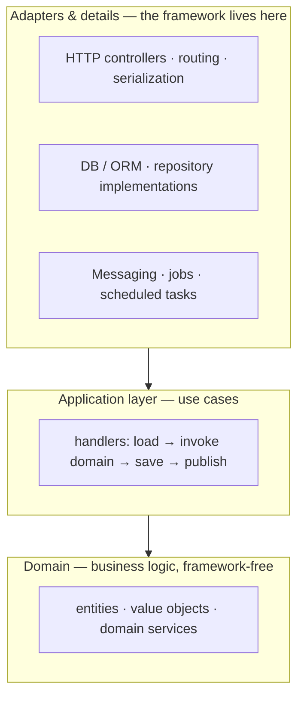

# Frameworks & business logic

*A framework exists to take the **configuration**, **object creation/lifecycle**, and **low-level
plumbing** off your plate so you can spend your code on **business logic**. But you only get that
benefit if the business logic lives in **its own place** — decoupled from the framework — instead
of being tangled into annotations, controllers, and database calls.*

Part of the language-agnostic [`fundamentals/`](../) track. Builds on `02-inversion-of-control` and
`06-collaborators`.

## The division of labor

A framework is infrastructure you plug into. It handles the generic, technical concerns that are
the same for every app; you handle the rules that make *your* app yours.

| The framework owns… | You own… |
| --- | --- |
| **Configuration** — settings, wiring, env | business **rules** and decisions |
| **Instantiation & lifecycle** — creating/sharing/disposing components (the IoC container) | *what* each component does |
| **Low-level plumbing** — HTTP/routing, serialization, DB transactions, connection pooling, security/auth, logging, scheduling | the domain **logic** those requests carry out |
| **Cross-cutting concerns** — retries, tracing, request scope | the **policies** specific to your problem |

The trade is deliberate: **give up control of the plumbing, keep control of the meaning.** You
write the business logic; the framework decides when to instantiate, configure, and call it (see
`02-inversion-of-control`).

## Why "business logic in its own place"

Business logic is the part that changes for **business** reasons — pricing, eligibility, workflows —
not technical ones. That makes it the most valuable and most-churning code, so it deserves the
least entanglement:

- **Testable without the framework.** Domain rules should run in a plain unit test — no server, no
  database, no HTTP, no container boot.
- **Understandable.** A rule you can read in one place beats one spread across controllers,
  decorators, and ORM callbacks.
- **Swappable infrastructure.** If the logic doesn't import the framework, you can change web
  frameworks, databases, or queueing without rewriting the rules.
- **Framework-agnostic by design.** The framework is a **detail**, not the architecture. Ideally you
  could host the same domain behind a CLI, a queue worker, or an HTTP API.

## How DI makes it possible

Dependency injection is the mechanism that lets the framework stay on the side. The framework
**provides** the infrastructure; your code **receives** it through interfaces and focuses on logic:

```ts
// Domain: pure business logic. No framework imports, no DB, no HTTP.
class PricingService {
  price(order: Order): Money {
    const subtotal = order.lines.reduce((s, l) => s.add(l.lineTotal), Money.usd(0));
    return order.customer.isVip ? subtotal.applyDiscount(0.1) : subtotal;
  }
}
```

```ts
// Application service: orchestrates a use case using injected collaborators.
class PlaceOrderHandler {
  constructor(
    private orders: OrderRepository,   // injected — not new'd here
    private pricing: PricingService,
    private events: EventPublisher,
  ) {}

  async handle(cmd: PlaceOrder) {
    const order = Order.create(cmd, /* ... */);
    order.total = this.pricing.price(order);   // business logic lives in the domain
    await this.orders.save(order);             // infra lives behind an interface
    await this.events.publish(order.pullEvents());
  }
}
```

The framework wires `PlaceOrderHandler` (constructor injection), routes the request to it, manages
the transaction, and serializes the response. None of that leaks into `PricingService`.

## The architecture: core inside, details outside

This is the shape that results — the business core at the center, the framework and other details
at the edge (Alistair Cockburn's *ports & adapters* / "hexagonal", and Robert C. Martin's *clean
architecture*):



- **Domain (center):** business rules. Depends on **nothing** technical. Plain classes/functions.
- **Application layer:** use cases that orchestrate the domain and talk to ports (interfaces).
- **Adapters/details (edge):** the framework, database, web, queues — they *depend on* the core, not
  the other way around. This is the **dependency-inversion** direction.

"Ports" are the interfaces your core exposes/needs; "adapters" are the concrete implementations the
framework plugs in. The DI container connects them — that's the composition root
(`03-value-objects-vs-collaborators`).

## Practical guidance

- **Keep the domain framework-free.** No annotations/decorators, no ORM base classes, no HTTP types
  in your entities. Plain language constructs.
- **Depend on interfaces (ports), not concretions.** Your core declares what it needs; adapters
  implement it.
- **Push all wiring to the composition root.** Only that one place knows the concrete framework
  classes.
- **Let the framework be a detail.** Ask "could I run this domain without the framework?" The closer
  the answer is to "yes", the cleaner the split.
- **Don't leak framework types across boundaries.** Map at the edge (DTOs, `11-data-transfer-objects`).
- **Put cross-cutting tech at the edge too** — transactions, auth, logging are adapters/decorators,
  not domain concerns.

## When *not* to bother

Separation costs indirection. It pays off for apps with **real, changing business logic** and a long
life. For a small CRUD app or a prototype, going framework-idiomatic (entities as ORM models, logic
in services) is a reasonable tradeoff — just make the choice knowingly. The principle is a tool, not
a mandate; the goal is that **business logic isn't accidentally trapped in infrastructure**.

## Pitfalls

- **Business logic in controllers/handlers.** "Rules" living in route handlers are untestable and
  duplicated. Push them into the domain.
- **Framework leakage into the core.** ORM annotations, `Request`/`Response`, or DI decorators on
  domain objects weld the domain to the framework.
- **Anemic domain, fat services.** Moving all logic into "services" while entities stay data bags is
  the anemic pattern (`05-entities`).
- **Container everywhere.** If your domain imports the DI container, the framework is no longer a
  detail — it's the architecture.
- **Ceremony for its own sake.** Full hexagonal layering for a tiny app adds files without value.

## One-line summary

**Frameworks earn their keep by owning configuration, object creation/lifecycle, and low-level
cross-cutting plumbing — so your code can focus on business logic — and the way to keep that benefit
is to put the business logic in its own framework-free place at the center, with the framework and
other details as swappable adapters at the edge, wired together by DI.**

## References

- Martin Fowler — *Inversion Of Control* — <https://martinfowler.com/bliki/InversionOfControl.html>
- Alistair Cockburn — *Hexagonal Architecture (Ports & Adapters)* — <https://alistair.cockburn.us/hexagonal-architecture/>
- Robert C. Martin — *The Clean Architecture* — <https://blog.cleancoder.com/uncle-bob/2012/08/13/the-clean-architecture.html>
- Martin Fowler — *PresentationDomainDataLayering* — <https://martinfowler.com/bliki/PresentationDomainDataLayering.html>
- Related: `02-inversion-of-control`, `06-collaborators`, `09-domain-services`, `11-data-transfer-objects`
