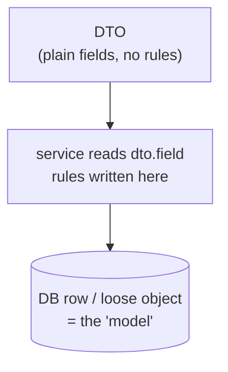
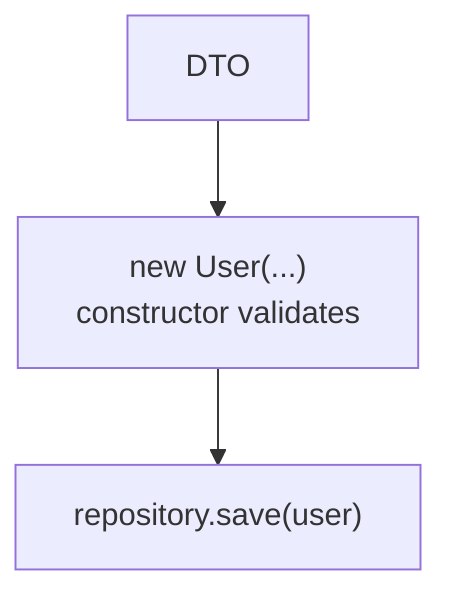
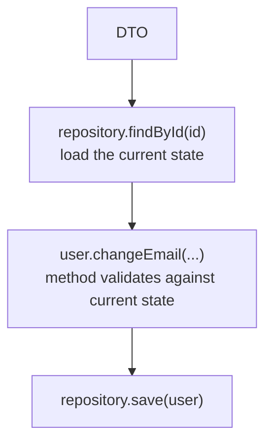

# Anemic domain via DTOs — DTOs are not your domain model

*Passing DTOs (or ORM/request shapes) deep into the domain and putting the logic in services that
operate on their fields rebuilds the anemic model — except worse: the "model" is now a transport-
or storage-shaped data bag, so the domain is coupled to the wire and the database and its invariants
are gone.*

Part of the language-agnostic [`fundamentals/`](../) track. Follows `15-anemic-domain-model`; builds
on `11-data-transfer-objects` and `05-entities`.

## The mistake in one line

A DTO is a shape chosen for a **boundary** (JSON over HTTP, a database row). If that shape becomes
the thing your business logic operates on, then:

- the logic runs on **plain data with no behavior** → anemic (`15-anemic-domain-model`), and
- the domain now **depends on the boundary's shape** → the API or table dictates your model.

You end up with a model that is neither rich nor appropriately simple — just data bags with a
transport accent.

## What it looks like

The request DTO is handed straight through, and the rules live in a service reading its fields:

```ts
// The API's shape — meant to cross the wire, not to model an order.
type CreateOrderDto = {
  customerId: string;
  lines: { sku: string; price: number; qty: number }[];
  vip?: boolean;
};

class OrderService {
  // The domain logic operates on the DTO's fields...
  create(dto: CreateOrderDto): CreateOrderDto {
    if (dto.lines.length === 0) throw new Error("empty order"); // rule on a transport shape
    const total = dto.lines.reduce((s, l) => s + l.price * l.qty, 0); // primitives, no Money
    if (dto.vip) total *= 0.9;                                        // pricing in a service
    return { ...dto, /* ...packed into more DTO fields... */ } as CreateOrderDto;
  }
}
```

Nothing here is an object that *guarantees* anything. `price` is a bare `number` (no currency), the
rule is deep in a service, and the returned value is the same DTO shape mutated in spirit. That's the
anemia — and it's now **typed by the API contract**.

A second flavour: **the ORM entity is the domain object.**

```ts
@Entity("orders")
class Order {
  @PrimaryColumn() id!: string;
  @Column() status!: string;         // database concerns on the domain object
  @OneToMany(() => OrderLine, (l) => l.order)
  lines!: OrderLine[];
  // ...no behavior...
}
```

Now the domain is welded to the persistence framework. Swap the ORM or the table layout and the "model"
changes with it (see `13-frameworks-and-business-logic`).

## Why it's harmful

- **It *is* anemia.** Data with no behavior; invariants enforced (maybe) in a service, bypassable by
  anyone holding the DTO.
- **Transport/persistence shapes leak into the core.** The API or schema now dictates the domain —
  the dependency points the wrong way. Change the wire format and business code changes.
- **Over-sharing / data exposure.** DTOs are shaped for consumers and often carry fields the domain
  shouldn't see (or vice versa: `passwordHash`, internal flags, DB columns).
- **Impedance loss.** DTOs must be serializable, so the model is forced into primitives
  (`string`/`number`) instead of rich types (`Money`, `EmailAddress`, `OrderId`) — losing the meaning
  and the validation that value objects provide.
- **Duplicated, misplaced validation.** Rules end up at the edge *and* in a service, drifting apart.
- **The ubiquitous language is lost.** DTO names describe payloads (`CreateOrderDto`), not the
  business (`Order`, `place()`), so the code stops speaking the domain.
- **Hard to test meaningfully.** You test "a service applied to a blob of transport data," not a
  domain object upholding its rules.

## The right shape: map at the boundary, model in the middle

Convert to a real domain object **at the edge**, keep the DTO only for the boundary, and map back on
the way out:

```ts
// Domain: rich, invariant-protecting, framework-free.
class Order {
  private lines: OrderLine[] = [];
  private status: OrderStatus = "draft";
  constructor(readonly id: OrderId, readonly customer: Customer) {}

  addLine(sku: Sku, price: Money, qty: number): void {
    if (this.status !== "draft") throw new Error("not editable");
    this.lines.push(new OrderLine(sku, price, qty));
  }
  place(): Money {
    if (this.lines.length === 0) throw new Error("empty order");
    this.status = "placed";
    return this.total();
  }
  private total(): Money {
    return this.lines.reduce((s, l) => s.add(l.lineTotal), Money.usd(0));
  }
}
```

```ts
// Edge (controller/adapter): map DTO → domain → DTO. The DTO stops here.
function toDomain(dto: CreateOrderDto, id: OrderId, customer: Customer): Order {
  const order = new Order(id, customer);
  for (const l of dto.lines) order.addLine(new Sku(l.sku), Money.usd(l.price), l.qty);
  return order;
}

function toResponse(order: Order): OrderResponse {
  return { id: order.id.value, status: order.status, total: order.total().amount };
}
```

Each layer keeps its **own shape**; the boundary owns the mapping. This is the same "core inside,
details outside" arrangement as `13-frameworks-and-business-logic`.

## Where do the rules come from? (the type, not the database)

A common confusion: *"to get the rules, do we load the user from the DB first?"* No. **The rules live
on the type** — the constructor and methods of the domain object. A `User` enforces its rules whether
it was just born from a DTO or loaded from storage.

Loading from the DB is a **different concern**, and it only applies to *changing something that
already exists*. Many rules are about the *change from the current state* — "you can't change the
email while the account is locked", "you can't add a line to a submitted order" — so the object has to
know where it is *now*, and the database is where that current state lives.

| Case | Load from the DB? | Why |
| --- | --- | --- |
| **Create** (signup) | **no** — nothing exists yet | `new User(...)`; the **constructor** enforces the rules |
| **Update** (edit email) | **yes** — load the current object | the **method** checks the rule against the real, current state |

In both cases the DTO **stops at the edge**. You never assign DTO fields straight onto the object
(that would skip the rules) — you call a **behavior method** with the new value.

```ts
// Create: build a new object from the DTO; the constructor enforces the rules.
function registerUser(dto: SignupDto, id: UserId): User {
  return new User(id, dto.name, new EmailAddress(dto.email));
}

// Update: load the current object, then call a method — don't set fields.
async function changeEmail(id: UserId, dto: ChangeEmailDto, users: UserRepository): Promise<void> {
  const user = await users.findById(id);
  if (!user) throw new Error("not found");
  user.changeEmail(new EmailAddress(dto.email)); // method enforces rules against current state
  await users.save(user);
}
```

### Diagram

**❌ Anemic — the DTO goes straight into the logic**



**✅ Create — new object, rules on the type**



**✅ Update — load current state, then change**



## Why it's tempting

- **"Fewer classes."** One shared shape avoids mapper code — until the shapes diverge and you're
  back to conditionals everywhere.
- **"DRY across layers."** Reusing the DTO/ORM entity in the domain feels like avoiding duplication,
  but the duplication it removes is *accidental*; the layers have genuinely different needs.
- **Frameworks encourage it.** ORMs hand you entities with setters; serializers hand you records. The
  path of least resistance is to make them the model.

## When sharing a shape is actually fine

Fowler's *LocalDTO* observation applies: for **simple CRUD**, one shape used for API, DB, and
"domain" is a legitimate, pragmatic choice — there's no behavior to lose and mapping adds nothing.
The rule of thumb:

- **Boundary shape == model shape, and there's little behavior** → sharing is acceptable (knowingly).
- **The shapes differ, or there is real behavior/invariants** → keep a distinct domain model and map
  at the edges.

The anti-pattern is not "a DTO exists"; it's **letting a boundary shape *be* the domain** and pushing
logic onto it.

## Practical guidance

- **DTOs live at the edge.** They enter and leave at controllers/adapters; they don't go inward.
- **Map explicitly at the boundary.** `toDomain`/`toResponse`, written by hand or with a mapper.
- **Keep the domain rich and framework-free.** Private fields, intention-revealing methods, value
  objects (`05-entities`, `04-value-objects`).
- **Separate the shapes that differ.** API DTO, domain model, and persistence model are three
  concerns; collapse them only when they genuinely coincide.
- **Don't annotate the domain with transport/ORM metadata.** Keep persistence ignorance where it
  matters (`PersistenceIgnorance`).

## One-line summary

**Using DTOs (or ORM/request shapes) as the domain model rebuilds the anemic model while also
welding the core to the wire and the database — the fix is to keep DTOs at the boundary, map them to
rich domain objects at the edge, and let each layer own its own shape (sharing one shape only when
there's genuinely no behavior to protect).**

## References

- Martin Fowler — *DataTransferObject* — <https://martinfowler.com/bliki/DataTransferObject.html>
- Martin Fowler — *LocalDTO* — <https://martinfowler.com/bliki/LocalDTO.html>
- Martin Fowler — *AnemicDomainModel* — <https://martinfowler.com/bliki/AnemicDomainModel.html>
- Martin Fowler — *PersistenceIgnorance* — <https://martinfowler.com/bliki/PersistenceIgnorance.html>
- Related: `11-data-transfer-objects`, `15-anemic-domain-model`, `05-entities`, `13-frameworks-and-business-logic`
