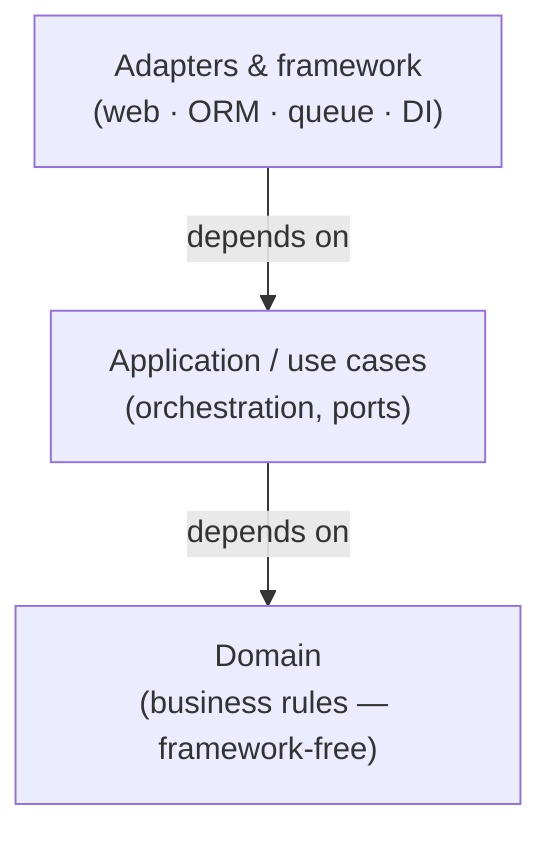

# Framework-free domain

*Keep the domain layer free of any framework or library — no ORM decorators, no web/DI/serialization
types, no ambient I/O. The core defines interfaces (ports); the framework's code implements them.
Dependencies point **inward**: the framework depends on the domain, never the reverse.*

Part of the language-agnostic [`fundamentals/`](../) track. The architectural form of
`02-inversion-of-control`; see also `13-frameworks-and-business-logic`, `05-entities`.

## Definition

A **framework-free domain** (a.k.a. *framework independence*, *persistence ignorance*) is a domain
model built only from plain language constructs — classes, functions, value objects — that **imports
nothing technical**: no ORM, no web framework, no DI container, no HTTP client, no serializer.

The domain knows its **ports** (the interfaces it needs); the framework provides **adapters** that
implement them. That inverts the usual dependency so the valuable, fast-changing business logic is
not welded to a technical detail.

## The dependency rule



Read it as: **source-code dependencies point inward, toward the core.** The center knows nothing
about the outside. The outer ring may import the inner ring; the inner ring must never import the
outer ring. This is the Dependency Inversion Principle applied at architecture scale.

## What "framework" means here

Anything technical the domain shouldn't know about:

- **Persistence** — ORM/query-builder decorators and base classes (`@Entity`, `Model`, `Repository<T>`), SQL, DB drivers.
- **Transport** — HTTP (`Request`/`Response`, route decorators), GraphQL, gRPC types.
- **DI container** — registration/injection decorators (`@Injectable`, `@Autowired`, service locators).
- **Serialization/validation libs** — schema/annotation frameworks used as the model.
- **Ambient I/O** — `Date.now()`, `Math.random()`, `process.env`, `fetch`, `fs`, `console`.
- **Jobs/queues/messaging** — consumers, producers, scheduler types.

None of these belong *inside* the domain.

## Where the rule applies

| Layer | Framework-free? | Contents |
| --- | --- | --- |
| **Domain** — entities, value objects, domain services, aggregates | **Yes, strictly** | business rules |
| **Application / use cases** | **Mostly** — only domain + self-defined ports | orchestration |
| **Adapters / infrastructure** — repo impls, controllers, clients, jobs | **No** — the framework lives here | DB · web · queue |
| **Composition root** | **No** — it is the wiring | container · concrete classes |

Enforce the rule in the **core**; confine the framework to the **edges**.

## How to keep it framework-free

- **Ports & adapters.** The domain declares interfaces (`OrderRepository`, `Clock`, `EventPublisher`); adapters implement them with the framework.
- **Data mapper, not annotations.** Keep a separate persistence model (ORM entity/row) and map `toRecord`/`toDomain`. The table shape is an adapter concern.
- **Map at the edge.** Convert boundary shapes (DTOs) into domain objects at the controller; the domain never sees them (`16-anemic-domain-via-dtos`).
- **Constructor injection.** Depend on ports via the constructor; wire concrete implementations only at the composition root. No container references inside the core.
- **Inject ambient inputs.** Pass `now`, `random`, config, and clients in — don't call the clock, RNG, env, or network directly (`01-pure-functions`).
- **Depend on abstractions.** The core defines the interface; the adapter depends on the core, not vice versa.

```ts
// Domain — framework-free. No imports beyond the language + other domain types.
interface Clock { now(): Date }             // a port the core needs
interface OrderRepository { save(o: Order): Promise<void> }

class Order {
  private status: OrderStatus = "draft";
  private lines: OrderLine[] = [];
  place(): void {
    if (this.lines.length === 0) throw new Error("empty order");
    this.status = "placed";
  }
}

// Adapter — the framework lives out here and implements the port.
@Entity class OrderRecord { /* columns... */ }
class PostgresOrderRepository implements OrderRepository { /* SQL here */ }

function toDomain(rec: OrderRecord): Order { /* map row → domain */ }
function toRecord(order: Order): OrderRecord { /* map domain → row */ }
```

## Why it matters

- **Testable without the framework** — the domain runs as plain unit tests: no server, DB, or container boot.
- **Swappable infrastructure** — change ORM, web framework, or queue without touching business rules.
- **No vendor lock-in** — the same core can run behind HTTP, a CLI, or a queue worker.
- **Clean ubiquitous language** — no ORM/web/DI vocabulary leaks into the business model.
- **Change is localized** — business changes touch the core; technical changes touch the edges.

## What it costs / when it's not worth it

- **Indirection and mapping.** Separate domain/persistence/transport shapes mean mapper code and more files.
- **Friction with convention-heavy frameworks.** Active Record / decorator-driven stacks (Rails, NestJS, Hibernate) push the model into the framework; keeping the core clean takes deliberate effort.
- **Not worth it for simple CRUD.** If there's little behavior, framework-idiomatic code with one shared shape is a fine, deliberate tradeoff (Fowler's *LocalDTO*). The rule earns its cost when there are **real, changing business rules** and a **long life**.

## Pitfalls / how to spot violations

- **Annotations on the domain** — `@Entity`/`@Column`/`@Injectable` on core classes → the ORM/container owns your model.
- **ORM entity *is* the domain object** — domain changes when the table changes.
- **Container inside the core** — the domain imports or resolves from the DI container; the framework became the architecture.
- **Ambient I/O in the domain** — `Date.now()`, `process.env`, `fetch`, `console` inside business logic: hidden, untestable dependencies.
- **Leaking boundary types inward** — `Request`/DTO/row types reaching the domain.
- **Fast check:** grep the domain directory for framework imports. It should import *only* the language and other domain modules.

## One-line summary

**A framework-free domain imports nothing technical — business rules are plain code, technical needs
are declared as ports, and frameworks implement them as adapters at the edges, so dependencies point
inward and the core stays testable, swappable, and unentangled from infrastructure.**

## References

- Martin Fowler — *PersistenceIgnorance* — <https://martinfowler.com/bliki/PersistenceIgnorance.html>
- Robert C. Martin — *The Clean Architecture* (the Dependency Rule) — <https://blog.cleancoder.com/uncle-bob/2012/08/13/the-clean-architecture.html>
- Alistair Cockburn — *Hexagonal Architecture (Ports & Adapters)* — <https://alistair.cockburn.us/hexagonal-architecture/>
- Martin Fowler — *Inversion Of Control* — <https://martinfowler.com/bliki/InversionOfControl.html>
- Related: `13-frameworks-and-business-logic`, `02-inversion-of-control`, `05-entities`, `11-data-transfer-objects`, `16-anemic-domain-via-dtos`
