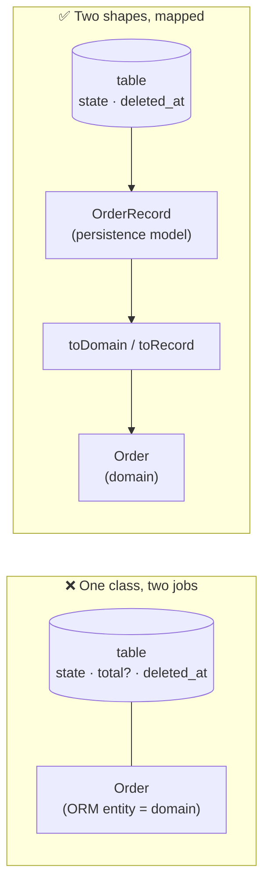
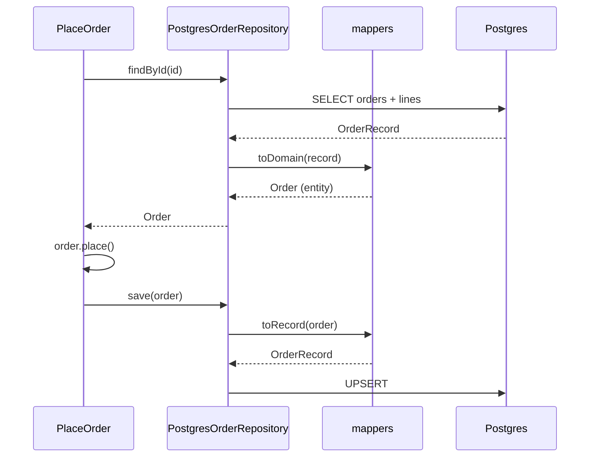

# Framework leaks into the domain — annotations & ORM entities

*Two concrete ways infrastructure owns your model: putting framework annotations (`@Entity`,
`@Column`, `@Injectable`) on domain classes, and letting the ORM entity **be** the domain object. In
both, the framework — not the business — decides the shape and lifecycle of your model, so a schema
or container change ripples straight into business logic.*

Part of the language-agnostic [`fundamentals/`](../) track. The vandalism that
`17-framework-free-domain` forbids; see also `16-anemic-domain-via-dtos`, `05-entities`.

## Leak 1 — annotations on the domain

Framework metadata baked onto core classes. The domain now **imports and depends on the framework**,
and the framework controls how instances are created and hydrated.

```ts
// ❌ Domain class as an ORM + DI artifact.
import { Entity, PrimaryGeneratedColumn, Column, OneToMany, Inject } from "typeorm";
import { Injectable, Inject as NestInject } from "@nestjs/common";

@Entity("orders")
export class Order {
  @PrimaryGeneratedColumn()
  id!: number;                       // DB-generated identity, not a domain concept

  @Column({ type: "text" })
  status!: string;                   // a table column, typed as a raw string

  @Column({ type: "numeric" })
  total!: number;                    // derived state stored as a column

  @OneToMany(() => OrderLine, (line) => line.order, { cascade: true })
  lines!: OrderLine[];               // persistence relationship = the model

  // ...business logic is expected to live here too...
}

@Injectable()
export class PricingService {
  @NestInject(OrderRepository) repo!: OrderRepository; // hidden, container-supplied dep
  price(o: Order): number { /* ... */ }
}
```

### What it costs

- **The core imports the framework.** `Order` can't exist without TypeORM/Nest; the domain depends on a detail.
- **Annotations *are* the schema.** `@Column`/`@OneToMany` choices become your model; the table layout and the business shape are the same thing.
- **The framework owns instantiation.** The ORM `new`s and hydrates `Order`; you can't freely `new Order(id)` to run invariants — construction is the container's job.
- **Hidden dependencies.** `repo` is injected into a field by the container; `PricingService` has a dependency you can't see in its constructor and can't supply without the DI container.
- **Reflection/registration required to test.** Instantiating the object or resolving its deps means booting or mocking the framework.
- **Pollution.** DB-generated ids, `deleted_at`, version columns, and relationship arrays leak into business vocabulary.

### The fix

```ts
// ✅ Domain — plain, framework-free.
export class Order {
  private status: OrderStatus = "draft";
  private lines: OrderLine[] = [];
  constructor(readonly id: OrderId) {}          // you new it; invariants run

  place(): void {
    if (this.lines.length === 0) throw new Error("empty order");
    this.status = "placed";
  }
  get total(): Money {                           // derived, not stored
    return this.lines.reduce((s, l) => s.add(l.lineTotal), Money.usd(0));
  }
}

export class PricingService {                    // constructor injection, no decorators
  constructor(private clock: Clock) {}
  price(o: Order): Money { /* ... */ }
}

// ✅ Adapter — the framework lives here.
@Entity("orders")
class OrderRecord { /* @PrimaryGeneratedColumn, @Column, @OneToMany ... */ }

function toDomain(rec: OrderRecord): Order { /* rows → domain */ }
function toRecord(o: Order): OrderRecord { /* domain → rows */ }
```

The annotations stay **outside** the core; the domain keeps plain constructors.

## Leak 2 — the ORM entity *is* the domain object

The same class is both the persisted row and the business object. Then **the table dictates the
model**: change the schema and you change the domain.

**Scenario:** the `orders` table changes — `status` is renamed to `state`, `total` moves to a
computed view, and a soft-delete column is added.

```ts
// Before: the ORM entity is the domain object.
@Entity("orders")
class Order {
  @Column() status!: string;
  @Column() total!: number;
}
// business code everywhere: order.status, order.total

// After the DB migration — the domain class must change with the table.
@Entity("orders")
class Order {
  @Column({ name: "state" }) state!: string;   // DB rename forced a domain rename
  // total removed (now a view) → business code reading order.total breaks
  @Column({ name: "deleted_at", nullable: true }) deletedAt?: Date; // DB concern in the model
}
```

A **database** decision rippled into **business** code: renames break callers, derived values vanish,
and storage-only fields appear in the model. Swap the ORM, switch to a document store, or add a
read replica with a different shape, and the domain changes again.

### What it costs

- **Table = model.** Schema changes are domain changes; the two can't evolve independently.
- **Persistence rules leak.** Nullable columns, generated ids, cascade settings, and soft-delete flags become your model's concerns.
- **You can't reuse the model.** A different store (or an in-memory test) must mimic the ORM's shape.
- **Incomplete objects.** ORMs return partially-loaded entities (lazy relations); the domain can hold a "valid" object whose data isn't there.
- **Hard to test the rules.** Testing behavior means constructing ORM-shaped rows, not clean objects.

### The fix

Separate the two shapes and map across the seam:



```ts
// ✅ Persistence model: shaped for the table.
@Entity("orders")
class OrderRecord {
  @PrimaryColumn() id!: string;
  @Column({ name: "state" }) state!: string;     // DB's naming lives here only
  @Column({ name: "deleted_at", nullable: true }) deletedAt?: Date;
}

// ✅ Domain model: shaped for the business.
export class Order {
  constructor(readonly id: OrderId, private status: OrderStatus = "draft") {}
  get total(): Money { /* derived */ }
}

// The mapper absorbs the difference — schema changes stop at the adapter.
function toDomain(rec: OrderRecord): Order { /* ... */ }
function toRecord(o: Order): OrderRecord { /* ... */ }
```

Now a column rename or a new DB-only field touches **only the adapter and mapper**; the domain —
and all its callers — is untouched.

## Why it's tempting

- **"It's the same data, so it's the same class."** The row and the concept look identical at first — until they diverge.
- **The framework makes it the default.** ORMs hand you decorated entities and want them to be your model; the path of least resistance is to accept.
- **Fewer classes.** One shape avoids mappers — until a schema change forces the mapping anyway, scattered everywhere.

## How to fix (summary)

- **Move annotations to the edge.** Keep `@Entity`/`@Column`/`@Injectable` off domain classes; put them on adapter/record classes.
- **Separate the shapes.** A persistence model (record/row) ≠ the domain model; map with `toDomain`/`toRecord`.
- **No container in the core.** Use constructor injection; wire concretes only at the composition root.
- **Nothing technical inward.** Domain imports only the language + other domain modules — the grep check from `17-framework-free-domain`.
- **Know when to skip it.** For simple CRUD with no behavior, one shared shape is a fine, deliberate tradeoff.

## The true fix — the adapter handles the entity

The real fix isn't just moving decorators out — it's the **ports & adapters** arrangement where the
adapter is the *only* thing that knows the ORM, and it **maps between the domain entity and the
persistence record**. Here's the whole chain.

### Where it lives

```
src/
├── domain/order/
│   ├── Order.ts                    # entity — framework-free
│   ├── OrderLine.ts
│   ├── OrderId.ts                  # value object
│   └── OrderRepository.ts          # PORT (interface)
├── application/place-order/
│   └── PlaceOrder.ts               # use case — depends on the PORT
├── infrastructure/persistence/typeorm/
│   ├── OrderRecord.ts              # @Entity/@Column — the ORM lives HERE
│   ├── mappers.ts                  # entity ⇄ record
│   └── PostgresOrderRepository.ts  # implements the PORT
└── composition-root.ts             # wires the concrete adapter into the use case
```

### 1. The port (domain)

```ts
export interface OrderRepository {
  findById(id: OrderId): Promise<Order | null>; // returns a DOMAIN entity
  save(order: Order): Promise<void>;            // accepts a DOMAIN entity
}
```

### 2. The adapter (infrastructure) — implements the port

```ts
@Entity("orders")
class OrderRecord {
  @PrimaryColumn("uuid") id!: string;
  @Column("text") status!: string;
  @OneToMany(() => OrderLineRecord, (l) => l.order, { cascade: true }) lines!: OrderLineRecord[];
}

export class PostgresOrderRepository implements OrderRepository {
  constructor(private db: DataSource) {}

  async findById(id: OrderId): Promise<Order | null> {
    const rec = await this.db.getRepository(OrderRecord).findOne({
      where: { id: id.value }, relations: { lines: true },
    });
    return rec ? toDomain(rec) : null;                          // record → entity
  }

  async save(order: Order): Promise<void> {
    await this.db.getRepository(OrderRecord).save(toRecord(order)); // entity → record
  }
}
```

### 3. The mapper — the seam between the two shapes

```ts
function toRecord(order: Order): OrderRecord {
  const rec = new OrderRecord();
  rec.id = order.id.value;
  rec.status = order.currentStatus;                 // read domain state outward
  rec.lines = order.orderLines.map(toLineRecord);
  return rec;
}

function toDomain(rec: OrderRecord): Order {
  const lines = rec.lines.map(
    (l) => new OrderLine(new Sku(l.sku), new Money(l.price_amount, l.price_currency), l.qty),
  );
  return Order.reconstitute(new OrderId(rec.id), rec.status as OrderStatus, lines);
}
```

### 4. The use case depends on the port (not the adapter)

```ts
export class PlaceOrder {
  constructor(private orders: OrderRepository) {}   // interface — no ORM, no DB
  async execute(cmd: PlaceOrderCommand): Promise<void> {
    const order = await this.orders.findById(new OrderId(cmd.orderId));
    if (!order) throw new Error("not found");
    order.place();                                   // domain logic on the entity
    await this.orders.save(order);                   // the adapter persists the entity
  }
}
```

### 5. Wiring — the composition root

```ts
const repo: OrderRepository = new PostgresOrderRepository(db); // adapter implements the port
const placeOrder = new PlaceOrder(repo);                       // inject the port
```

### How it's connected at runtime



### Two details that make it correct

- **Read access, never setters.** The mapper *reads* the entity (`get currentStatus`, `get orderLines`)
  and the adapter never assigns domain fields — changes happen only through behavior methods
  (`place()`, `addLine()`). So the persistence seam can't smuggle invalid state into the entity.
- **`reconstitute` ≠ constructor.** Loading from the DB must **not** re-run create-time rules (an
  already-`placed` order is valid), so rebuilding from a record uses `Order.reconstitute(...)`, a
  separate path from the constructor (see `12-factories`).

## One-line summary

**Putting framework annotations on domain classes, or letting the ORM entity be the domain object,
hands ownership of your model to the framework — constructor, lifecycle, and shape all become the
database's/container's concern — so schema changes force domain changes; the fix is plain
constructors, separate persistence/domain shapes, and a mapper that absorbs the difference at the
adapter.**

## References

- Martin Fowler — *PersistenceIgnorance* — <https://martinfowler.com/bliki/PersistenceIgnorance.html>
- Martin Fowler — *Data Mapper* (PoEAA) — <https://martinfowler.com/eaaCatalog/dataMapper.html>
- Robert C. Martin — *The Clean Architecture* — <https://blog.cleancoder.com/uncle-bob/2012/08/13/the-clean-architecture.html>
- Related: `17-framework-free-domain`, `16-anemic-domain-via-dtos`, `05-entities`, `08-repositories`
