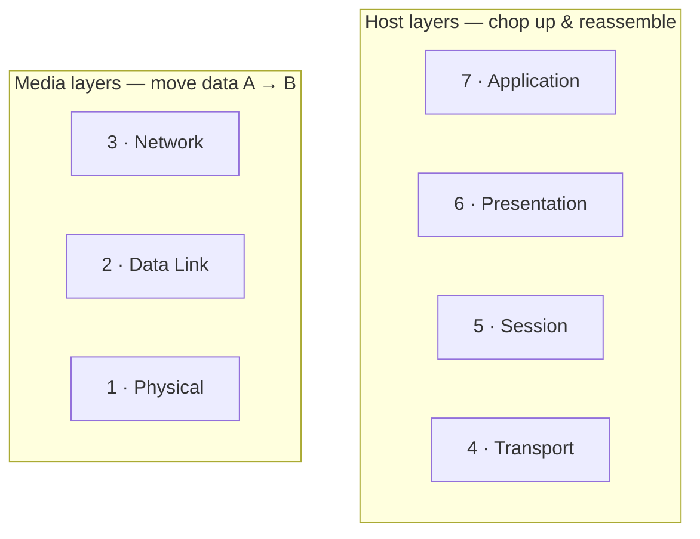

# The OSI Model

*The OSI model is not a thing your network uses — it is a lens for reading one. Seven conceptual layers that break "how do two machines talk?" into questions small enough to answer, so you can design and debug real networks instead of memorizing cables.*

Source: this topic follows the **Tech Fundamentals** course at [learn.cantrill.io](https://learn.cantrill.io/p/tech-fundamentals).

---

## What it is

The **OSI (Open Systems Interconnection) model** is a conceptual framework describing the communication functions of a telecommunication or computer system. It divides that job into **seven layers**, each responsible for one specific function in moving data between networked devices.

The point of the layering is *standardization*: it lets different devices communicate regardless of their underlying hardware or software, because every device agrees on what each layer is supposed to do. For an engineer, that shared vocabulary is the payoff — you can design, implement, and troubleshoot complex networks far more efficiently when you can say "that's a layer 2 problem" and everyone knows what part of the system you mean.

Two honest caveats before we start:

- **It's a conceptual model, not a spec.** Real networking software is not always literally implemented as seven stacked boxes. The model is a *teaching and reasoning tool* — a foundation for understanding how networking actually works — not a diagram of your kernel.
- **The "network stack" on a laptop, phone, or server *is* organized this way.** Every one of those devices runs a networking stack, and that stack maps onto these layers. The abstraction is real enough to reason with.

### Practice targets for this course

As we go, the practical networking topics map onto the layers like this:

| Course topic | Roughly lives at |
| --- | --- |
| Local networking / Ethernet | Layers 1–2 |
| Routing | Layer 3 |
| Segmenting, ports, sessions | Layers 4–5 |
| Applications | Layer 7 |

---

## Media layers vs. host layers

The seven layers split into two halves.

- **Media layers (bottom — 1, 2, 3):** how data is *moved from A to B*. Whether the two devices are on the same network or on opposite sides of the planet, this is the half that carries the bits.
- **Host layers (top — 4, 5, 6, 7):** how data is *chopped up and re-assembled*. This is the half that makes a stream of bits into a sensible conversation between two programs.



The seven layers, top to bottom:

| # | Layer | One-line job |
| --- | --- | --- |
| 7 | Application | The interface to the actual app (HTTP, DNS, SMTP…) |
| 6 | Presentation | Translate/encrypt/compress data into a usable form |
| 5 | Session | Manage the conversation (open, maintain, close) |
| 4 | Transport | Segment data, ports, reliability (TCP/UDP) |
| 3 | Network | Logical addressing and routing between networks (IP) |
| 2 | Data Link | Physical addressing within a local network (MAC) |
| 1 | Physical | Move raw bits — voltages, light, radio |

Mnemonics, bottom-up and top-down respectively:

```
1→7   Please Do Not Throw Sausage Pizza Away
7→1   All People Seem To Need Data Processing
```

### "Layer X device" rule

When we say a device "is a layer X device," we mean it understands **layer X and every layer below it** — never above. A **layer 3 device** operates on layers 3, 2, and 1: it can route, but it does not care about sessions or application data. Keep this in your head; it explains why a switch and a router behave so differently.

---

## Layer 1 — the physical layer

Let's make it concrete: two laptops in a house, and you want to play a LAN game between them.

- A **physical networking cable** connects them. Each laptop has a **network interface card (NIC)**.
- Assume the medium is **copper**. That gives us a **point-to-point electrical medium** between the two devices. The medium could equally be **Wi-Fi** or **fibre** — different physics, same layer.
- The medium carries information. The physical layer's job is to convey a **stream of bits — 1s and 0s**.
- For copper, the standard defines the encoding: a certain voltage means binary **1** (say `+1`), another means binary **0** (say `-1`).
- Both NICs implement the **same standard**, so they agree on what a `+1` volt means. Agreement is the whole trick.

So two devices can talk over a point-to-point link. But what happens when we want **more than two** devices?

### The hub

Add a device called a **hub** with multiple ports, and connect the devices to it. Now everything is interconnected. But a hub is a blunt instrument:

- Anything a hub receives on one port is **retransmitted out of all its other ports** — including the errors.
- There is **no way to address a specific device**. Whatever the hub receives goes to everyone. It's like shouting in a room.
- This is purely a **layer 1** device.

### Collisions, and why layer 1 can't stop them

Because everyone hears everything, two devices can transmit at the same time. Their signals overlap on the shared medium and **corrupt each other — a collision**.

- Layer 1 has **no media access control**, so it has no way to prevent collisions from happening.
- Layer 1 **can't detect collisions** either. It just transmits voltage changes onto the wire; it has no concept of "someone else is talking."
- The more devices on the segment, the higher the chance of a collision.

And that's the ceiling of a layer-1-only network:

- **No media access control** — collisions will happen and nothing stops them.
- **Everyone must share the same medium and the same device standard** (i.e., compatible NICs).
- **No way to uniquely identify a device.**

To fix any of this we need to go up a layer. That's layer 2 — media access control, addressing, and a smarter device than a hub — which is where the next topic picks up.

---

## Summary

- OSI is a **conceptual 7-layer framework**, not an implementation.
- Layers split into **media** (1–3: move data) and **host** (4–7: chop up and reassemble).
- A **layer X device** understands layer X and below.
- Layer 1 moves raw bits over a medium; a **hub** is a layer 1 device that floods everything.
- With only layer 1 there is no addressing, no access control, and **collisions are unavoidable**.

---

## References

- Tech Fundamentals course — [learn.cantrill.io/p/tech-fundamentals](https://learn.cantrill.io/p/tech-fundamentals)
- ISO/IEC 7498-1 — the original OSI Basic Reference Model (the standard the layers come from).
