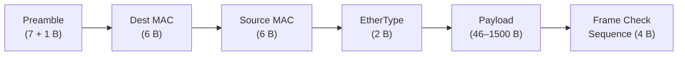
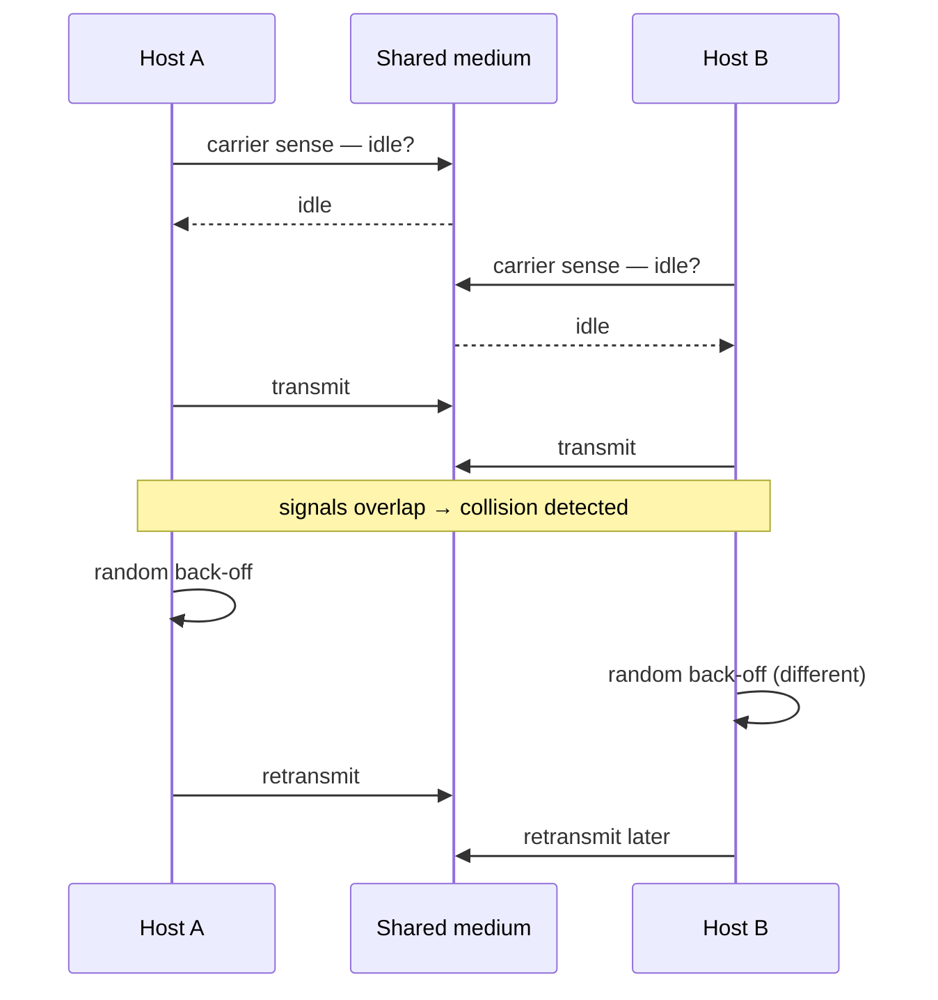
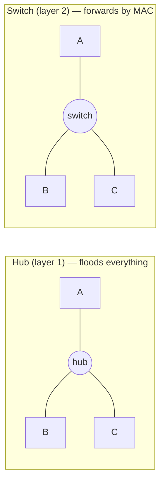

# Layer 2 — The Data Link Layer (Ethernet & MAC)

*Layer 1 moves raw bits, but it can't tell devices apart and can't stop them from talking over each other. Layer 2 fixes both: it wraps the bits in **frames**, gives every NIC a unique **MAC address**, and adds **media access control** so devices share one medium without corrupting each other. This is the layer that makes a **LAN** — and every network, including the internet, is built out of layer-2 networks glued together.*

Source: this topic follows the **Tech Fundamentals** course at [learn.cantrill.io/p/tech-fundamentals](https://learn.cantrill.io/p/tech-fundamentals). Continues from [`01-osi-model`](../01-osi-model); leads into [`03-network-layer`](../03-network-layer).

---

## What layer 2 does

Layer 1 alone gives you a medium that carries 1s and 0s, but:

- It can't **address** a specific device — everything on the wire hears everything.
- It can't **control access** to the medium — two devices transmitting at once produce a **collision**.

Layer 2 sits directly on top and adds exactly the missing pieces:

- **Frames** — a structured container for data on the wire.
- **MAC addresses** — a unique hardware address per network interface, so a frame can be aimed at one device.
- **Media access control** — rules for *when* a device may transmit, so collisions are prevented or handled.

### Layer 2 requires layer 1

**Layer 2 runs on top of layer 1** — it *needs* it. You cannot have a layer-2 network without a layer-1 medium underneath, because layer 2 never touches the wire itself: it hands its frame **down** to layer 1, which encodes it as signals.

Crucially, **layer 1 does not understand frames** — it only understands signals (voltages, light, radio). The frame is layer 2's concept; layer 1 just carries it as a stream of bits.

---

## The MAC address

Every **network interface card (NIC)** — the network hardware in a laptop, phone, or server — owns a **MAC address**:

- **48 bits** long (6 bytes), written as hex pairs: `00:1A:2B:3C:4D:5E`.
- A **hardware address**: it's burned into the NIC (or assigned to it), not configured per network like an IP.
- The first 3 bytes are the **OUI** (vendor identifier); the last 3 are unique to that NIC.

The MAC address is what lets a frame on a shared medium say *"this one's for you, not everyone."*

---

## The Ethernet frame

A **frame** is the layer-2 container. Think of it as an envelope: layer-3 data goes *inside*, and the envelope carries the addressing and error-checking the wire needs.

| Part | Size | Job |
| --- | --- | --- |
| **Preamble** | 7 + 1 bytes | Wake up and sync the receiver's clock (`0xAA…` + start delimiter) |
| **Destination MAC** | 6 bytes | Who this frame is for |
| **Source MAC** | 6 bytes | Who sent it |
| **EtherType** | 2 bytes | Which layer-3 protocol is inside (`0x0800` = IPv4, `0x86DD` = IPv6, `0x0806` = ARP) |
| **Payload** | 46–1500 bytes | The actual data — supplied by **layer 3** |
| **Frame Check Sequence** | 4 bytes | CRC used to **detect errors** in the frame |

### Encapsulation

Putting layer-3 data *into* the frame's payload is **encapsulation**. It works like this:

1. The **layer-2 software at the source** builds the frame, putting the layer-3 data in the payload.
2. It passes the frame **down to layer 1**, which turns it into signals on the medium.
3. On the **destination**, the signals are taken off the medium, turned back into a frame, and passed **up to layer 2**.
4. Layer 2 **de-encapsulates** — strips the frame — and hands the payload **up to layer 3**.

This is the core idea of the whole model: **as data moves *down* the stack it is encapsulated; as it moves *up* it is de-encapsulated.** And anything **below** the layer you're working at is **abstracted away** — layer 3 never thinks about voltages; layer 1 never thinks about frames.

---

## Media access control: solving layer 1's collision problem

Recall layer 1's fatal flaw: with a **hub**, everyone shares one medium, so two devices can transmit at the same time and their signals **overlap and corrupt each other — a collision**.

Layer 2 adds **media access control** to fix this. Classic Ethernet uses **CSMA/CD** — *Carrier Sense Multiple Access with Collision Detection*:

- **Carrier Sense** — listen *before* transmitting. If the medium is busy (someone else is speaking), **wait**.
- **Multiple Access** — many devices share the same medium.
- **Collision Detection** — if two devices listen, both hear silence, and both transmit anyway, the signals collide. Both detect the collision, stop, and **back off for a random time**. Because the random back-off differs, they retry at **different moments** and one gets through.

### Who accepts a signal?

A natural question: *if the MAC address is inside the frame, how does the physical layer decide which signals to accept?*

**It doesn't.** Layer 1 accepts **every** signal on the medium — it has no concept of addressing. Layer 2 then **takes a peek at the destination MAC** in each frame and decides: *is this for me?* If yes, keep it and pass it up; if no, discard it. Addressing is entirely layer 2's job.

---

## Hub vs. switch

Both are multi-port devices that connect several hosts. The difference is **how many layers they understand**.

| | **Hub** | **Switch** |
| --- | --- | --- |
| **Layer** | Layer 1 only | Layer 2 |
| **What it is** | A multi-port **repeater** | A layer-2 forwarding device |
| **Understands frames?** | No | Yes |
| **Addressing** | None | MAC address table |
| **Behavior** | Repeats one port's traffic out **all** others | Forwards to **only** the right port |
| **Collisions** | Common — and repeated on every port | Isolated per port; frame checked before sending |

### The hub

A hub is dumb: whatever it receives on one port, it **repeats out of every other port**. So if A and B transmit at the same time, the collision is repeated everywhere. No addressing, no intelligence.

### The switch

A switch is a **layer-2** device, so it has layer-2 software and a **MAC address table** inside:

- When a device first sends a frame, the switch **learns** its **MAC → port** and records it.
- When a frame arrives, the switch looks up the **destination MAC**:
  - **Known** → forward it out of **only that port** (the right device).
  - **Unknown** → **flood** it out of all other ports (so it still reaches the target).
- It **stores** the frame, checks it's valid, sends it, and then **discards** it.

That intelligence is why **modern Ethernet is switched**: each port is its own collision domain, so collisions are largely a thing of the past.

---

## Can you have layer 1 or layer 2 "networks"?

Yes — but "network" here means a single **LAN/segment**, not the internet:

- A **layer-1 "network"** is a shared medium (a hub or a single cable segment): devices can exchange bits, but there's **no addressing** and collisions are constant. It's barely a network.
- A **layer-2 network** is a **switched LAN**: MAC addressing and media access control give you **identifiable devices** — the first real "network." This is what makes a LAN work.

You **cannot** have a layer-2 network without layer 1 (layer 2 runs on layer 1). And neither is "the internet": to connect one LAN to another you need **layer 3** and routing — which is where [`03-network-layer`](../03-network-layer) picks up.

---

## Unicast vs. broadcast

Layer 2 supports two ways of addressing a frame:

- **Unicast (1 : 1)** — the destination MAC is one specific NIC; only that device keeps the frame.
- **Broadcast (1 : all)** — the destination MAC is all-`FF` (`FF:FF:FF:FF:FF:FF`); **every** device on the segment processes it (used for things like ARP "who has this IP?").

---

## Summary

- **Layer 2 = device-to-device communication on a LAN**, built on top of layer 1.
- It adds **frames**, **MAC addresses** (48-bit hardware addresses on the NIC), and **media access control**.
- The **Ethernet frame**: preamble → dest MAC → source MAC → EtherType → payload (46–1500 B) → FCS.
- **Encapsulation**: layer-3 data goes into the frame at the source and is de-encapsulated at the destination. Down = encapsulate, up = de-encapsulate; lower layers are abstracted away.
- Layer 1 **accepts every signal**; layer 2 reads the **destination MAC** to decide what to keep.
- **CSMA/CD** prevents/handles collisions: listen first, detect collisions, then random back-off.
- A **hub** (layer 1) repeats everything out all ports; a **switch** (layer 2) learns MAC→port and forwards to only the right device.
- With a switch you get the first **identifiable devices** — a real LAN. **Unicast** is 1:1, **broadcast** is 1:all.
- Every network — including the internet — is built from **layer-2 networks connected together**.

---

## References

- Tech Fundamentals course — [learn.cantrill.io/p/tech-fundamentals](https://learn.cantrill.io/p/tech-fundamentals)
- IEEE 802.3 — *Ethernet* — <https://standards.ieee.org/ieee/802.3/7071/>
- IEEE 802.1Q — *VLANs* (layer-2 segmentation, a later topic)

## Related

- `01-osi-model` — the seven layers and where layer 2 sits
- `03-network-layer` — how LANs are connected together with IP and routing
