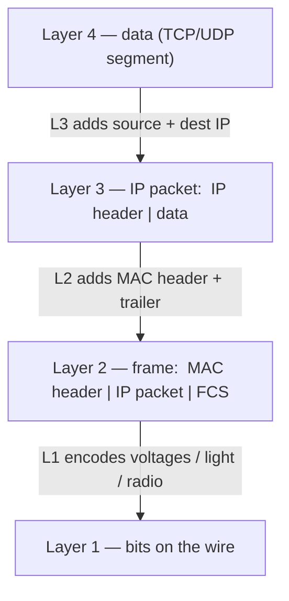
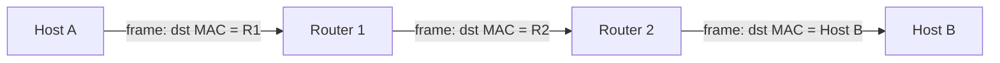

# Layer 3 — The Network Layer (IP)

*Layer 2 connects devices **inside** one local network. Layer 3 connects local networks **to each other** — it puts a logical address on every device (an IP address) and routes packets across the public internet, hop by hop, until they reach the right LAN. The frame is rebuilt at every hop; the IP packet survives end to end.*

Source: this topic follows the **Tech Fundamentals** course at [learn.cantrill.io](https://learn.cantrill.io/p/tech-fundamentals). Continues from [`01-osi-model`](../01-osi-model).

---

## What layer 3 adds

Layer 2 gets you a working **LAN** — devices wired to a switch, talking with **MAC addresses**. But that only exists inside one closed space. The moment you want two LANs to talk — one house to another across the country — layer 2 runs out of road:

- **MAC addresses are local.** They identify a NIC on a single segment; they mean nothing once a frame leaves it.
- **Switches don't route between networks.** A switch forwards frames within a LAN; it has no idea how to reach a different network.
- **Point-to-point links don't scale.** You *could* run a dedicated cable between every pair of houses, but with `n` sites that's roughly `n²` links — and every site would have to run the exact same layer-2 protocol. That is not how the internet is built.

So we introduce a new layer whose job is **logical addressing and routing between networks**. That layer is **layer 3**, and on the internet its protocol is **IP (Internet Protocol)**.

---

## Why we use public networks

Instead of private point-to-point links between every pair of sites, every LAN connects to a **shared public network** through a **router**. The router is the doorway:

- Inside the LAN, layer 2 handles delivery (**switching**).
- To leave the LAN, the frame is handed to the router, which forwards the traffic across the public network toward the destination LAN.
- The public network is a mesh of routers; no single site needs a link to every other site.

This is the whole reason the internet works: a **shared, routed public network** instead of a fully-connected web of private cables.

---

## Where encapsulation happens

Here is the question to get straight: **who wraps the frame into an IP packet, and when?**

The answer: **the sending host's own network stack**, not the switch and not the router. Every host (laptop, phone, server) runs a full network stack, and it builds each layer before anything goes on the wire:

So the encapsulation is **not** triggered by "leaving the LAN." The host builds the IP packet **every time it sends**, local or remote. What changes is **what the frame's destination MAC is**:

- **Destination is in the same LAN** → the frame's destination MAC is the **destination host's** MAC.
- **Destination is in another LAN** → the frame's destination MAC is the **default gateway's** MAC (the router).

That's the subtlety. The IP packet is created either way; the router only becomes involved when the destination IP is outside the local subnet. (To learn that next-hop MAC, the host uses **ARP** for IPv4 / **NDP** for IPv6 — "who has this IP, tell me your MAC.")

---

## Does intra-LAN traffic stay at layer 2?

Short answer: **it stays *switched*, but it does not skip layer 3.**

The sending host decides local vs remote by comparing the destination IP against its own **subnet mask**:

- **Same subnet →** send the frame **directly** to the destination host. No router, no layer-3 hop. The switch forwards the frame by MAC; the IP packet just rides along inside it.
- **Different subnet →** send the frame to the **default gateway**, which routes it onward.

So be precise about the wording:

| Statement | True? |
| --- | --- |
| "Traffic within a LAN is *switched*, not routed." | **Yes** — no router touches it. |
| "Traffic within a LAN never uses layer 3 / IP." | **No** — the IP packet is still built and carried; L3 addressing decides it's local. |
| "Switches understand IP and route by it." | **No** — switches are layer 2; they forward by MAC and don't inspect IP. |

The clean mental model: **layer 3 decides *whether* a router is needed; layer 2 does the delivery inside the LAN.**

---

## The IP packet

The **IP packet** is the layer-3 unit. Its most important fields:

| Field | Meaning |
| --- | --- |
| **Source IP** | Logical address of the sender |
| **Destination IP** | Logical address of the intended recipient |
| **TTL / Hop Limit** | Decremented at each hop; hits `0` → packet dropped (loop protection) |
| **Protocol** | Which layer-4 protocol the payload is (TCP `6`, UDP `17`, ICMP `1`) |

An **IP address** is the logical address that identifies a device across *different* local networks — the thing a MAC address can't do.

---

## The hop

A **hop** is one step a packet takes through the network — the trip from one device to the **next** router (or from the last router to the destination host). Every router a packet passes through is a hop.

At **every hop**, the same dance repeats:

1. The router **receives the frame** and strips the incoming layer-2 header (de-encapsulates).
2. It reads the **destination IP**, consults its routing table, and picks the **next hop**.
3. It **decrements the TTL**.
4. It wraps the **same IP packet** in a **brand-new frame** addressed to the next hop, and sends it on.

The key insight is **what changes and what doesn't**:

| | Stays the same end to end | Rewritten at every hop |
| --- | --- | --- |
| **Layer 3** | IP packet — source & destination IP | — |
| **Layer 2** | — | Frame — source & destination MAC |

The **IP packet is constant** from sender to receiver (that's why we can route by destination IP). The **frame is disposable** — a fresh one is built for each hop, with a destination MAC pointing only to the *next* device, never to the final destination across the world.

---

## Arrival at the destination

When the final frame reaches the destination host, the stack unwinds **bottom-up** — the exact reverse of how it was built:

1. **Layer 1:** the NIC receives the physical signal (voltage/light/radio) and decodes it back into **bits**.
2. **Layer 2:** the frame is reassembled. The host checks the **destination MAC** matches (and the checksum is valid). If it does, it **strips the frame header/trailer** and passes the payload up — that payload is the IP packet.
3. **Layer 3:** the host checks the **destination IP** matches its own address. It consumes the packet (TTL is not forwarded further) and reads the **Protocol** field to know which layer-4 protocol is inside.
4. **Layer 4:** TCP/UDP reads the port, reassembles any segments in order, and delivers the payload to the correct **socket / process**.
5. **Layers 5–7:** the application data is reassembled and handed to the app (e.g., an HTTP response body).

That's the full round trip: the data was chopped up going *down* the stack at the sender and is put back together going *up* the stack at the receiver.

---

## IPv4 vs IPv6

There are two versions of IP address in use today:

| | IPv4 | IPv6 |
| --- | --- | --- |
| **Size** | 32-bit | 128-bit |
| **Format** | Dotted decimal — `192.168.1.1` | Hex, colon-separated — `2001:db8::1` |
| **Space** | ~4.3 billion (exhausted) | ~3.4 × 10³⁸ |
| **Next-hop lookup** | ARP | NDP |
| **Header** | Variable, with options | Simpler, fixed |

Both do the same job: logical addressing and routing across networks. IPv6 exists mainly because the world ran out of IPv4 addresses.

---

## Summary

- **Layer 3 = logical addressing + routing between networks** (IP). Layer 2 connects devices inside one LAN; layer 3 connects LANs.
- We use a **shared public network** of routers instead of point-to-point links, because `n²` private links don't scale.
- **The sending host does the encapsulation**, not the switch or router: L4 data → **IP packet** (adds source/dest IP) → **frame** (adds MAC header/trailer) → **bits**.
- Intra-LAN traffic is **switched, not routed** — but it still *uses* layer 3 to decide the destination is local. The switch forwards by MAC and ignores IP.
- A **hop** is one step between routers. At each hop the frame is **stripped and rebuilt**; the **IP packet stays the same end to end**.
- On arrival, the stack unwinds bottom-up: signal → frame → IP packet → TCP/UDP segment → application data.
- **IPv4** (32-bit, `192.168.1.1`) and **IPv6** (128-bit, `2001:db8::1`) are the two address versions.

---

## References

- Tech Fundamentals course — [learn.cantrill.io/p/tech-fundamentals](https://learn.cantrill.io/p/tech-fundamentals)
- RFC 791 — *Internet Protocol* (IPv4) — <https://datatracker.ietf.org/doc/html/rfc791>
- RFC 8200 — *Internet Protocol, Version 6 (IPv6) Specification* — <https://datatracker.ietf.org/doc/html/rfc8200>

## Related

- `01-osi-model` — the seven layers and where layer 3 sits
