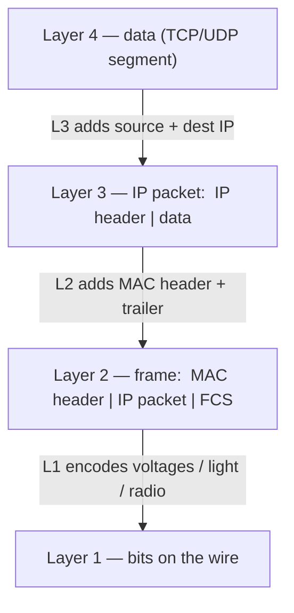
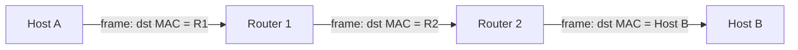
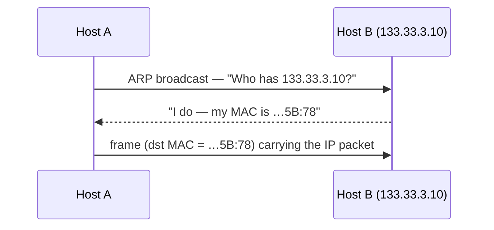
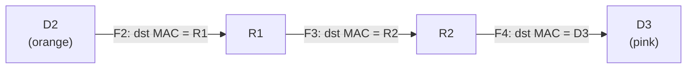

# Layer 3 — The Network Layer (IP)

*Layer 2 connects devices **inside** one local network. Layer 3 connects local networks **to each other** — it puts a logical address on every device (an IP address), works out whether a destination is **local or remote**, and **routes** packets across the public internet, hop by hop, until they reach the right LAN. The frame is rebuilt at every hop; the IP packet survives end to end.*

Source: this topic follows the **Tech Fundamentals** course at [learn.cantrill.io/p/tech-fundamentals](https://learn.cantrill.io/p/tech-fundamentals). Continues from [`01-osi-model`](../01-osi-model) and [`02-data-link-layer`](../02-data-link-layer).

---

## What layer 3 adds

Layer 2 gets you a working **LAN** — devices wired to a switch, talking with **MAC addresses**. But that only exists inside one closed space. The moment you want two LANs to talk — one house to another across the country — layer 2 runs out of road:

- **MAC addresses are local.** They identify a NIC on a single segment; they mean nothing once a frame leaves it.
- **Switches don't route between networks.** A switch forwards frames within a LAN; it has no idea how to reach a different network.
- **Point-to-point links don't scale.** You *could* run a dedicated cable between every pair of houses, but with `n` sites that's roughly `n²` links — and every site would have to run the exact same layer-2 protocol. That is not how the internet is built.

So we add a new layer. Concretely, layer 3 contributes:

- **IP addresses** (v4 or v6) — *cross-network* logical addressing, so devices on different LANs can be identified.
- **ARP** — a way to find the MAC address for a given IP address, bridging layer 3 to layer 2.
- **Routes and route tables** — rules defining where to forward a packet.
- **Routers** — devices that move packets from source to destination, re-encapsulating them in new layer-2 frames along the way.

The result is **device-to-device communication across the internet** — reaching a server several intermediate networks away, each crossing many different layer-2 networks.

---

## Why we use public networks

Instead of private point-to-point links between every pair of sites, every LAN connects to a **shared public network** through a **router**. The router is the doorway:

- Inside the LAN, layer 2 handles delivery (**switching**).
- To leave the LAN, the frame is handed to the router, which forwards the traffic across the public network toward the destination LAN.
- The public network is a mesh of routers; no single site needs a link to every other site.

This is the whole reason the internet works: a **shared, routed public network** instead of a fully-connected web of private cables.

---

## IP addressing

An **IP address** is the logical address that identifies a device using layer-3 (IP) networking. IPv4 addresses are written in **dotted decimal notation**: four decimal numbers, `0`–`255`, separated by dots — e.g. `133.33.3.7`. From a connectivity point of view, if an address is valid you can send packets to it and they'll at least *start* the journey (firewalls or an offline host may stop them).

But dotted decimal is only the **human** format. The machine sees **binary**: each decimal part is an **8-bit octet**, and there are four of them → **32 bits** in total.

| Octet | Decimal | Binary |
| --- | --- | --- |
| 1st | 133 | `10000101` |
| 2nd | 33 | `00100001` |
| 3rd | 3 | `00000011` |
| 4th | 7 | `00000111` |

So `133.33.3.7` = `10000101.00100001.00000011.00000111`.

Every IP address has **two parts**:

- the **network part** — which IP network this address belongs to;
- the **host part** — which device (host) on that network.

Two IP addresses are on the **same network** if their **network parts match**; otherwise they're on **different networks**. That single fact drives everything: **same network → talk directly** (layer 2); **different network → use a router** (layer 3).

The catch: from an IP address *alone* you can't tell where the network part ends and the host part begins. For that you need a **subnet mask**.

---

## Subnet masks & prefixes

A **subnet mask** tells you which part of an IP address is the network and which is the host. It's configured on a layer-3 interface **alongside the IP address** (usually automatically, via DHCP).

It's written either in dotted decimal (`255.255.0.0`) or as a **prefix** (`/16`) — these mean the same thing. The prefix is simply the **number of leading 1s** in the mask, counted from the left.

Convert the mask to binary, then read it as **1 = network, 0 = host**:

```
mask    255      .255      .0        .0
binary  11111111 .11111111 .00000000 .00000000
        └────────── 16 ones ──────────┘            →  /16
```

Overlay the mask on the IP address to split it:

```
IP     133.33.3.7   = 10000101 . 00100001 . 00000011 . 00000111
mask   255.255.0.0  = 11111111 . 11111111 . 00000000 . 00000000
                      └─── network ───┘  └─────── host ───────┘
network part = 133.33
```

So for `133.33.3.7/16`, the **network** is `133.33` and `3.7` is the **host** part.

### Network range: first and last address

For any network you can calculate the start and end:

- **Network (start) address** — network part + an **all-zeros** host part → `133.33.0.0`
- **Broadcast (end) address** — network part + an **all-ones** host part → `133.33.255.255`

So the network spans `133.33.0.0 – 133.33.255.255`, and **any** two addresses inside it are local to each other.

### Same network or different?

Compare the **network parts**:

- `133.33.3.7/16` and `133.33.33.37/16` both start with `133.33` → **same network**.
- `133.33.3.7/16` and `133.33.3.10/24` → different masks, so the comparison differs — the `/24` treats the first 24 bits as network (`133.33.3`).

A host uses this test to decide: send the frame **directly** on the LAN, or hand it to the **default gateway**.

---

## Static vs. dynamic addresses, and the default gateway

IP addresses are assigned one of two ways:

- **Static** — set manually by a human; the address never changes.
- **Dynamic (DHCP)** — assigned automatically by a **DHCP server** (Dynamic Host Configuration Protocol) running on the network.

Either way, IP addresses must be **unique** — at least within a network, and (for public addresses) globally. Duplicates cause bad, hard-to-debug behaviour.

Alongside the IP and mask, most interfaces are also configured with a **default gateway**: the IP of a **local router** that packets are forwarded to when the destination is **not local**. On a home network, your internet router is the default gateway. That's why, when you browse to Netflix or AWS, your packets go to the router rather than being hunted for on your LAN.

---

## The IP packet

The **IP packet** is the layer-3 unit. Its most important fields:

| Field | Meaning |
| --- | --- |
| **Source IP** | Logical address of the sender |
| **Destination IP** | Logical address of the intended recipient |
| **TTL / Hop Limit** | Decremented at each hop; hits `0` → packet dropped (loop protection) |
| **Protocol** | Which layer-4 protocol the payload is (TCP `6`, UDP `17`, ICMP `1`) |

---

## Where encapsulation happens

Here is the question to get straight: **who wraps the frame into an IP packet, and when?**

The answer: **the sending host's own network stack**, not the switch and not the router. Every host (laptop, phone, server) runs a full network stack, and it builds each layer before anything goes on the wire:



So the encapsulation is **not** triggered by "leaving the LAN." The host builds the IP packet **every time it sends**, local or remote. What changes is **what the frame's destination MAC is**:

- **Destination is in the same LAN** → the frame's destination MAC is the **destination host's** MAC.
- **Destination is in another LAN** → the frame's destination MAC is the **default gateway's** MAC (the router).

That's the subtlety. The IP packet is created either way; the router only becomes involved when the destination IP is outside the local subnet. (To learn that next-hop MAC, the host uses **ARP** for IPv4 / **NDP** for IPv6 — "who has this IP, tell me your MAC.")

---

## Does intra-LAN traffic stay at layer 2?

Short answer: **it stays *switched*, but it does not skip layer 3.**

The sending host decides local vs remote by comparing the destination IP against its own **subnet mask**:

- **Same subnet →** send the frame **directly** to the destination host. No router, no layer-3 hop. The switch forwards the frame by MAC; the IP packet just rides along inside it.
- **Different subnet →** send the frame to the **default gateway**, which routes it onward.

So be precise about the wording:

| Statement | True? |
| --- | --- |
| "Traffic within a LAN is *switched*, not routed." | **Yes** — no router touches it. |
| "Traffic within a LAN never uses layer 3 / IP." | **No** — the IP packet is still built and carried; L3 addressing decides it's local. |
| "Switches understand IP and route by it." | **No** — switches are layer 2; they forward by MAC and don't inspect IP. |

The clean mental model: **layer 3 decides *whether* a router is needed; layer 2 does the delivery inside the LAN.**

---

## The hop

A **hop** is one step a packet takes through the network — the trip from one device to the **next** router (or from the last router to the destination host). Every router a packet passes through is a hop.

At **every hop**, the same dance repeats:

1. The router **receives the frame** and strips the incoming layer-2 header (de-encapsulates).
2. It reads the **destination IP**, consults its routing table, and picks the **next hop**.
3. It **decrements the TTL**.
4. It wraps the **same IP packet** in a **brand-new frame** addressed to the next hop, and sends it on.



The key insight is **what changes and what doesn't**:

| | Stays the same end to end | Rewritten at every hop |
| --- | --- | --- |
| **Layer 3** | IP packet — source & destination IP | — |
| **Layer 2** | — | Frame — source & destination MAC |

The **IP packet is constant** from sender to receiver (that's why we can route by destination IP). The **frame is disposable** — a fresh one is built for each hop, with a destination MAC pointing only to the *next* device, never to the final destination across the world.

---

## Routing: route tables and routes

Now the core of layer 3: **how does a router know where to send a packet?**

Every router has at least one **route table** — a collection of **routes**. Each row is one route with:

- a **destination** — a network, written in prefix form; and
- a **next hop / target** — where to forward matching packets (the next router, one step closer).

When a packet arrives, the router reads its **destination IP** and looks for routes that **match** it.

### Longest prefix match

More than one route can match, and when they do the router picks the **most specific** — the one with the **longer prefix** (more leading 1s):

- `/32` — a **single** IP address (most specific).
- `/24` — the first 24 bits are network → **256** addresses.
- `/0` — **every** IP address (least specific) → this is the **default route**, `0.0.0.0/0`.

The default route matches **only when nothing more specific does** — that's why traffic "just goes to the ISP." Example, for a packet destined to `52.217.13.37`:

| Destination | Next hop | Matches? |
| --- | --- | --- |
| `52.217.13.0/24` | AWS router | ✅ and more specific |
| `0.0.0.0/0` | upstream ISP | ✅ but less specific |
| `10.0.0.0/8` | — | ❌ |

Both the first two match; the `/24` wins by **longest prefix**. The router then forwards the packet to that route's **next hop**.

Route tables are filled in either **statically** (hand-written) or by **routing protocols** like **BGP** (Border Gateway Protocol), where routers exchange the networks they know about — this is how the core of the internet functions.

---

## ARP: IP address → MAC address

To actually **send** a frame on the wire, a host needs the **MAC address** of the next hop — but it only knows the next hop's **IP address**. **ARP (Address Resolution Protocol)** bridges that gap: it finds the **MAC address for a given IP address**.

It runs at the boundary between layer 2 and layer 3:

1. Host A has a packet for `133.33.3.10` but no MAC for it.
2. A **broadcasts** a layer-2 frame to `FF:FF:FF:FF:FF:FF`: *"Who has `133.33.3.10`?"*
3. The owner replies with its MAC address.
4. A now builds the frame addressed to that MAC and sends it.



ARP is what lets layer-3 packets ride inside layer-2 frames — the glue between "IP address" and "next-hop MAC."

---

## Worked example: local vs. remote delivery

Three networks, two routers. Two laptops, `D1` and `D2`, are in the **orange** network; `D3` is in the **pink** network. `R1` sits between orange and green, `R2` between green and pink. Each router has an interface in **both** networks it touches (routers are layer-3 devices, so they understand layers 1–3).

### Local: D1 → D2 (same network)

1. `D1` compares its IP + mask with `D2`'s IP → **same network** → no router needed.
2. It builds packet `P1` with `D2` as the destination IP.
3. **ARP** gets `D2`'s MAC; `P1` is wrapped in a frame addressed to `D2`.
4. `D2` receives the frame, checks the destination MAC, strips the frame, checks the destination IP, strips the packet, and hands the data to the game.

One frame, no router — plain layer-2 delivery.

### Remote: D2 → D3 (different networks)

1. `D2` compares its IP + mask with `D3`'s IP → **different network** → it needs the **default gateway**, `R1`.
2. It builds packet `P2`: source `D2`, destination `D3`.
3. It wraps `P2` in frame `F2` whose destination MAC is **`R1`** (found via ARP). `F2` is sent to `R1`.
4. `R1` sees the frame is addressed to itself, **strips `F2`**, leaving `P2`. A normal host would drop a packet not meant for it — but a **router** is happy to forward it. `R1` checks its route table, sees the destination is on the pink network, and picks **`R2`** as the next hop.
5. `R1` wraps `P2` in a **new** frame `F3` whose destination MAC is **`R2`** (via ARP), and sends it.
6. `R2` strips `F3`, leaving `P2` again. The destination is on its **local** network, so no more routing is needed — it uses ARP to get `D3`'s MAC and wraps `P2` in a final frame `F4` addressed to **`D3`**.
7. `D3` receives `F4`, confirms it's the destination MAC, strips the frame, confirms it's the destination IP, strips the packet, and the data reaches the game.



The **packet `P2` never changes** — same source and destination IP the whole way. The **frames `F2`, `F3`, `F4` are all different**, each addressed only to the next hop. That's the essence of routing: **move the packet one layer-2 network at a time, rebuild the frame each time.**

---

## Arrival at the destination

When the final frame reaches the destination host, the stack unwinds **bottom-up** — the exact reverse of how it was built:

1. **Layer 1:** the NIC receives the physical signal (voltage/light/radio) and decodes it back into **bits**.
2. **Layer 2:** the frame is reassembled. The host checks the **destination MAC** matches (and the checksum is valid). If it does, it **strips the frame header/trailer** and passes the payload up — that payload is the IP packet.
3. **Layer 3:** the host checks the **destination IP** matches its own address. It consumes the packet (TTL is not forwarded further) and reads the **Protocol** field to know which layer-4 protocol is inside.
4. **Layer 4:** TCP/UDP reads the port, reassembles any segments in order, and delivers the payload to the correct **socket / process**.
5. **Layers 5–7:** the application data is reassembled and handed to the app (e.g., an HTTP response body).

That's the full round trip: the data was chopped up going *down* the stack at the sender and is put back together going *up* the stack at the receiver.

---

## IPv4 vs IPv6

There are two versions of IP address in use today:

| | IPv4 | IPv6 |
| --- | --- | --- |
| **Size** | 32-bit | 128-bit |
| **Format** | Dotted decimal — `192.168.1.1` | Hex, colon-separated — `2001:db8::1` |
| **Space** | ~4.3 billion (exhausted) | ~3.4 × 10³⁸ |
| **Next-hop lookup** | ARP | NDP |
| **Header** | Variable, with options | Simpler, fixed |

Both do the same job: logical addressing and routing across networks. IPv6 exists mainly because the world ran out of IPv4 addresses.

---

## Summary

- **Layer 3 = logical addressing + routing between networks** (IP). Layer 2 connects devices inside one LAN; layer 3 connects LANs.
- It adds **IP addresses**, **ARP**, **routes / route tables**, and **routers** — enabling device-to-device communication across the internet.
- We use a **shared public network** of routers instead of point-to-point links, because `n²` private links don't scale.
- An **IP address** is 32 bits (four 8-bit **octets**); it has a **network part** and a **host part**. Two IPs are on the same network iff their network parts match.
- A **subnet mask** / **prefix** (`255.255.0.0` = `/16`) says which bits are network (**1**) and host (**0**). The network's **start** = network part + all-zero host; its **end** = network part + all-one host.
- Addresses are **static** or **DHCP**-assigned and must be **unique**. The **default gateway** is the local router used for non-local destinations.
- **The sending host does the encapsulation**, not the switch or router: L4 data → **IP packet** (adds source/dest IP) → **frame** (adds MAC header/trailer) → **bits**.
- Intra-LAN traffic is **switched, not routed** — but it still *uses* layer 3 to decide the destination is local. The switch forwards by MAC and ignores IP.
- **Routing** uses **route tables**: match the destination IP, prefer the **longest prefix** (`/32` most specific, `/0` = **default route**). Routes are **static** or learned via **BGP**.
- **ARP** resolves an IP to a MAC (broadcast "who has this IP?"), gluing layer 3 to layer 2.
- A **hop** is one step between routers. At each hop the frame is **stripped and rebuilt**; the **IP packet stays the same end to end**.
- On arrival, the stack unwinds bottom-up: signal → frame → IP packet → TCP/UDP segment → application data.
- **IPv4** (32-bit, `192.168.1.1`) and **IPv6** (128-bit, `2001:db8::1`) are the two address versions.

---

## References

- Tech Fundamentals course — [learn.cantrill.io/p/tech-fundamentals](https://learn.cantrill.io/p/tech-fundamentals)
- RFC 791 — *Internet Protocol* (IPv4) — <https://datatracker.ietf.org/doc/html/rfc791>
- RFC 826 — *An Ethernet Address Resolution Protocol* (ARP) — <https://datatracker.ietf.org/doc/html/rfc826>
- RFC 8200 — *Internet Protocol, Version 6 (IPv6) Specification* — <https://datatracker.ietf.org/doc/html/rfc8200>

## Related

- `01-osi-model` — the seven layers and where layer 3 sits
- `02-data-link-layer` — the frames and MAC addresses that carry IP packets
