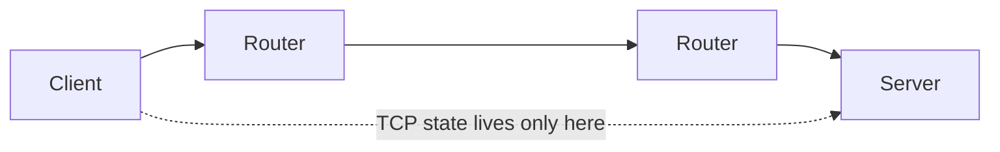
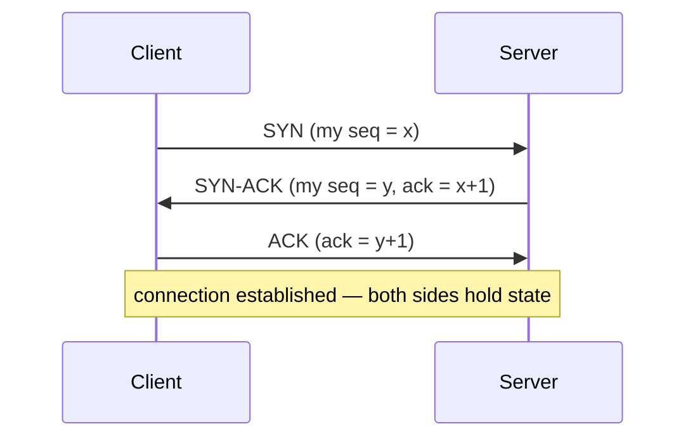

# Layer 4 — The Transport Layer (TCP, connections & sockets)

*Layer 3 moves packets between networks but promises nothing — they can be lost, duplicated, or arrive out of order. Layer 4 adds **ports** to address a process (not just a host) and, with **TCP**, a **connection**: state held at the two endpoints (sequence numbers, acknowledgements, buffers) that turns unreliable packets into an ordered, reliable byte stream. There is **no tunnel** — routers still just forward packets; the "connection" exists only in the two machines.*

Source: this topic follows the **Tech Fundamentals** course at [learn.cantrill.io/p/tech-fundamentals](https://learn.cantrill.io/p/tech-fundamentals). Continues from [`03-network-layer`](../03-network-layer); framed around TCP sockets in Node.js.

---

## What layer 4 adds

Layer 3 (IP) gets a packet to the right **host** — the right machine on the right network. But a machine runs many programs, and the packet needs to reach a specific **process**. That's layer 4's job:

- **Ports** — a 16-bit number (`0`–`65535`) that identifies the process on the host. IP = *which machine*, port = *which program*.
- **Segments** — the layer-4 unit (IP's "packet" is layer 3; TCP/UDP's unit is a "segment/datagram").
- **Two protocols** — **TCP** (reliable, ordered, connection-oriented) and **UDP** (fire-and-forget datagrams).

So layer 3 gives you *packets between networks*; layer 4 gives you *conversations between processes* — and, with TCP, a promise that the bytes arrive **in order and intact**.

---

## The connection is not a tunnel

A natural question: if two machines have a "TCP connection," is it some **exclusive tunnel** through the internet, reserved for just those two?

**No.** The internet is **packet-switched**, not circuit-switched:

- There is **no dedicated path**. Routers **forward each packet independently** toward its destination IP, one hop at a time — exactly like the hop-by-hop behaviour from `03-network-layer`.
- A router in the middle **doesn't know or care** that two hosts have a TCP connection. It sees an IP packet and forwards it.



The connection is not a thing in the network — it's **state remembered at the two endpoints**. The analogy: routers are **mail trucks following roads**, not builders of **private highways**. Each packet is a parcel dropped in the mail; the trucks don't reserve a lane for it.

---

## Sockets

A **socket** is the operating system's handle for one endpoint of a connection — the API your program uses to send and receive bytes. Two roles:

- **Listening socket** — bound to a port, waiting for incoming connections (e.g. your Node server listening on `:3000`).
- **Accepted (connected) socket** — created once a connection is established; represents **that specific connection** to **that specific client**.

A connection is uniquely identified by the **4-tuple**: `source IP : source port : destination IP : destination port`. That's how the OS tells many simultaneous connections apart on the same port.

In Node.js, the OS does the heavy lifting. `http.createServer(...).listen(3000)` creates the listening socket; each incoming connection is handed to your callback as a socket object:

```js
import net from "node:net";

const server = net.createServer((socket) => {
  // `socket` is the accepted connection to one client.
  console.log("connected from", socket.remoteAddress, socket.remotePort);
  socket.on("data", (chunk) => socket.write(`echo: ${chunk}`));
  socket.on("end", () => console.log("client closed"));
});

server.listen(3000);
```

The routers between you and the client are irrelevant to this code — your app only ever sees the socket.

---

## The three-way handshake

TCP establishes a connection with a **three-way handshake**. Both sides exchange **sequence numbers** so each can track what has been sent and received:



1. **SYN** — client asks to connect and proposes a starting **sequence number**.
2. **SYN-ACK** — server acknowledges and sends its own sequence number.
3. **ACK** — client acknowledges the server's.

After the third message both sides have the state they need, and the OS hands the app an **accepted socket**. Note: this handshake happens **whether or not** you keep the connection alive — a connection always costs at least this.

---

## What the connection actually is

Strip away the metaphor and a TCP connection is **state at two endpoints**:

- **Sequence numbers** — where each side is in the byte stream.
- **Acknowledgements** — which bytes the other side has received.
- **Buffers** — where received-but-not-yet-delivered data waits.
- **State machine** — the connection's lifecycle (establishing, established, closing…).

That state is what fixes layer 3's problems. IP packets can:

- **arrive out of order** → TCP **reorders** them using sequence numbers;
- **be lost** → TCP **retransmits** the missing bytes;
- **be duplicated** → TCP **discards** duplicates.

So your program sees a clean, **ordered, reliable byte stream**, even though the underlying packets are none of those things. The routers never guarantee order or delivery — **TCP at the endpoints does.**

---

## Keep-alive vs. a new connection

The question that started this: *what's the overhead of **not** keeping a connection alive?*

Without keep-alive (e.g. classic HTTP/1.0), **every request opens a brand-new TCP connection**. Each one pays:

- the **three-way handshake** — at least **one round trip** of latency;
- **state setup** — allocate sequence numbers, buffers, and connection state;
- **teardown** — close cleanly and free it all (plus `TIME_WAIT`).

With **keep-alive** (persistent connections), the two computers **remember they're talking** and reuse the same connection for many requests, skipping all of that setup:

| | New connection each request | Keep-alive (persistent) |
| --- | --- | --- |
| **Handshake** | every request (1+ RTT each) | once, then reused |
| **State setup / teardown** | every request | paid once |
| **Latency** | extra round trip per request | saved |
| **CPU** | handshake + alloc + cleanup each time | mostly avoided |
| **Memory** | freed when idle | a little held while idle |
| **Example** | HTTP/1.0 | HTTP/1.1 default, WebSockets, chat apps |

The trade is explicit: **a bit of idle memory for faster, smoother exchange.** That's why chat and realtime apps love persistent connections — they'd otherwise pay a handshake on every message. (HTTPS adds a **TLS handshake** on top, so keep-alive saves even more round trips there.)

---

## The hops in between

Everything from `03-network-layer` still applies: the packet is **encapsulated in a fresh frame at every hop**, and the **IP packet stays the same end to end**. The only new thing at layer 4 is that the **two endpoints** also keep TCP state. The routers:

- forward by **destination IP**, hop by hop;
- never see or store "connection" information;
- don't reserve bandwidth or a path.

So a "connection" spanning the planet is really: **a stream of independently-routed packets**, plus **matching state at two machines** that lets them reassemble the stream.

---

## TCP vs. UDP

| | **TCP** | **UDP** |
| --- | --- | --- |
| **Connection** | connection-oriented (handshake) | connectionless |
| **Reliability** | ordered, retransmits, no duplicates | best-effort, may drop/reorder |
| **Overhead** | higher (state, acks, handshake) | minimal |
| **Use for** | web, file transfer, chat | DNS, video/voice, games |

TCP pays for its guarantees with state and round trips; UDP skips all of that when you'd rather be fast and can tolerate loss.

---

## Summary

- **Layer 4 = process-to-process communication**: **ports** address a program, **segments** carry the data, **TCP/UDP** are the two protocols.
- A TCP connection is **not a tunnel** — the internet is **packet-switched**; routers forward packets independently and don't know about the connection. The connection is **state at the two endpoints**.
- A **socket** is the OS handle for one endpoint: a **listening socket** accepts connections; an **accepted socket** represents one connection. Identified by the 4-tuple `srcIP:srcPort:dstIP:dstPort`.
- TCP opens with a **three-way handshake** — **SYN → SYN-ACK → ACK** — exchanging **sequence numbers**.
- The connection is **sequence numbers + acknowledgements + buffers + a state machine**, which turn unreliable packets into an **ordered, reliable byte stream** (reordering, retransmitting, de-duplicating).
- **Keep-alive** reuses a connection across requests, skipping the handshake, state setup, and teardown — trading **a little idle memory for lower latency and less CPU**. Without it, every request pays a fresh handshake.
- Routers still just **forward packets hop by hop**; TCP guarantees live only at the endpoints.

---

## References

- Tech Fundamentals course — [learn.cantrill.io/p/tech-fundamentals](https://learn.cantrill.io/p/tech-fundamentals)
- RFC 9293 — *Transmission Control Protocol (TCP)* — <https://datatracker.ietf.org/doc/html/rfc9293>
- RFC 768 — *User Datagram Protocol (UDP)* — <https://datatracker.ietf.org/doc/html/rfc768>
- Node.js docs — [`node:net`](https://nodejs.org/api/net.html), [`node:http`](https://nodejs.org/api/http.html)

## Related

- `03-network-layer` — the IP packets and hops that carry TCP segments
- `02-data-link-layer` — the frames rebuilt at every hop
