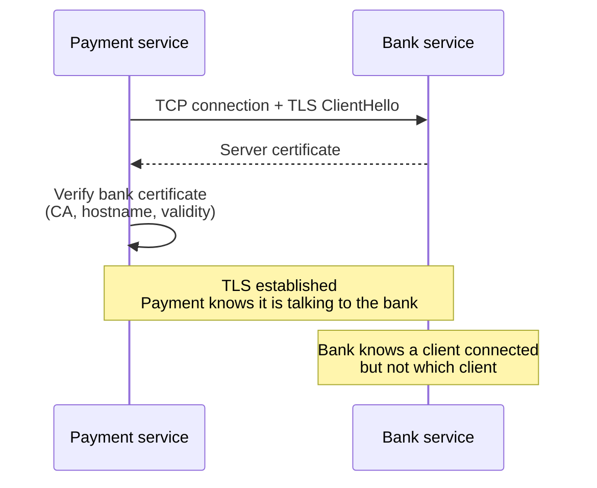
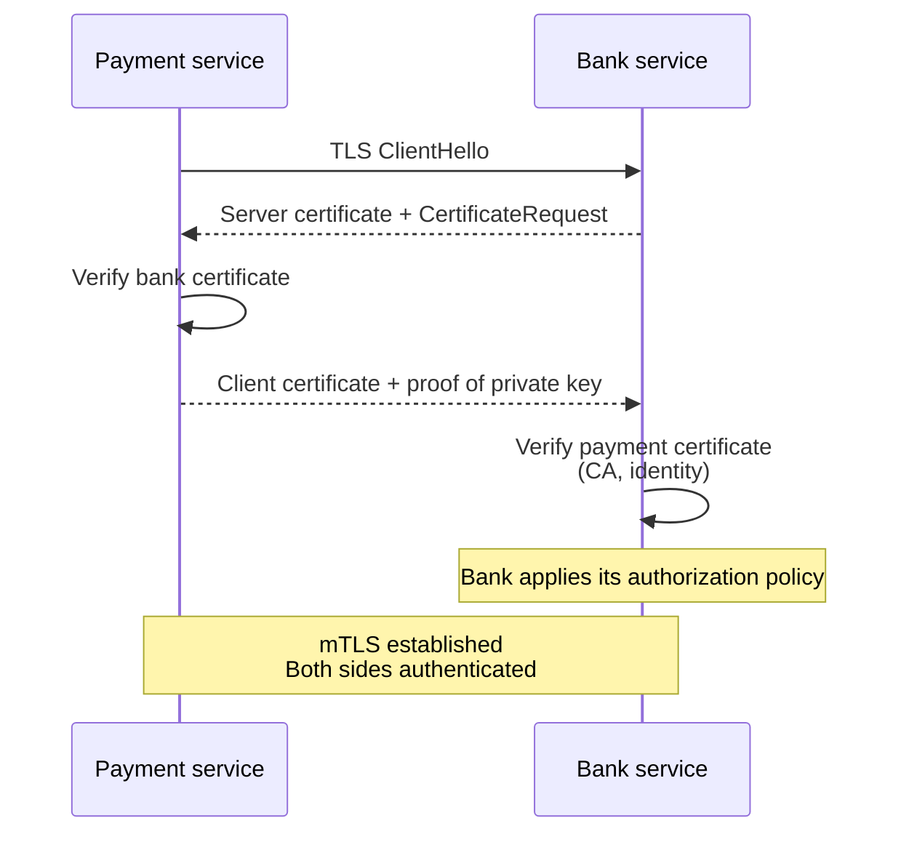

# TLS vs mutual TLS (mTLS)

*TLS proves the server's identity to the client. Mutual TLS adds the other direction: the client also proves its identity to the server. In a payment → bank call, the bank's certificate tells payment it is talking to the real bank; mTLS is how the bank can also know which client is calling it.*

## The short version

| | TLS (normal HTTPS) | Mutual TLS (mTLS) |
| --- | --- | --- |
| Server certificate | Required | Required |
| Client certificate | Usually not requested | Required and verified |
| Client authenticates the server | Yes | Yes |
| Server authenticates the client | No, not at the TLS layer | Yes |
| Typical use | Browser → website | Service → service, B2B, zero trust |
| What it proves | "This is the bank" | "This is the bank" + "This is the payment service" |
| What it does not prove | Who the user is, or what they may do | Same |

The key point: **mTLS is not a different kind of encryption. It is the same TLS with client authentication turned on and enforced.**

## The payment → bank scenario

### Normal TLS

1. Payment opens a TLS connection to the bank.
2. The bank presents its certificate.
3. Payment verifies that certificate against a trusted CA, checks the hostname/SAN, validity dates, and revocation.
4. Payment now knows it is talking to the real bank, not an impostor.
5. But the bank only sees a connection from *some* client. It does not know whether that client is the payment service, another internal service, or an attacker who reached the endpoint.



TLS did its job: it authenticated the **server**. It did not ask the client for an identity.

### Mutual TLS

1. Payment opens the connection as before.
2. The bank presents its certificate, and payment verifies it.
3. The bank also asks the client for a certificate.
4. Payment sends its client certificate and proves it holds the matching private key.
5. The TLS layer verifies the certificate chain and the client identity. The bank's application policy then decides whether that identity may call this endpoint.
6. Both sides now know who the other is.



That is the gap mTLS closes. The bank's certificate proves the bank to payment. Payment's client certificate proves the payment service to the bank.

## What the certificates actually prove

A certificate is a signed statement: **"this public key belongs to this identity."** The CA's signature is what makes it verifiable.

- **Server certificate** — proves the bank's identity to the client. Payment checks the CA chain, the hostname/SAN, and validity. This is what prevents a man-in-the-middle from pretending to be the bank.
- **Client certificate** — proves the payment service's identity to the bank. The bank checks the CA chain, the client identity, and whether that identity is allowed to call this endpoint.
- **Private key** — the certificate is public; the holder proves possession by signing data during the handshake. A stolen certificate alone is not enough. A stolen private key is the real compromise.

The client does not send a password. It proves it holds the private key that matches the public key in its certificate.

## "Legit user" is the important nuance

mTLS authenticates the **payment service as a client**. It does not authenticate the person making the payment.

If the bank needs to know that *Alice* authorized a payment, mTLS alone is not enough. The bank still needs one of these:

- a user authentication token (OAuth/OIDC) that represents Alice;
- a signed request that carries user context;
- an explicit trust decision that the payment service may assert user identity on the bank's behalf;
- or the bank's own user authentication flow.

Keep the two questions separate:

- **Authentication:** who is calling? → mTLS can answer "the payment service."
- **Authorization:** what may they do? → policy answers "this service may debit account X for user Alice."

mTLS gives the bank a strong answer to the first question. It does not answer the second.

## The bank can still verify without mTLS

mTLS is one mechanism, not the only one. Without it, the bank can authenticate the caller at the application layer with:

- an API key;
- OAuth2 client credentials;
- a signed request (HMAC or a private-key signature);
- a network allowlist or private link.

Those are weaker or stronger depending on how they are implemented, but the bank is not helpless without mTLS. What it lacks without mTLS is a **transport-layer client identity**. mTLS is attractive because the identity is established before the first HTTP request and does not depend on the application remembering to check a header.

## What mTLS does not do

- **It does not replace authorization.** A valid certificate says "this is the payment service." It does not say "this service may move money from any account." The bank still needs policy.
- **It does not prove the end user.** A service certificate identifies a workload, not a person.
- **It does not make a compromised service safe.** If the payment service is compromised, its valid certificate still authenticates it. Least privilege, scopes, monitoring, and revocation still matter.
- **It is not end-to-end encryption through every proxy.** If a gateway terminates TLS, the gateway can see the traffic and re-encrypt it to the next hop. mTLS protects the connection to the terminating endpoint, not necessarily the whole path.
- **It does not protect data at rest.**
- **It does not replace input validation, rate limiting, or audit logging.**

## Authentication is not authorization

A common mistake is to trust every certificate signed by the same CA. That is authentication without authorization. If the bank's CA also issues certificates to other services, any of them could call the payment endpoint unless the bank checks *which* identity is calling.

The bank should:

- map the certificate identity (SPIFFE ID, DNS SAN, subject) to a known service;
- allow only specific operations for that service;
- reject certificates from other services in the same trust domain;
- combine mTLS with scopes or request signing when the operation is sensitive;
- rotate certificates and revoke compromised ones.

The certificate answers "who." Policy answers "allowed."

## Where mTLS fits well

- **Service-to-service calls** inside a trust domain.
- **B2B APIs** where both organizations can manage certificates.
- **Zero-trust networks** where identity comes from cryptography, not from "we are inside the VPN."
- **High-value internal calls** such as payments, banking, and control planes.
- **Device identity** for IoT and machine clients.

It fits less well for:

- public websites and mobile apps, where client-certificate UX is poor;
- systems that need end-user identity rather than workload identity;
- small systems where certificate operations cost more than the risk justifies.

## mTLS vs other mechanisms

| Mechanism | What it proves | Where it lives | Good for | Weakness |
| --- | --- | --- | --- | --- |
| **mTLS** | Client workload identity | TLS layer | Service-to-service, zero trust | Certificate operations; not user auth |
| **API key** | Holder of a shared secret | Application layer | Simple integrations | Shared secret; rotation and replay concerns |
| **OAuth2 client credentials** | Client identity plus scopes | Application layer | Service-to-service with authorization | Token handling; not transport identity |
| **Signed request (HMAC)** | Holder of a key plus message integrity | Application layer | Webhooks, B2B APIs | Key management; replay protection needed |
| **Network allowlist** | Network location | Network layer | Defense in depth | Not an identity; weaker if the network is compromised |

mTLS and OAuth are complementary. mTLS establishes the workload identity at the connection level; OAuth carries user or client authorization at the application level. Use both when you need both answers.

## What it looks like in Node.js

A server that requires a client certificate:

```js
import https from "node:https";

https.createServer(
  {
    key: serverKey,
    cert: serverCert,
    ca: [clientCa],
    requestCert: true,
    rejectUnauthorized: true,
  },
  handler,
);
```

A client that presents its certificate and verifies the server:

```js
https.request({
  host: "bank.internal",
  port: 443,
  path: "/payments",
  method: "POST",
  key: clientKey,
  cert: clientCert,
  ca: [serverCa],
});
```

`requestCert: true` asks for a client certificate. `rejectUnauthorized: true` makes the server reject a missing or invalid one. In production, mTLS often terminates at a gateway or service mesh; then the application must trust only the proxy's identity header and strip any client-supplied version of that header.

## The operational cost

mTLS is not free. It adds:

- a CA and trust-store strategy;
- certificate issuance, distribution, and rotation;
- expiry monitoring;
- revocation handling;
- identity naming (SANs, SPIFFE IDs);
- handshake debugging;
- private-key protection;
- careful handling when a proxy terminates TLS.

That is why service meshes and workload-identity systems exist. mTLS buys strong workload identity; the cost is certificate operations.

## One-line summary

**TLS authenticates the server to the client; mTLS authenticates both. In payment → bank, the bank's certificate proves the bank to payment, and payment's client certificate proves the payment service to the bank — but it still does not prove which human user is behind the payment.**

## References

- RFC 8446 — *The Transport Layer Security (TLS) Protocol Version 1.3* — <https://datatracker.ietf.org/doc/html/rfc8446>
- RFC 5246 — *The Transport Layer Security (TLS) Protocol Version 1.2* — <https://datatracker.ietf.org/doc/html/rfc5246>
- OWASP — *Transport Layer Security Cheat Sheet* — <https://cheatsheetseries.owasp.org/cheatsheets/Transport_Layer_Security_Cheat_Sheet.html>
- Node.js — *HTTPS* — <https://nodejs.org/api/https.html>
- SPIFFE — *Secure Production Identity Framework for Everyone* — <https://spiffe.io/>
